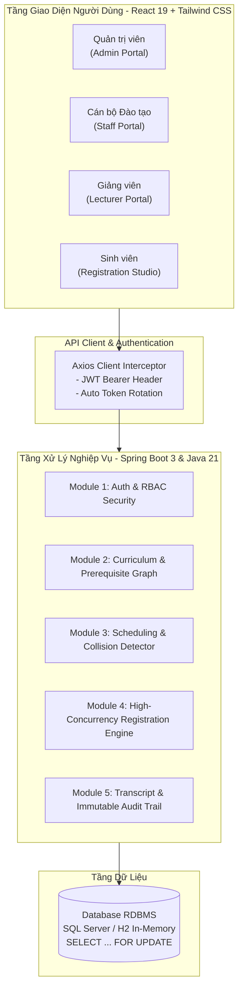
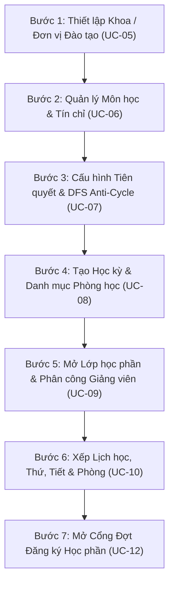
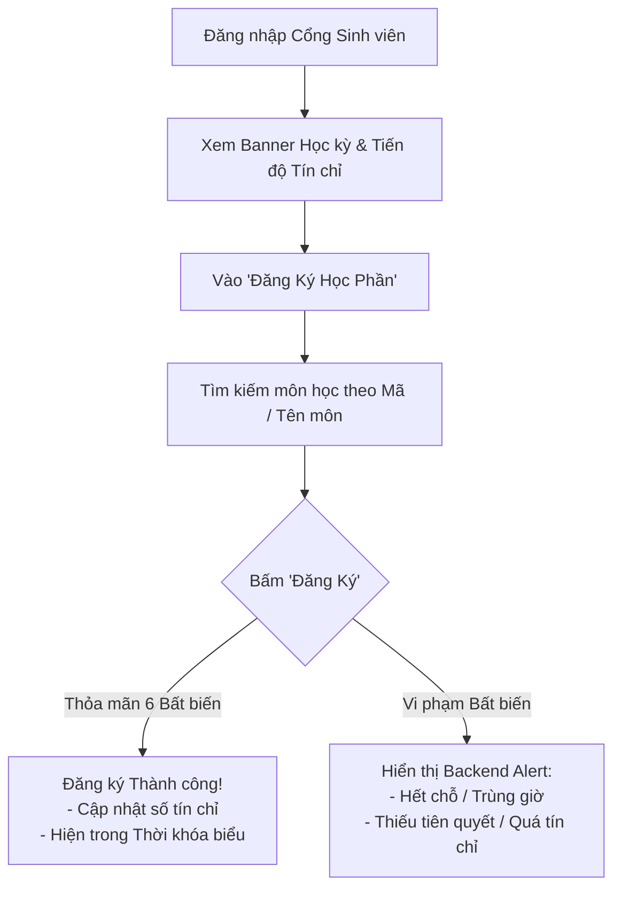

# 🎓 UniEnroll - HỆ THỐNG ĐĂNG KÝ HỌC PHẦN TRỰC TUYẾN CHUẨN ĐẠI HỌC
> **TÀI LIỆU HƯỚNG DẪN SỬ DỤNG HỆ THỐNG TOÀN DIỆN CHO TẤT CẢ CÁC ĐỐI TƯỢNG (ACTORS)**  
> **Phiên bản:** 1.0.0 (Production-Ready) | **Cập nhật:** 2026

---

## 📌 MỤC LỤC
1. [Giới thiệu Tổng quan & Kiến trúc](#1-giới-thiệu-tổng-quan--kiến-trúc)
2. [Hướng dẫn Khởi động & Tài khoản Mặc định](#2-hướng-dẫn-khởi-động--tài-khoản-mặc-định)
3. [Ma trận Phân quyền theo Vai trò (RBAC Matrix)](#3-ma-trận-phân-quyền-theo-vai-trò-rbac-matrix)
4. [Hướng dẫn Dành cho Quản trị viên (Admin)](#4-hướng-dẫn-dành-cho-quản-trị-viên-admin)
5. [Hướng dẫn Dành cho Cán bộ Phòng Đào tạo (Academic Staff)](#5-hướng-dẫn-dành-cho-cán-bộ-phòng-đào-tạo-academic-staff)
6. [Hướng dẫn Dành cho Giảng viên (Lecturer)](#6-hướng-dẫn-dành-cho-giảng-viên-lecturer)
7. [Hướng dẫn Dành cho Sinh viên (Student)](#7-hướng-dẫn-dành-cho-sinh-viên-student)
8. [Cẩm nang Quy tắc Nghiệp vụ (Business Rules) & Mã lỗi Thường gặp](#8-cẩm-nang-quy-tắc-nghiệp-vụ-business-rules--mã-lỗi-thường-gặp)
9. [Kịch bản Kiểm thử & Sử dụng Mẫu từ Đầu đến Cuối (E2E Walkthrough)](#9-kịch-bản-kiểm-thử--sử-dụng-mẫu-từ-đầu-đến-cuối-e2e-walkthrough)

---

## 1. GIỚI THIỆU TỔNG QUAN & KIẾN TRÚC

**UniEnroll** là nền tảng quản trị đào tạo và đăng ký học phần trực tuyến hiệu năng cao dành cho các cơ sở giáo dục đại học. Hệ thống được thiết kế theo tiêu chuẩn kiến trúc hướng dịch vụ (Service-Oriented Architecture), áp dụng cơ chế khóa bi quan (**Pessimistic Locking**) để chống hiện tượng bán vượt chỗ (Over-subscription) trong các đợt cao điểm đăng ký tín chỉ và thuật toán **DFS Anti-Cycle** để ngăn chặn chu trình phụ thuộc môn học tiên quyết.



---

## 2. HƯỚNG DẪN KHỞI ĐỘNG & TÀI KHOẢN MẶC ĐỊNH

### 2.1. Yêu cầu Môi trường
- **Java Development Kit (JDK):** Phiên bản 21 trở lên.
- **Node.js & npm:** Node 18.x trở lên, npm 9.x trở lên.
- **Apache Maven:** 3.9 trở lên.
- **Hệ quản trị CSDL:** SQL Server (hoặc sử dụng H2 In-Memory mặc định trong hồ sơ chạy thử).

### 2.2. Khởi động Ứng dụng

#### Bước 1: Khởi động Backend (Spring Boot Server)
Mở cửa sổ dòng lệnh tại thư mục gốc dự án:
```powershell
cd d:\UniEnroll\backend
mvn clean spring-boot:run
```
*Backend sẽ khởi động tại địa chỉ:* `http://localhost:8080` *(API Context: `/api/v1`)*

#### Bước 2: Khởi động Frontend (React Single Page App)
Mở một cửa sổ dòng lệnh khác:
```powershell
cd d:\UniEnroll\frontend
npm install
npm run dev
```
*Giao diện người dùng sẽ chạy tại:* `http://localhost:5173`

---

### 2.3. Danh sách Tài khoản Khởi tạo Sẵn (Default Seed Accounts)

Hệ thống đã tự động kích hoạt 4 tài khoản tiêu chuẩn đại diện cho 4 nhóm đối tượng:

| Vai trò (Role) | Username | Password | Họ và tên | Mã định danh | Quyền hạn chính |
| :--- | :--- | :--- | :--- | :--- | :--- |
| **Quản trị viên (Admin)** | `admin` | `123456` | Quản trị Hệ thống | `ADMIN_01` | Toàn quyền quản trị tài khoản, phân quyền, tra cứu nhật ký kiểm toán. |
| **Cán bộ Đào tạo (Staff)** | `staff` | `123456` | Nguyễn Văn Đào Tạo | `CB001` | Lập học kỳ, khoa, môn học, lớp học phần, phòng học, mở đợt đăng ký, xem báo cáo. |
| **Giảng viên (Lecturer)** | `lecturer` | `123456` | TS. Nguyễn Văn Giảng | `GV001` | Xem danh sách sinh viên theo lớp học phần phụ trách (Class Roster). |
| **Sinh viên (Student)** | `student` | `123456` | Trần Văn Sinh | `SV20260001` | Đăng ký/hủy học phần trực tuyến, xem thời khóa biểu, theo dõi số tín chỉ. |

---

## 3. MA TRẬN PHÂN QUYỀN THEO VAI TRÒ (RBAC MATRIX)

| Chức năng & Màn hình | Quản trị viên (ADMIN) | Cán bộ Đào tạo (STAFF) | Giảng viên (LECTURER) | Sinh viên (STUDENT) |
| :--- | :---: | :---: | :---: | :---: |
| **Đăng nhập & Phiên làm việc (UC-01, 02, 03)** | ✅ Có | ✅ Có | ✅ Có | ✅ Có |
| **Quản lý Tài khoản & Phân quyền (UC-04)** | ✅ Toàn quyền | ❌ Không | ❌ Không | ❌ Không |
| **Nhật ký Kiểm toán Hệ thống (UC-19)** | ✅ Xem toàn bộ | ❌ Không | ❌ Không | ❌ Không |
| **Quản lý Khoa / Đơn vị Đào tạo (UC-05)** | ✅ Xem/Tạo | ✅ Toàn quyền | ❌ Không | ❌ Không |
| **Quản lý Môn học & Tiên quyết (UC-06, 07)** | ❌ Không | ✅ Toàn quyền | ❌ Không | ❌ Không |
| **Quản lý Học kỳ & Phòng học (UC-08)** | ❌ Không | ✅ Toàn quyền | ❌ Không | ❌ Không |
| **Mở Lớp học phần & Xếp lịch (UC-09, 10, 11)** | ❌ Không | ✅ Toàn quyền | ❌ Không | ❌ Không |
| **Thiết lập Đợt mở cổng ĐKHP (UC-12)** | ❌ Không | ✅ Toàn quyền | ❌ Không | ❌ Không |
| **Tiện ích Nhập điểm Tiên quyết (UC-14/Harness)**| ❌ Không | ✅ Toàn quyền | ❌ Không | ❌ Không |
| **Báo cáo Tỷ lệ Lấp đầy Lớp (UC-18)** | ❌ Không | ✅ Toàn quyền | ❌ Không | ❌ Không |
| **Xem Danh sách Lớp giảng dạy (UC-17)** | ❌ Không | ❌ Không | ✅ Toàn quyền | ❌ Không |
| **Cổng Đăng ký Học phần (UC-13, 14, 15)** | ❌ Không | ❌ Không | ❌ Không | ✅ Toàn quyền |
| **Thời khóa biểu & Lớp đã ĐK (UC-16)** | ❌ Không | ❌ Không | ❌ Không | ✅ Toàn quyền |

---

## 4. HƯỚNG DẪN DÀNH CHO QUẢN TRỊ VIÊN (ADMIN)

Quản trị viên chịu trách nhiệm kiểm soát an toàn bảo mật, định danh người dùng và giám sát vết kiểm toán toàn trường.

### 4.1. Quản lý Tài khoản & Phân bổ Vai trò (UC-04)
* **Đường dẫn trên Menu:** `Quản trị hệ thống` $\rightarrow$ `Quản lý Người dùng`
* **Các chức năng chính:**
  1. **Xem danh sách tài khoản:** Hiển thị danh sách toàn bộ người dùng kèm vai trò (`ROLE_STUDENT`, `ROLE_LECTURER`, `ROLE_STAFF`, `ROLE_ADMIN`), trạng thái (`ACTIVE` hoặc `LOCKED`), mã sinh viên/giảng viên/cán bộ.
  2. **Tìm kiếm & Lọc:**
     - Lọc theo Vai trò (Sinh viên, Giảng viên, Phòng Đào Tạo, Admin).
     - Lọc theo Trạng thái (Hoạt động, Đã khóa).
     - Tìm kiếm theo Username, Họ và tên hoặc Email.
  3. **Thêm mới Tài khoản:**
     - Bấm nút **"Tạo Tài Khoản Mới"**.
     - Nhập thông tin cơ bản: Tên đăng nhập (Username), Mật khẩu khởi tạo, Họ và tên, Email.
     - Chọn Vai trò hệ thống:
       + Nếu chọn **Sinh viên (`ROLE_STUDENT`)**: Nhập thêm *Mã Sinh Viên* (ví dụ: `SV2026002`) và *Chuyên ngành* (ví dụ: `Khoa học máy tính`).
       + Nếu chọn **Giảng viên (`ROLE_LECTURER`)**: Nhập thêm *Mã Giảng Viên* (ví dụ: `GV002`) và *Khoa/Bộ môn*.
       + Nếu chọn **Cán bộ Đào tạo (`ROLE_STAFF`)**: Nhập thêm *Mã Cán Bộ*.
     - Bấm **"Lưu Tài Khoản"**.
  4. **Khóa / Mở khóa Tài khoản:**
     - Tại cột *Hành động*, bấm nút **"Khóa"** để đình chỉ quyền truy cập của người dùng (ngay lập tức chặn đăng nhập và từ chối các giao dịch đăng ký theo quy định bảo mật). Bấm **"Kích hoạt"** để mở khóa trở lại.

### 4.2. Giám sát Nhật ký Kiểm toán Đăng ký (Audit Logs - UC-19)
* **Đường dẫn trên Menu:** `Quản trị hệ thống` $\rightarrow$ `Nhật ký Kiểm toán`
* **Công dụng:** Truy vết chi tiết từng thao tác ghi danh hoặc hủy môn của sinh viên theo thời gian thực để phục vụ phúc khảo và xử lý khiếu nại.
* **Thông tin giám sát bao gồm:**
  - **Thời điểm (Timestamp):** Ngày giờ chính xác đến từng giây.
  - **Tài tử (Actor):** Tên sinh viên và mã sinh viên thực hiện giao dịch.
  - **Hành động (Action):** `ENROLL` (Đăng ký mới) hoặc `DROP` (Hủy học phần).
  - **Lớp học phần (Section):** Mã lớp học phần, tên môn học và mã học kỳ.
  - **Địa chỉ IP máy trạm (IP Address):** IP của sinh viên lúc gửi request (phục vụ điều tra gian lận/sử dụng bot đăng ký).
  - **Trạng thái & Ghi chú:** Thành công hay thất bại.

---

## 5. HƯỚNG DẪN DÀNH CHO CÁN BỘ PHÒNG ĐÀO TẠO (ACADEMIC STAFF)

Cán bộ Phòng Đào tạo giữ vai trò vận hành xương sống của hệ thống, thiết lập toàn bộ quy chế và danh mục đào tạo trước khi mở cổng đăng ký cho sinh viên.

### 5.1. Quy trình 7 Bước Chuẩn bị Dữ liệu Đầu kỳ của Cán bộ Đào tạo



---

### 5.2. Hướng dẫn Từng Chức năng Chi tiết

#### Bước 1: Quản lý Khoa / Bộ môn Đào tạo (UC-05)
* **Đường dẫn:** `Đào tạo & Môn học` $\rightarrow$ `Khoa / Đơn vị Đào tạo`
* **Thao tác:** Bấm **"Thêm Khoa Mới"**, điền *Mã Khoa* (ví dụ: `IT`, `BA`, `EE`) và *Tên Khoa* (ví dụ: `Khoa Công nghệ Thông tin`). Bấm **"Lưu Khoa"**.

#### Bước 2: Quản lý Môn học & Tín chỉ (UC-06)
* **Đường dẫn:** `Đào tạo & Môn học` $\rightarrow$ `Môn học & Tiên quyết`
* **Thao tác thêm môn học mới:**
  1. Bấm nút **"Thêm Môn Học Mới"**.
  2. Điền các trường:
     - **Mã Môn Học:** Ví dụ `CS101`, `CS102`, `MATH101`.
     - **Khoa Phụ Trách:** Chọn đơn vị quản lý môn học từ dropdown.
     - **Tên Môn Học:** Ví dụ `Cấu trúc dữ liệu và Giải thuật`.
     - **Tín Chỉ Lý Thuyết & Tín Chỉ Thực Hành:** Hệ thống sẽ tự động cộng tổng số tín chỉ.
     - **Mô tả Môn Học:** Tóm tắt kiến thức của học phần.
  3. Bấm **"Lưu Môn Học"**.

#### Bước 3: Cấu hình Điều kiện Môn học Tiên quyết (UC-07)
* **Công dụng:** Đảm bảo sinh viên phải tích lũy các môn cơ sở trước khi học môn nâng cao (**Quy tắc BR-04**). Hệ thống áp dụng thuật toán tìm kiếm theo chiều sâu (**DFS Anti-Cycle Algorithm**) để chặn đứng các vòng lặp phụ thuộc tròn.
* **Thao tác:**
  1. Trên danh sách môn học, tìm môn mục tiêu và bấm nút **"Cấu hình Tiên quyết"**.
  2. Trong modal hiện ra, chọn môn học bắt buộc phải học trước tại dropdown **"Môn Tiên Quyết Cần Học Trước"**.
  3. Bấm **"Thêm Môn Tiên Quyết"**.
  4. Nếu có quan hệ tiên quyết cũ không còn phù hợp, bấm nút **"Xóa"** màu đỏ để hủy bỏ điều kiện.
  > [!NOTE]  
  > Nếu người dùng vô tình tạo chu trình lặp (ví dụ: Môn A cần B, B cần C, rồi lại thêm C cần A), hệ thống sẽ từ chối giao dịch ngay lập tức với mã lỗi `ERR_CIRCULAR_PREREQUISITE_DETECTED`.

#### Bước 4: Quản lý Hạ tầng Đào tạo: Học kỳ & Phòng học (UC-08)
* **Đường dẫn:** `Lớp học phần & Lịch` $\rightarrow$ `Hạ tầng Học kỳ & Phòng`
* **Thao tác với Học kỳ:**
  - Bấm **"Thêm Học Kỳ"**, nhập *Mã Học Kỳ* (ví dụ: `2026_1`), *Tên Học Kỳ* (ví dụ: `Học kỳ 1 Năm học 2026-2027`), chọn *Ngày Bắt Đầu* và *Ngày Kết Thúc*.
* **Thao tác với Phòng học:**
  - Bấm **"Thêm Phòng Học"**, nhập *Tòa nhà* (ví dụ: `Tòa A1`), *Số Phòng* (ví dụ: `A1-201`), và **Sức chứa chỗ ngồi ($C_{room}$)** (ví dụ: `50` chỗ).

#### Bước 5 & 6: Mở Lớp học phần & Xếp Lịch học Chi tiết (UC-09, UC-10)
* **Đường dẫn:** `Lớp học phần & Lịch` $\rightarrow$ `Lớp học phần & Xếp lịch`
* **Bước 5 - Mở Lớp:**
  1. Bấm **"Mở Lớp Học Phần Mới"**.
  2. Chọn *Môn học*, điền *Mã Lớp Học Phần* (ví dụ: `CS101_01`), chọn *Học kỳ*, nhập **Sức Chứa Lớp (Chỉ tiêu $C_{max}$)** (ví dụ: `40`), chọn *Giảng viên phụ trách* (tùy chọn).
  3. Bấm **"Tạo Lớp Học Phần"**.
* **Bước 6 - Xếp Lịch học (Schedule Slots):**
  1. Tại hàng của lớp học phần vừa tạo, bấm nút **"Xếp Lịch Học"**.
  2. Chọn **Phòng học** bố trí.
  3. Chọn **Thứ trong tuần** (Thứ Hai $\rightarrow$ Chủ Nhật).
  4. Chọn **Tiết bắt đầu** và **Tiết kết thúc** (từ tiết 1 đến tiết 12).
  5. Bấm **"Lưu Lịch Học"**.
  > [!IMPORTANT]  
  > Hệ thống tự động thẩm định 2 ràng buộc cốt lõi:
  > 1. **Quy tắc BR-09 (Sức chứa phòng):** Sức chứa phòng học ($C_{room}$) phải lớn hơn hoặc bằng chỉ tiêu lớp ($C_{max}$). Nếu phòng nhỏ hơn lớp, hệ thống sẽ chặn với lỗi `ERR_ROOM_CAPACITY_INSUFFICIENT`.
  > 2. **Quy tắc BR-03 (Xung đột lịch học):** Nếu phòng học hoặc giảng viên đã có lịch khác trùng thứ và khoảng tiết trong cùng học kỳ, hệ thống sẽ báo lỗi xung đột `ERR_ROOM_SCHEDULE_CONFLICT` hoặc `ERR_LECTURER_SCHEDULE_CONFLICT`.

#### Bước 7: Điều chỉnh Sức chứa Lớp hoặc Hủy lớp (UC-11)
* **Đổi sức chứa:** Bấm nút **"Đổi Chỉ Tiêu"**, nhập sức chứa mới. Hệ thống tuân thủ **Quy tắc BR-02**: Không được phép giảm sức chứa xuống thấp hơn số lượng sinh viên hiện đã ghi danh thành công.
* **Hủy lớp:** Bấm **"Hủy Lớp"** đối với các lớp không đủ sĩ số mở lớp.

#### Bước 8: Thiết lập Đợt mở cổng Đăng ký học phần (UC-12)
* **Đường dẫn:** `Lớp học phần & Lịch` $\rightarrow$ `Đợt mở Cổng ĐKHP`
* **Thao tác:**
  1. Bấm **"Mở Đợt Đăng Ký Mới"**.
  2. Nhập *Tên đợt* (ví dụ: `ĐKHP Chính Thức HK1 2026-2027`).
  3. Chọn *Học kỳ áp dụng*.
  4. Chọn *Thời gian bắt đầu* và *Thời gian kết thúc* chính xác.
  5. Nhập *Khóa sinh viên áp dụng* (ví dụ: `K65` hoặc để trống nếu mở cho toàn trường).
  6. Bấm **"Lưu Đợt Đăng Ký"**.
  > [!TIP]  
  > Sinh viên chỉ có thể thực hiện đăng ký khi thời điểm hiện tại nằm trọn trong khung giờ này (**Quy tắc BR-01**).

#### Bước 9: Tiện ích Nhập kết quả điểm phục vụ Kiểm thử Tiên quyết (UC-14/Harness)
* **Đường dẫn:** `Báo cáo & Tiện ích` $\rightarrow$ `Nhập Điểm Tiên Quyết`
* **Công dụng:** Cung cấp công cụ cho Cán bộ Đào tạo thiết lập điểm môn học (`PASSED` hoặc `FAILED`) cho sinh viên bất kỳ, giúp giả lập tình huống sinh viên đã đạt hoặc trượt môn tiên quyết trước khi sinh viên thử nghiệm đăng ký môn tiếp theo.
* **Thao tác:** Chọn sinh viên $\rightarrow$ Chọn môn học đã học $\rightarrow$ Chọn học kỳ $\rightarrow$ Nhập điểm (ví dụ: `8.5`) $\rightarrow$ Chọn trạng thái `PASSED` hoặc `FAILED` $\rightarrow$ Bấm **"Lưu Kết Quả Điểm Số"**.

#### Bước 10: Theo dõi Báo cáo Tỷ lệ Lấp đầy Lớp học phần (UC-18)
* **Đường dẫn:** `Báo cáo & Tiện ích` $\rightarrow$ `Tỷ lệ lấp đầy Lớp HP`
* **Công dụng:** Theo dõi số lượng đăng ký/sức chứa của từng lớp, tỷ lệ % lấp đầy, phát hiện các lớp có nguy cơ hủy do quá ít sinh viên hoặc các lớp đã chạm mốc 100% để kịp thời mở thêm lớp mới. Hỗ trợ nút **"In Báo Cáo"**.

---

## 6. HƯỚNG DẪN DÀNH CHO GIẢNG VIÊN (LECTURER)

Giảng viên theo dõi tiến độ giảng dạy và danh sách sinh viên chính thức của các lớp được phân công.

### 6.1. Đăng nhập & Điều hướng
* Đăng nhập với tài khoản Giảng viên (ví dụ: `lecturer` / `123456`).
* Menu giảng viên hiển thị danh mục `Giảng dạy & Lớp học` $\rightarrow$ `Danh sách Lớp Học Phần`.

### 6.2. Tra cứu Danh sách Sinh viên Lớp học phần (Class Roster - UC-17)
1. **Lựa chọn Lớp học phần:** Tại thanh chọn lớp ở đầu trang, chọn mã lớp học phần mà giảng viên được phân công phụ trách.
2. **Xem Thống kê Nhanh:**
   - Mã môn và tên môn học.
   - Học kỳ và phòng học giảng dạy.
   - Sĩ số đã đăng ký thực tế trên chỉ tiêu (ví dụ: `35 / 40 Sinh viên`).
3. **Danh sách Sinh viên Chính thức:**
   - Bảng danh sách chi tiết: STT, Mã số sinh viên (MSSV), Họ và tên sinh viên, Khóa học (Cohort), Chuyên ngành, Ngày giờ đăng ký vào lớp.
4. **In và Xuất Danh sách Điểm danh:**
   - Bấm nút **"In Danh Sách Điểm Danh"** ở góc phải màn hình để xuất bản in phục vụ giảng dạy trên lớp.

---

## 7. HƯỚNG DẪN DÀNH CHO SINH VIÊN (STUDENT)

Sinh viên sử dụng hệ thống để lập kế hoạch học tập, tra cứu lớp học phần mở và đăng ký trực tuyến theo thời gian thực.



---

### 7.1. Cổng Đăng ký Học phần Trực tuyến (Registration Studio - UC-13, 14, 15)
* **Đường dẫn trên Menu:** `Đăng ký & Học tập` $\rightarrow$ `Đăng Ký Học Phần`
* **Giao diện tổng quan gồm:**
  1. **Thanh Thống kê Tín chỉ (Credit Progress Bar):**
     - Hiển thị tổng số tín chỉ sinh viên đã đăng ký trong học kỳ hiện tại so với định mức ($N_{min} = 12$ TC, $N_{max} = 24$ TC theo quy chế đào tạo tín chỉ).
     - Thanh màu trực quan giúp sinh viên biết mình đã đạt điều kiện tối thiểu hay sắp chạm ngưỡng tối đa.
  2. **Bộ lọc & Tìm kiếm Môn học:**
     - Lọc theo Khoa/Viện chủ quản.
     - Ô tìm kiếm nhanh: Nhập mã môn học (ví dụ: `CS101`) hoặc tên môn học (ví dụ: `Lập trình`) và nhấn Enter.
  3. **Danh mục Lớp học phần Đang mở:**
     - Hiển thị đầy đủ: Mã lớp, Tên môn, Số tín chỉ, Giảng viên, Lịch học chi tiết (Thứ, Tiết bắt đầu - Tiết kết thúc, Phòng học).
     - Cột *Sĩ số / Chỉ tiêu*: Hiển thị tỷ lệ người đã đăng ký (ví dụ: `28/30`). Nếu lớp đã đầy, hệ thống hiển thị huy hiệu `FULL` màu đỏ.
  4. **Thực hiện Đăng ký Lớp học phần (UC-14):**
     - Bấm nút **"Đăng Ký"** màu xanh tại hàng của lớp học phần mong muốn.
     - Hệ thống sẽ chạy pipeline thẩm định kiểm tra đồng thời cả 6 quy tắc nghiệp vụ (**BR-01 đến BR-06**).
     - Khi thành công: Hệ thống hiển thị thông báo chúc mừng màu xanh, tự động tăng số tín chỉ và cập nhật lịch học ngay lập tức.
  5. **Hủy Đăng ký Lớp học phần (Drop Section - UC-15):**
     - Tại bảng *Lớp Đã Đăng Ký Thành Công* ở phía dưới, bấm nút **"Hủy Lớp"** màu đỏ đối với môn muốn rút.
     - Chỗ trống sẽ ngay lập tức được hoàn trả lại cho các sinh viên khác đăng ký theo thời gian thực.

---

### 7.2. Tra cứu Thời khóa biểu & Kế hoạch Cá nhân (Timetable - UC-16)
* **Đường dẫn trên Menu:** `Đăng ký & Học tập` $\rightarrow$ `Thời Khóa Biểu Tuần`
* **Công dụng:**
  - **Ma trận Thời khóa biểu Tuần (Weekly Schedule Matrix):** Trực quan hóa toàn bộ lịch học từ **Thứ Hai đến Chủ Nhật** và từ **Tiết 1 đến Tiết 12**. Các lớp đã đăng ký được thể hiện bằng các khối màu nổi bật, ghi rõ mã lớp, môn học và phòng học.
  - **Bảng Thống kê Danh mục Lớp:** Hiển thị chi tiết danh sách môn học đã đăng ký trong kỳ, tổng tín chỉ tích lũy và nút **"In Thời Khóa Biểu"** hỗ trợ sinh viên lưu lại lịch biểu.

---

## 8. CẨM NANG QUY TẮC NGHIỆP VỤ (BUSINESS RULES) & MÃ LỖI THƯỜNG GẶP

Khi một thao tác đăng ký bị từ chối, Backend UniEnroll sẽ trả về mã lỗi chuẩn hóa để hiển thị rõ nguyên nhân trên giao diện:

| Mã Lỗi Hệ thống | Quy tắc Vi phạm | Ý nghĩa Nghiệp vụ | Cách Khắc phục |
| :--- | :--- | :--- | :--- |
| `ERR_REGISTRATION_WINDOW_CLOSED` | **BR-01 (Thời gian)** | Cổng đăng ký chưa đến giờ mở hoặc đã kết thúc thời hạn cho phép. | Kiểm tra lại lịch mở cổng của Phòng Đào tạo tại trang Đợt Đăng Ký. |
| `ERR_SECTION_CAPACITY_FULL` | **BR-02 (Sức chứa)** | Lớp học phần đã đủ $100\%$ chỉ tiêu chỗ ngồi ($N_{enrolled} = C_{max}$). | Chọn lớp học phần khác của cùng môn hoặc đề xuất Phòng Đào tạo tăng chỉ tiêu. |
| `ERR_SCHEDULE_COLLISION` | **BR-03 (Trùng lịch)** | Lịch học của lớp này bị trùng thứ và khoảng tiết với một lớp sinh viên đã đăng ký trước đó. | Hủy lớp cũ gây trùng hoặc chọn lớp học phần có khung giờ khác. |
| `ERR_PREREQUISITE_NOT_MET` | **BR-04 (Tiên quyết)** | Sinh viên chưa hoàn thành hoặc chưa đạt điểm `PASSED` ở môn tiên quyết bắt buộc. | Đăng ký và tích lũy đạt môn tiên quyết trước khi đăng ký môn kế tiếp. |
| `ERR_CREDIT_LIMIT_EXCEEDED` | **BR-05 (Vượt tín chỉ)** | Tổng tín chỉ sau khi đăng ký lớp này sẽ vượt quá định mức tối đa ($N_{max} = 24$ TC). | Hủy bớt môn học khác hoặc xin duyệt ghi đè hạn mức tín chỉ từ Phòng Đào tạo. |
| `ERR_DUPLICATE_COURSE_ENROLLMENT` | **BR-06 (Trùng môn)** | Sinh viên đã đăng ký thành công một lớp khác của cùng môn học này trong kỳ. | Không cần đăng ký lại; nếu muốn đổi lớp, cần hủy lớp cũ trước khi đăng ký lớp mới. |
| `ERR_ROOM_CAPACITY_INSUFFICIENT` | **BR-09 (Hạ tầng)** | Sức chứa phòng học nhỏ hơn chỉ tiêu lớp học phần dự kiến mở ($C_{room} < C_{max}$). | Cán bộ Đào tạo đổi sang phòng học có sức chứa lớn hơn hoặc giảm chỉ tiêu lớp. |
| `ERR_ROOM_SCHEDULE_CONFLICT` | **BR-03 (Hạ tầng)** | Phòng học đã được bố trí cho một lớp khác trong cùng khung giờ. | Chọn phòng học khác còn trống cho khung giờ đó. |
| `ERR_CIRCULAR_PREREQUISITE_DETECTED` | **BR-04 (DFS Graph)** | Phát hiện chu trình phụ thuộc vòng tròn giữa các môn tiên quyết. | Kiểm tra lại đồ thị tiên quyết, gỡ bỏ liên kết gây chu trình. |

---

## 9. KỊCH BẢN KIỂM THỬ & SỬ DỤNG MẪU TỪ ĐẦU ĐẾN CUỐI (E2E WALKTHROUGH)

Bạn có thể thực hiện kiểm thử toàn diện toàn bộ quy trình của trường đại học trong 10 phút theo kịch bản mẫu sau:

### Giai đoạn 1: Chuẩn bị của Cán bộ Đào tạo (Actor: `staff` / `123456`)
1. **Đăng nhập:** Đăng nhập với tài khoản `staff`.
2. **Kiểm tra Học kỳ:** Vào `Hạ tầng Học kỳ & Phòng`, thêm học kỳ `2026_1` (Từ `2026-09-01` đến `2027-01-15`). Thêm phòng `A1-101` (Sức chứa: `50`).
3. **Thêm Môn học & Tiên quyết:**
   - Vào `Môn học & Tiên quyết`, tạo môn `CS101` (Cơ sở lập trình, 3 TC LT, 0 TC TH).
   - Tạo môn `CS102` (Cấu trúc dữ liệu & Giải thuật, 3 TC LT, 1 TC TH = 4 TC).
   - Mở modal tiên quyết của `CS102`, thêm `CS101` làm môn tiên quyết.
4. **Mở Lớp & Xếp lịch:**
   - Vào `Lớp học phần & Xếp lịch`, mở lớp `CS101_01` cho môn `CS101` (Chỉ tiêu: `40`).
   - Xếp lịch cho `CS101_01`: Phòng `A1-101`, Thứ Hai, Tiết 1 - 3.
5. **Mở Đợt Đăng ký:** Vào `Đợt mở Cổng ĐKHP`, tạo đợt đăng ký bao trùm thời điểm hiện tại (ví dụ: từ hôm nay đến 7 ngày sau).

### Giai đoạn 2: Trải nghiệm Đăng ký của Sinh viên (Actor: `student` / `123456`)
1. **Đăng nhập:** Đăng xuất và đăng nhập lại với tài khoản `student`.
2. **Thử nghiệm Đăng ký Thành công:**
   - Vào `Đăng Ký Học Phần`, tìm lớp `CS101_01`.
   - Bấm **"Đăng Ký"** $\rightarrow$ Hệ thống ghi nhận thành công, số tín chỉ tăng lên 3 TC.
3. **Thử nghiệm Ràng buộc Tiên quyết (BR-04):**
   - Tìm môn `CS102` (yêu cầu tiên quyết `CS101`). Nếu sinh viên chưa có điểm đạt `CS101`, hệ thống sẽ từ chối đăng ký lớp `CS102` và hiển thị cảnh báo vi phạm môn tiên quyết.
4. **Xem Thời khóa biểu:**
   - Vào `Thời Khóa Biểu Tuần`, kiểm tra ma trận tuần thấy lớp `CS101_01` xuất hiện tại cột Thứ Hai, Tiết 1 - 3, Phòng A1-101.

### Giai đoạn 3: Giảng viên Giám sát Lớp học (Actor: `lecturer` / `123456`)
1. **Đăng nhập:** Đăng nhập với tài khoản `lecturer`.
2. **Xem Danh sách Lớp:** Vào `Danh sách Lớp Học Phần`, chọn lớp `CS101_01`.
3. **Kiểm tra Sĩ số:** Thấy sinh viên `Trần Văn Sinh (SV20260001)` đã có mặt chính thức trong danh sách sinh viên của lớp.

### Giai đoạn 4: Quản trị viên Giám sát Kiểm toán (Actor: `admin` / `123456`)
1. **Đăng nhập:** Đăng nhập với tài khoản `admin`.
2. **Xem Nhật ký:** Vào `Nhật ký Kiểm toán`, xác nhận có dòng ghi nhận sự kiện `ENROLL` của sinh viên `student` đối với lớp `CS101_01` với đầy đủ dấu vết thời gian và địa chỉ IP.

---
**UniEnroll System - Sẵn sàng cho Môi trường Đào tạo Hiện đại & Tin cậy!**
