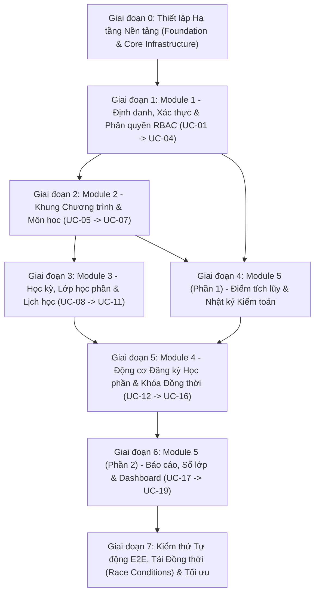
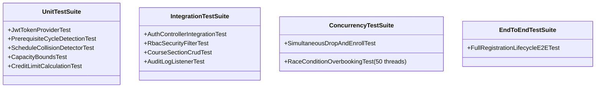

# KẾ HOẠCH PHÁT TRIỂN BACKEND THEO GIAI ĐOẠN (BACKEND DEVELOPMENT PLAN)
## DỰ ÁN: HỆ THỐNG ĐĂNG KÝ HỌC PHẦN TRỰC TUYẾN (UNIENROLL)
**Công nghệ:** Spring Boot 3.x (Java 21), Spring Data JPA, Spring Security (JWT), Relational Database (PostgreSQL/MySQL), JUnit 5, Mockito, Testcontainers  
**Phiên bản kế hoạch:** 1.0  
**Ngày ban hành:** 28/10/2026

---

## 1. TỔNG QUAN CHIẾN LƯỢC TRIỂN KHAI BACKEND

Để đảm bảo kiến trúc phân tầng chuẩn mực, kiểm soát giao dịch đồng thời (Concurrency Control), và đáp ứng toàn bộ 19 Use Case cùng 6 Quy tắc Nghiệp vụ (BR-01 đến BR-06), kế hoạch phát triển Backend được chia thành **7 Giai đoạn (Phases)** có tính kế thừa chặt chẽ:



---

## 2. MA TRẬN PHÂN KỲ PHÁT TRIỂN VÀ KIỂM THỬ TỰ ĐỘNG

| Giai đoạn | Nội dung trọng tâm | Use Cases phụ trách | Quy tắc nghiệp vụ | Chiến lược Kiểm thử Tự động |
| :--- | :--- | :--- | :--- | :--- |
| **Phase 0** | Khung dự án, `pom.xml`, Base Entity, Wrapper API, Global Exception | Hạ tầng dùng chung | Toàn bộ chuẩn API | Unit Test cho Base DTO & Exception Handler |
| **Phase 1** | Auth & RBAC (User, Role, Profiles, JWT Filter, BCrypt) | UC-01, UC-02, UC-03, UC-04 | RBAC Policy | Security Filter Test, MockMvc Auth, JWT Unit Test |
| **Phase 2** | Curriculum (Department, Course, Prerequisite Conditions) | UC-05, UC-06, UC-07 | BR-04 (Graph) | DFS Algorithm Test (Anti-cycle), Course CRUD Test |
| **Phase 3** | Scheduling (Semester, Room, CourseSection, ScheduleSlot) | UC-08, UC-09, UC-10, UC-11 | BR-02, BR-03 | Collision Detector Unit Test, Capacity Bounds Test |
| **Phase 4** | Records Foundation (GradeRecord, RegistrationAuditLog) | Phục vụ Module 4 | BR-04, BR-08 | Audit Log Async Event Test, Grade Query Test |
| **Phase 5** | **Core Engine: Registration Pipeline, Pessimistic Lock** | UC-12, UC-13, UC-14, UC-15, UC-16 | **BR-01 đến BR-06** | **Multi-threaded Concurrency Test (50+ threads)** |
| **Phase 6** | Reporting & Rosters (Lecturer Class Roster, Occupancy Dashboard) | UC-17, UC-18, UC-19 | BR-08, RBAC | Authorization Guard Test, Aggregation Query Test |
| **Phase 7** | Tích hợp E2E, Seed Data, Stress Test & Đánh giá NFR | Toàn bộ hệ thống | Toàn bộ Invariants | Full Flow Testcontainers, JMeter / Benchmarking |

---

## 3. KẾ HOẠCH CHI TIẾT TỪNG GIAI ĐOẠN

---

### GIAI ĐOẠN 0: THIẾT LẬP NỀN TẢNG HẠ TẦNG KỸ THUẬT (FOUNDATION & CORE)
* **Mục tiêu:** Cung cấp cấu hình Maven chuẩn cho Java 21, Spring Boot 3.x, quy chuẩn đóng gói API, cấu hình Cơ sở dữ liệu và xử lý ngoại lệ tập trung.
* **Nhiệm vụ cụ thể:**
  1. **Nâng cấp `backend/pom.xml`:**
     - `spring-boot-starter-web`, `spring-boot-starter-data-jpa`, `spring-boot-starter-security`, `spring-boot-starter-validation`.
     - Thư viện JWT: `io.jsonwebtoken:jjwt-api:0.12.6`, `jjwt-impl`, `jjwt-jackson`.
     - Database Driver: `postgresql` / `mysql-connector-j` và `h2` (phục vụ running unit/integration test).
     - Công cụ: `lombok`, `mapstruct`.
     - Testing: `spring-boot-starter-test`, `testcontainers`.
  2. **Tổ chức cấu trúc thư mục (Vertical + Layered Architecture):**
     ```text
     backend/src/main/java/com/unienroll/
     ├── common/          # ApiResponse, ErrorCode, BaseEntity, GlobalExceptionHandler
     ├── config/          # SecurityConfig, JpaConfig, AuditConfig, OpenApiConfig
     ├── modules/
     │   ├── auth/        # Module 1
     │   ├── curriculum/  # Module 2
     │   ├── scheduling/  # Module 3
     │   ├── engine/      # Module 4
     │   └── reporting/   # Module 5
     ```
  3. **Xây dựng lớp vỏ bọc chuẩn (Standard Response Envelopes):**
     - `ApiResponse<T>`: `{ success, timestamp, data, error }`.
     - `ApiError`: `{ code, message, details }`.
     - `ErrorCode` Enum: Định nghĩa toàn bộ mã lỗi (`ERR_REGISTRATION_WINDOW_CLOSED`, `ERR_SECTION_CAPACITY_FULL`, ...).
  4. **Bộ xử lý ngoại lệ tập trung (`GlobalExceptionHandler`):**
     - Bắt `BusinessException` (ném mã lỗi nghiệp vụ chuẩn kèm HTTP status phù hợp).
     - Bắt `MethodArgumentNotValidException` (Validation lỗi body).
     - Bắt `AccessDeniedException` (RBAC vi phạm quyền).
* **Kiểm thử tự động giai đoạn 0:**
  - `GlobalExceptionHandlerTest`: Đảm bảo mọi exception sinh ra đều được bọc đúng định dạng JSON `ApiResponse<T>`.

---

### GIAI ĐOẠN 1: MODULE 1 - ĐỊNH DANH, XÁC THỰC & PHÂN QUYỀN RBAC
* **Phạm vi Use Case:** `UC-01` (Login), `UC-02` (Refresh Token), `UC-03` (Current Profile), `UC-04` (Admin Users).
* **Nhiệm vụ cụ thể:**
  1. **Thực thể dữ liệu (Entities):**
     - `User`: `id`, `username`, `password_hash`, `email`, `role` (`ROLE_STUDENT`, `ROLE_LECTURER`, `ROLE_STAFF`, `ROLE_ADMIN`), `status` (`ACTIVE`, `INACTIVE`, `LOCKED`).
     - `StudentProfile`: `id`, `student_code`, `full_name`, `cohort` (ví dụ: K65), `major`, `user_id`.
     - `LecturerProfile`: `id`, `lecturer_code`, `full_name`, `department_id`, `user_id`.
     - `StaffProfile`: `id`, `staff_code`, `full_name`, `user_id`.
  2. **Security & JWT Service:**
     - `JwtTokenProvider`: Ký và xác thực HMAC-SHA256, sinh Access Token (15 phút) và Refresh Token (7 ngày).
     - `JwtAuthenticationFilter`: Đọc Header `Authorization: Bearer <token>`, trích xuất Authentication đặt vào `SecurityContext`.
     - `SecurityConfig`: Cấu hình stateless session, phân quyền URL endpoint theo RBAC (`hasRole`).
  3. **Controllers & Endpoints:**
     - `POST /api/v1/auth/login` (UC-01)
     - `POST /api/v1/auth/refresh` (UC-02)
     - `GET /api/v1/users/me` (UC-03)
     - `POST /api/v1/admin/users`, `PUT /api/v1/admin/users/{id}/status` (UC-04)
* **Kiểm thử tự động giai đoạn 1:**
  - `JwtTokenProviderTest` (Unit test): Test sinh token, xác thực token hợp lệ, token hết hạn, sai chữ ký.
  - `AuthControllerIntegrationTest`: Test đăng nhập đúng (200 OK + JWT), test sai mật khẩu (401 + `ERR_AUTH_INVALID_CREDENTIALS`), test tài khoản bị khóa (403 + `ERR_AUTH_ACCOUNT_LOCKED`).
  - `RbacSecurityFilterTest`: Test Student không thể gọi endpoint Admin (403 Forbidden).

---

### GIAI ĐOẠN 2: MODULE 2 - CHƯƠNG TRÌNH ĐÀO TẠO & MÔN HỌC
* **Phạm vi Use Case:** `UC-05` (Department), `UC-06` (Course), `UC-07` (Prerequisites).
* **Nhiệm vụ cụ thể:**
  1. **Thực thể dữ liệu (Entities):**
     - `Department`: `id`, `code` (Unique), `name`, `description`.
     - `Course`: `id`, `code` (Unique), `name`, `theory_credits`, `practical_credits`, `total_credits`, `department_id`.
     - `PrerequisiteCondition`: `id`, `target_course_id`, `prerequisite_course_id`.
  2. **Thuật toán Kiểm tra Chu trình Tiên quyết (Prerequisite Graph Validation):**
     - Xây dựng hàm `validateNoCycle(targetCourseId, prerequisiteCourseId)` sử dụng thuật toán DFS để phát hiện chu trình phụ thuộc vòng (Circular Dependency), ngăn chặn tình huống $A \rightarrow B \rightarrow A$.
  3. **Controllers & Endpoints:**
     - `POST /api/v1/admin/departments`, `GET /api/v1/admin/departments` (UC-05)
     - `POST /api/v1/courses`, `GET /api/v1/courses`, `GET /api/v1/courses/{id}` (UC-06)
     - `POST /api/v1/courses/{id}/prerequisites`, `GET /api/v1/courses/{id}/prerequisites` (UC-07)
* **Kiểm thử tự động giai đoạn 2:**
  - `PrerequisiteCycleDetectionTest` (Unit test): Kiểm tra tính đúng đắn của giải thuật DFS khi gán quan hệ tiên quyết: phát hiện vòng 2 đỉnh ($A \rightarrow B \rightarrow A$) và 3 đỉnh ($A \rightarrow B \rightarrow C \rightarrow A$), ném lỗi `ERR_CIRCULAR_PREREQUISITE_DETECTED`.
  - `CourseControllerIntegrationTest`: CRUD môn học, kiểm tra bắt lỗi trùng mã môn (`ERR_COURSE_CODE_DUPLICATE`).

---

### GIAI ĐOẠN 3: MODULE 3 - LỚP HỌC PHẦN, PHÒNG HỌC & XẾP LỊCH
* **Phạm vi Use Case:** `UC-08` (Semester & Room), `UC-09` (CourseSection), `UC-10` (ScheduleSlots), `UC-11` (Capacity Adjustment).
* **Nhiệm vụ cụ thể:**
  1. **Thực thể dữ liệu (Entities):**
     - `Semester`: `id`, `name`, `start_date`, `end_date`, `status` (`PLANNED`, `ACTIVE`, `FINISHED`).
     - `Room`: `id`, `room_number`, `building`, `capacity`.
     - `CourseSection`: `id`, `section_code`, `course_id`, `semester_id`, `capacity` ($C_{max}$), `enrolled_count` ($N_{enrolled}$), `lecturer_id`, `status` (`OPEN`, `CLOSED`, `CANCELLED`).
     - `ScheduleSlot`: `id`, `section_id`, `room_id`, `day_of_week` (`MONDAY` - `SUNDAY`), `start_period` (1-12), `end_period` (1-12).
  2. **Logic Thẩm định Xung đột Lịch (Collision Detection Engine):**
     - Thuật toán so khớp lịch học: $\max(Start_1, Start_2) \le \min(End_1, End_2)$ trong cùng một `day_of_week`.
     - Thẩm định xung đột phòng học: Phòng $R$ không thể có 2 lớp cùng học trong 1 khung giờ.
     - Thẩm định xung đột giảng viên: Giảng viên $L$ không thể dạy 2 lớp khác nhau cùng khung giờ.
  3. **Logic Điều chỉnh Sức chứa An toàn (Capacity Invariant - BR-02 & BR-09):**
     - $C_{max\_new} \ge N_{enrolled}$ (Không được hạ thấp hơn số người đã đăng ký).
     - $C_{max\_new} \le Capacity_{Room}$ (Không được vượt quá sức chứa phòng).
     - Tự động chuyển đổi `status`: Nếu $N_{enrolled} < C_{max\_new}$ và đang `CLOSED` $\rightarrow$ đổi về `OPEN`.
  4. **Controllers & Endpoints:**
     - `POST /api/v1/academic/semesters`, `POST /api/v1/academic/rooms` (UC-08)
     - `POST /api/v1/academic/sections` (UC-09)
     - `POST /api/v1/academic/sections/{id}/schedules` (UC-10)
     - `PUT /api/v1/academic/sections/{id}/capacity` (UC-11)
* **Kiểm thử tự động giai đoạn 3:**
  - `ScheduleCollisionDetectorTest` (Unit test): Test các trường hợp giao thoa khung giờ (giao nhau 1 tiết, bao trùm, trùng hoàn toàn, không giao nhau).
  - `SectionCapacityServiceTest`: Test kiểm tra không cho phép hạ sức chứa dưới mức đã đăng ký (`ERR_CAPACITY_LOWER_THAN_ENROLLED`).
  - `SectionControllerIntegrationTest`: Mở lớp học phần và gán lịch thành công.

---

### GIAI ĐOẠN 4: MODULE 5 (PHẦN 1) - DỮ LIỆU ĐIỂM TÍCH LŨY & DỊCH VỤ AUDIT LOG
* **Mục tiêu:** Chuẩn bị các service dữ liệu nền để phục vụ việc kiểm tra điều kiện tiên quyết (**BR-04**) và ghi vết kiểm toán (**BR-08**) trước khi kích hoạt Module 4.
* **Nhiệm vụ cụ thể:**
  1. **Thực thể dữ liệu (Entities):**
     - `GradeRecord`: `id`, `student_id`, `course_id`, `semester_id`, `final_score`, `status` (`PASSED`, `FAILED`, `INCOMPLETE`).
     - `RegistrationAuditLog`: `id`, `actor_id`, `action_type` (`ENROLL`, `DROP`, `OVERRIDE_CAPACITY`), `section_id`, `timestamp`, `ip_address`, `status` (`SUCCESS`, `FAILED`), `error_message`.
  2. **Dịch vụ Truy vấn Điểm (`GradeService`):**
     - Phương thức: `boolean hasPassedAllPrerequisites(Long studentId, Long courseId)`.
     - Tìm danh sách các môn tiên quyết của môn học; truy vấn `GradeRecord` xem sinh viên có bản ghi `PASSED` cho toàn bộ các môn đó hay chưa.
  3. **Dịch vụ Ghi log Kiểm toán Bất đồng bộ (`AuditLogService`):**
     - Triển khai Spring Application Events (`@EventListener` + `@Async`) để ghi log kiểm toán mà không làm chậm thời gian phản hồi của luồng giao dịch chính.
* **Kiểm thử tự động giai đoạn 4:**
  - `GradeServiceTest`: Mock sinh viên đã đậu môn A nhưng trượt môn B $\rightarrow$ kiểm tra môn C yêu cầu cả A và B trả về `false`.
  - `AuditLogEventTest`: Đảm bảo event đăng ký sinh ra bản ghi trong `registration_audit_logs`.

---

### GIAI ĐOẠN 5: MODULE 4 - ĐỘNG CƠ ĐĂNG KÝ HỌC PHẦN & KIỂM SOÁT GIAO DỊCH ĐỒNG THỜI (TRỌNG TÂM CỐT LÕI)
* **Phạm vi Use Case:** `UC-12` (Phase), `UC-13` (Search), `UC-14` (Enroll - Core), `UC-15` (Drop), `UC-16` (Timetable).
* **Nhiệm vụ cụ thể:**
  1. **Thực thể dữ liệu (Entities):**
     - `RegistrationPhase`: `id`, `semester_id`, `name`, `start_time`, `end_time`, `target_cohort`.
     - `EnrollmentRecord`: `id`, `student_id`, `section_id`, `course_id`, `semester_id`, `status` (`ENROLLED`, `DROPPED`), `enrolled_at`, `dropped_at`.
     - **Unique Constraint:** Tạo Unique Index tổ hợp trên DB: `(student_id, course_id, semester_id)` khi `status = 'ENROLLED'` (bảo vệ **BR-06** ở tầng DB).
  2. **Xây dựng Registration Validation Pipeline (6 Bước tuần tự):**
     ```text
     Request Đăng ký
           │
           ▼
     [Bước 1] Thẩm định BR-01: Khung giờ mở cổng (Tstart <= Ttrans <= Tend)
           ▼
     [Bước 2] Thẩm định BR-04: Môn tiên quyết (GradeRecord == PASSED)
           ▼
     [Bước 3] Thẩm định BR-06: Trùng môn trong học kỳ (No active duplicate)
           ▼
     [Bước 4] Thẩm định BR-03: Trùng lịch học (ScheduleSlot overlap check)
           ▼
     [Bước 5] Thẩm định BR-05: Hạn mức tín chỉ (Total + Course <= 24)
           ▼
     [Bước 6] Khóa dòng bi quan & Thẩm định BR-02 (SELECT ... FOR UPDATE)
           │     -> Kiểm tra Nenrolled < Cmax
           ▼
     [Thực thi Transaction Nguyên tử]
           ├── Nenrolled = Nenrolled + 1 (Nếu đầy -> CLOSED)
           └── Insert EnrollmentRecord
           ▼
     [Commit & Phát tán Audit Event (Async)]
     ```
  3. **Kỹ thuật Khóa bi quan (Pessimistic Locking Implementation):**
     ```java
     @Repository
     public interface CourseSectionRepository extends JpaRepository<CourseSection, Long> {
         @Lock(LockModeType.PESSIMISTIC_WRITE)
         @Query("SELECT s FROM CourseSection s WHERE s.id = :id")
         Optional<CourseSection> findByIdWithLock(@Param("id") Long id);
     }
     ```
  4. **Thực thi Thao tác Hủy Đăng ký (Drop Section - UC-15):**
     - Kiểm tra BR-01 (Thời gian).
     - Kiểm tra BR-05 (Số tín chỉ còn lại $\ge 12$).
     - Khóa dòng lớp học phần, giảm $N_{enrolled} = N_{enrolled} - 1$, mở lại trạng thái `OPEN` nếu đang `CLOSED`.
     - Đổi trạng thái `EnrollmentRecord` thành `DROPPED`.
  5. **Controllers & Endpoints:**
     - `POST /api/v1/academic/registration-phases` (UC-12)
     - `GET /api/v1/sections` (UC-13 - Tối ưu Index cho tra cứu < 200ms)
     - `POST /api/v1/student/registrations` (UC-14)
     - `DELETE /api/v1/student/registrations/{sectionId}` (UC-15)
     - `GET /api/v1/student/registrations/active` (UC-16)
* **Kiểm thử tự động giai đoạn 5 (Kiểm thử Đồng thời - Critical):**
  - **`RegistrationPipelineTest` (Unit Tests):** Lần lượt kích hoạt vi phạm từng quy tắc BR-01, BR-03, BR-04, BR-05, BR-06 và assert trả về đúng ErrorCode tương ứng.
  - **`RegistrationConcurrencyIntegrationTest` (Multi-threaded Concurrency Test):**
    - **Kịch bản:** Mở 1 lớp học phần chỉ còn **1 slot trống** duy nhất ($C_{max} = 10, N_{enrolled} = 9$).
    - Sử dụng `ExecutorService` và `CountDownLatch` kích hoạt đồng thời **50 luồng (threads)** đại diện cho 50 sinh viên khác nhau cùng gửi request đăng ký trong cùng 1 mili-giây.
    - **Kỳ vọng nghiệm thu:**
      - Đúng **1 request** nhận được HTTP 200 OK (`success = true`).
      - Đúng **49 request** bị chặn lại với HTTP 409 Conflict (`ERR_SECTION_CAPACITY_FULL`).
      - $N_{enrolled}$ trong Database chốt đúng bằng $10$, không bao giờ vượt quá 10 (Triệt tiêu 100% Race Condition / Overbooking).

---

### GIAI ĐOẠN 6: MODULE 5 (PHẦN 2) - BÁO CÁO, SỔ ĐIỂM DANH & DASHBOARD GIÁM SÁT
* **Phạm vi Use Case:** `UC-17` (Lecturer Roster), `UC-18` (Occupancy Dashboard), `UC-19` (Audit Log Query).
* **Nhiệm vụ cụ thể:**
  1. **Báo cáo Danh sách Sinh viên Lớp học phần cho Giảng viên (UC-17):**
     - Endpoint: `GET /api/v1/lecturer/sections/{sectionId}/students`.
     - Kiểm tra bảo mật: Giảng viên chỉ được xem sinh viên của lớp mà chính mình phụ trách (`section.lecturerId == currentUser.lecturerId`).
  2. **Dashboard Tỷ lệ Lấp đầy cho Cán bộ Đào tạo (UC-18):**
     - Endpoint: `GET /api/v1/academic/reports/occupancy?semesterId={id}`.
     - Phân loại 3 nhóm: Đầy 100%, Ổn định (50%-99%), Nguy cơ hủy do không đủ sinh viên (< 15 sinh viên).
  3. **Tra cứu Nhật ký Kiểm toán (UC-19):**
     - Endpoint: `GET /api/v1/admin/audit-logs` hỗ trợ lọc theo sinh viên, lớp, loại hành động và khoảng thời gian.
* **Kiểm thử tự động giai đoạn 6:**
  - `LecturerRosterSecurityTest`: Test trường hợp Giảng viên A cố tình truy cập lớp của Giảng viên B $\rightarrow$ trả về HTTP 403 Forbidden.
  - `OccupancyReportServiceTest`: Test tính toán tỷ lệ lấp đầy chính xác trên tập dữ liệu mẫu.

---

### GIAI ĐOẠN 7: TÍCH HỢP E2E, SEED DATA VÀ ĐÁNH GIÁ HIỆU NĂNG PHI CHỨC NĂNG (NFR)
* **Mục tiêu:** Chạy chuỗi kịch bản hoàn chỉnh từ đầu đến cuối trên cơ sở dữ liệu thật thông qua Testcontainers, nạp dữ liệu mẫu (Seed Data) và đo lường độ trễ (Latency).
* **Nhiệm vụ cụ thể:**
  1. **Tạo Bộ Dữ liệu Mẫu Khởi tạo (Database Seeder):**
     - 4 tài khoản người dùng đại diện cho 4 Roles: Admin, Staff, Lecturer, Student.
     - 2 Khoa, 10 Môn học có thiết lập chuỗi môn tiên quyết (VD: Nhập môn lập trình $\rightarrow$ Cấu trúc dữ liệu $\rightarrow$ Lập trình Web).
     - 1 Học kỳ hoạt động, 5 Phòng học, 15 Lớp học phần có lịch học mẫu.
  2. **Kiểm thử Tích hợp Đầu-cuối (End-to-End Integration Suite):**
     - Kịch bản: Sinh viên đăng nhập $\rightarrow$ Tra cứu lớp $\rightarrow$ Thử đăng ký môn vi phạm tiên quyết (Thất bại) $\rightarrow$ Đăng ký lớp hợp lệ (Thành công) $\rightarrow$ Xem thời khóa biểu $\rightarrow$ Rút môn (Thành công, slot hoàn trả) $\rightarrow$ Kiểm tra log kiểm toán được tạo đầy đủ.
  3. **Đánh giá NFR & Tối ưu Chỉ mục (Performance Benchmarking):**
     - Kiểm tra B-Tree Index trên các cột khóa ngoại và trường lọc (`course_code`, `student_id`, `section_id`, `status`).
     - Đo lường độ trễ: Đảm bảo 95% request tra cứu học phần phản hồi dưới 200ms, request ghi nhận đăng ký phản hồi dưới 500ms.
* **Kiểm thử tự động giai đoạn 7:**
  - `FullRegistrationLifecycleE2ETest`: Chạy hoàn chỉnh kịch bản nghiệp vụ với cơ sở dữ liệu Testcontainers.

---

## 4. CHI TIẾT BỘ TEST CASE TỰ ĐỘNG BẮT BUỘC (AUTOMATED TEST SUITE)

Để hệ thống đạt chuẩn xuất xưởng, bộ test suite của Backend phải thỏa mãn bảng kiểm thử tự động sau:



### Danh mục File Test Tự động Triển khai:
1. `src/test/java/.../auth/JwtTokenProviderTest.java`: Kiểm thử mã hóa token, hết hạn, chữ ký.
2. `src/test/java/.../curriculum/PrerequisiteGraphTest.java`: Kiểm thử giải thuật phát hiện chu trình phụ thuộc vòng (DFS).
3. `src/test/java/.../scheduling/ScheduleCollisionTest.java`: Kiểm thử thuật toán giao thoa lịch học, phòng học, giảng viên.
4. `src/test/java/.../engine/RegistrationPipelineTest.java`: Kiểm thử đơn vị toàn bộ 6 Invariants BR-01 $\rightarrow$ BR-06.
5. `src/test/java/.../engine/RegistrationConcurrencyTest.java`: **Kiểm thử tải đồng thời 50 threads để chứng minh không bao giờ bán vượt quá sức chứa lớp (Zero Overbooking).**
6. `src/test/java/.../reporting/LecturerAccessControlTest.java`: Kiểm thử phân quyền truy xuất dữ liệu sổ lớp.
7. `src/test/java/.../e2e/FullRegistrationFlowTest.java`: Kiểm thử tích hợp toàn trình luồng nghiệp vụ.

---

## 5. ĐỊNH NGHĨA HOÀN THÀNH (DEFINITION OF DONE - DoD)

Một giai đoạn Backend được coi là hoàn thành khi và chỉ khi:
1. Toàn bộ Endpoint RESTful API tuân thủ đúng định dạng vỏ bọc `ApiResponse<T>` và mã lỗi trong `README_BUSINESS_RULES.md`.
2. Toàn bộ Entity và Constraint ở Database được thiết lập (Unique, Foreign Key, Check, Indexes).
3. 100% các Unit Test và Integration Test của giai đoạn đó chạy vượt qua (`mvn clean test` đạt `BUILD SUCCESS`).
4. Giai đoạn 5 (Core Engine) bắt buộc phải vượt qua bài kiểm thử đồng thời (Concurrency Test) với 50 luồng không phát sinh sai lệch dữ liệu.
