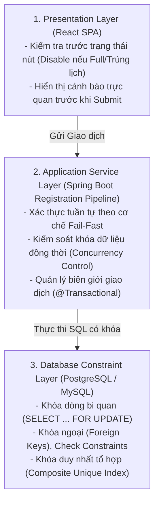

# TÀI LIỆU ĐẶC TẢ QUY TẮC NGHIỆP VỤ CỐT LÕI (BUSINESS RULES SPECIFICATION)
## DỰ ÁN: HỆ THỐNG ĐĂNG KÝ HỌC PHẦN TRỰC TUYẾN (UNIENROLL)
**Phiên bản:** 1.0  
**Ngày ban hành:** 28/10/2026  
**Mục đích:** Chuẩn hóa các bất biến (Invariants) bắt buộc thực thi xuyên suốt tầng Application Service và Database Level.

---

## 1. TRIẾT LÝ THIẾT KẾ & KIẾN TRÚC BẢO VỆ 3 TẦNG

Mọi quy tắc nghiệp vụ trong UniEnroll được coi là các **Bất biến (Invariants)** không thể bị phá vỡ. Hệ thống triển khai mô hình phòng thủ theo chiều sâu (Defense-in-Depth) với 3 tầng độc lập:



### Chiến lược Thực thi Pipeline: Fail-Fast & Late-Locking
Để tối ưu hóa hiệu năng, giảm thời gian chiếm giữ tài nguyên khóa (Lock Hold Time) trong các đợt tải cao, thứ tự thẩm tra các quy tắc được sắp xếp theo nguyên tắc:
1. **Kiểm tra không tốn I/O hoặc I/O rẻ trước:** Khung thời gian (**BR-01**), Môn tiên quyết (**BR-04**), Trùng môn học (**BR-06**).
2. **Kiểm tra tính toán lịch và tín chỉ:** Trùng lịch học (**BR-03**), Hạn mức tín chỉ (**BR-05**).
3. **Kiểm tra sức chứa kèm Khóa bi quan cuối cùng:** Giới hạn sức chứa (**BR-02**) đặt ở bước chốt để khóa dòng lớp học phần trong khoảng thời gian ngắn nhất (vài mili-giây) trước khi `COMMIT`.

---

## 2. CHI TIẾT 6 QUY TẮC NGHIỆP VỤ CỐT LÕI (BR-01 ĐẾN BR-06)

---

### BR-01: RÀNG BUỘC KHUNG THỜI GIAN ĐĂNG KÝ (TEMPORAL WINDOW INVARIANT)

* **1. Định nghĩa Toán học / Logic:**
  Giao dịch chỉ hợp lệ khi thời điểm thực thi giao dịch $T_{trans}$ (tính theo giờ hệ thống chuẩn UTC) nằm trong khoảng thời gian hiệu lực của đợt mở cổng:
  $$T_{start} \le T_{trans} \le T_{end}$$
* **2. Mô tả Nghiệp vụ:**
  - Sinh viên chỉ được phép thực hiện các thao tác thêm (`ADD`) hoặc rút bớt (`DROP`) lớp học phần trong khoảng thời gian mà Phòng Đào tạo đã cấu hình cho khóa/ngành của sinh viên đó.
  - Ngoài khoảng thời gian trên, toàn bộ nút thao tác trên UI chuyển sang trạng thái Disable và Backend từ chối mọi yêu cầu ghi.
* **3. Cấp độ Thực thi:**
  - **Tầng Client:** Kiểm tra $T_{client}$ so với đợt mở để vô hiệu hóa nút bấm và hiển thị đồng hồ đếm ngược.
  - **Tầng Service:** Query bảng `registration_phases` theo `semester_id` và `student.cohort` để đối chiếu với `Instant.now()`.
* **4. Mã lỗi & Phản hồi Chuẩn:**
  - **HTTP Status:** `400 Bad Request`
  - **Error Code:** `ERR_REGISTRATION_WINDOW_CLOSED`
  - **JSON Response:**
    ```json
    {
      "success": false,
      "timestamp": "2026-10-28T10:00:01Z",
      "data": null,
      "error": {
        "code": "ERR_REGISTRATION_WINDOW_CLOSED",
        "message": "Cổng đăng ký học phần hiện đang đóng. Thời gian hiệu lực: 2026-10-20 08:00 đến 2026-10-27 17:00",
        "details": {
          "currentTime": "2026-10-28T10:00:01Z",
          "windowStart": "2026-10-20T08:00:00Z",
          "windowEnd": "2026-10-27T17:00:00Z"
        }
      }
    }
    ```
* **5. Ca biên (Edge Cases):**
  - Giao dịch gửi tại giây cuối cùng ($T_{trans} = T_{end}$): Hợp lệ nếu DB ghi nhận trước mili-giây kết thúc.
  - Sai lệch múi giờ (Timezone skew): Toàn bộ hệ thống Backend và DB bắt buộc đồng bộ theo múi giờ `UTC` hoặc `Asia/Ho_Chi_Minh` thống nhất.

---

### BR-02: RÀNG BUỘC GIỚI HẠN SỨC CHỨA (CAPACITY INVARIANT)

* **1. Định nghĩa Toán học / Logic:**
  Số lượng sinh viên đăng ký thành công hợp lệ ($N_{enrolled}$) vào lớp học phần tại mọi thời điểm $t$ không được phép vượt quá chỉ tiêu sức chứa tối đa ($C_{max}$):
  $$N_{enrolled} \le C_{max}$$
  Khi $N_{enrolled} = C_{max}$, trạng thái hiển thị của lớp chuyển sang `CLOSED`.
* **2. Mô tả Nghiệp vụ:**
  - Mỗi lớp học phần có một chỉ tiêu nhất định dựa trên sĩ số đào tạo và sức chứa của phòng học gán cho lớp đó.
  - Nghiêm cấm tuyệt đối hiện tượng "Bán vượt số chỗ" (Overbooking/Over-subscription).
* **3. Cơ chế Kiểm soát Đồng thời (Concurrency Handling):**
  - **Kỹ thuật áp dụng:** Khóa bi quan (**Pessimistic Write Lock**) trên bản ghi `CourseSection`.
  - **Cơ chế hoạt động:**
    ```sql
    -- Spring Data JPA: @Lock(LockModeType.PESSIMISTIC_WRITE)
    SELECT id, capacity, enrolled_count, status 
    FROM course_sections 
    WHERE id = :sectionId 
    FOR UPDATE;
    ```
  - Khi luồng A thực hiện lệnh trên, các luồng B, C cùng đăng ký vào lớp đó sẽ bị chặn ở mức Database Row Lock cho tới khi giao dịch của A `COMMIT` hoặc `ROLLBACK`.
  - Sau khi giữ khóa:
    - Nếu `enrolled_count < capacity`: Thực hiện `enrolled_count = enrolled_count + 1`. Nếu bằng thì đổi `status = 'CLOSED'`.
    - Nếu `enrolled_count >= capacity`: Ném biệt lệ vi phạm và giải phóng khóa ngay.
* **4. Mã lỗi & Phản hồi Chuẩn:**
  - **HTTP Status:** `409 Conflict`
  - **Error Code:** `ERR_SECTION_CAPACITY_FULL`
  - **JSON Response:**
    ```json
    {
      "success": false,
      "timestamp": "2026-10-28T10:00:02Z",
      "data": null,
      "error": {
        "code": "ERR_SECTION_CAPACITY_FULL",
        "message": "Lớp học phần đã hết chỗ khả dụng (50/50 sinh viên). Vui lòng chọn lớp học phần khác.",
        "details": {
          "sectionId": "SEC-CS101-01",
          "currentEnrolled": 50,
          "maxCapacity": 50
        }
      }
    }
    ```
* **5. Tính Nguyên tử khi Thu hồi Slot (Drop Section):**
  - Khi sinh viên hủy môn thành công, thực thi có khóa: `enrolled_count = enrolled_count - 1`.
  - Nếu trạng thái trước đó là `CLOSED`, tự động kích hoạt chuyển thành `OPEN`.

---

### BR-03: RÀNG BUỘC TRÙNG LẶP LỊCH HỌC (SCHEDULE CONFLICT INVARIANT)

* **1. Định nghĩa Toán học / Logic:**
  Sinh viên không được phép đăng ký lớp học phần $S_{target}$ nếu tồn tại bất kỳ buổi học nào của $S_{target}$ trùng với buổi học của các lớp $S_{active}$ mà sinh viên đã đăng ký trong cùng học kỳ:
  $$\exists b_1 \in S_{target}, b_2 \in S_{active}: Day(b_1) = Day(b_2) \wedge \left( \max(Start_{b1}, Start_{b2}) \le \min(End_{b1}, End_{b2}) \right)$$
* **2. Mô tả Nghiệp vụ:**
  - Một sinh viên không thể có mặt ở 2 phòng học/lớp học khác nhau trong cùng một khung giờ.
  - Các tiết học được đánh số từ tiết 1 đến tiết 12 (hoặc theo khoảng thời gian thực $HH:mm - HH:mm$). Hai lớp trùng nhau khi chúng diễn ra cùng Thứ trong tuần và khoảng thời gian giao nhau khác rỗng.
* **3. Cấp độ Thực thi:**
  - Truy vấn toàn bộ các `ScheduleSlot` của các lớp sinh viên đang theo học (`status = 'ENROLLED'`) trong học kỳ.
  - Lặp qua các slot của lớp mục tiêu và so khớp điều kiện giao khoảng thời gian:
    - Trùng nhau $\iff$ Cùng `dayOfWeek` VÀ `StartA <= EndB` VÀ `StartB <= EndA`.
* **4. Mã lỗi & Phản hồi Chuẩn:**
  - **HTTP Status:** `409 Conflict`
  - **Error Code:** `ERR_TIMETABLE_COLLISION`
  - **JSON Response:**
    ```json
    {
      "success": false,
      "timestamp": "2026-10-28T10:00:03Z",
      "data": null,
      "error": {
        "code": "ERR_TIMETABLE_COLLISION",
        "message": "Lịch học của lớp đăng ký xung đột với lớp CS102.N02 vào Thứ 3 (Tiết 1-3)",
        "details": {
          "conflictedSectionId": "SEC-CS102-02",
          "conflictedCourseCode": "CS102",
          "dayOfWeek": "TUESDAY",
          "slotRange": "Tiết 1 - Tiết 3"
        }
      }
    }
    ```

---

### BR-04: RÀNG BUỘC MÔN HỌC TIÊN QUYẾT (PREREQUISITE INVARIANT)

* **1. Định nghĩa Toán học / Logic:**
  Để đăng ký môn học $C$, sinh viên phải tích lũy thành công toàn bộ các môn tiên quyết thuộc tập $Prerequisites(C)$ với điểm kết luận đạt (`PASSED`):
  $$\forall P \in Prerequisites(C), \exists g \in GradeRecords(Student): g.courseId = P \wedge g.status = 'PASSED'$$
* **2. Mô tả Nghiệp vụ:**
  - Đảm bảo lộ trình tích lũy kiến thức chuẩn của khung chương trình.
  - Sinh viên chưa học môn tiên quyết, hoặc đã học nhưng điểm số là `FAILED`/`INCOMPLETE`, đều không đủ điều kiện đăng ký môn tiếp theo.
* **3. Cấp độ Thực thi:**
  - Truy xuất danh sách môn tiên quyết của môn học tương ứng với lớp học phần (`Module 2`).
  - Đối soát với bảng điểm tích lũy `grade_records` của sinh viên (`Module 5`).
  - Nếu thiếu ít nhất một môn, từ chối giao dịch ngay lập tức.
* **4. Mã lỗi & Phản hồi Chuẩn:**
  - **HTTP Status:** `400 Bad Request`
  - **Error Code:** `ERR_PREREQUISITE_NOT_FULFILLED`
  - **JSON Response:**
    ```json
    {
      "success": false,
      "timestamp": "2026-10-28T10:00:04Z",
      "data": null,
      "error": {
        "code": "ERR_PREREQUISITE_NOT_FULFILLED",
        "message": "Sinh viên chưa đạt điều kiện tiên quyết. Yêu cầu hoàn thành môn: Cấu trúc dữ liệu và Giải thuật (CS102)",
        "details": {
          "targetCourseCode": "CS201",
          "missingPrerequisites": [
            { "courseCode": "CS102", "courseName": "Cấu trúc dữ liệu và Giải thuật" }
          ]
        }
      }
    }
    ```

---

### BR-05: RÀNG BUỘC NGƯỠNG TÍN CHỈ HỌC KỲ (CREDIT LIMIT INVARIANT)

* **1. Định nghĩa Toán học / Logic:**
  Tổng số tín chỉ đăng ký hợp lệ trong học kỳ của sinh viên ($Credits_{total}$) phải nằm trong khoảng cho phép:
  $$Credit_{min} \le Credits_{total} \le Credit_{max}$$
  - Giá trị chuẩn: $Credit_{min} = 12$, $Credit_{max} = 24$.
  - Khi đăng ký môn mới ($Credits_{new}$):
    $$Credits_{current} + Credits_{new} \le Credit_{max}$$
  - Khi rút môn ($Credits_{dropped}$):
    $$Credits_{current} - Credits_{dropped} \ge Credit_{min}$$
* **2. Mô tả Nghiệp vụ:**
  - Tránh tình trạng sinh viên đăng ký quá tải dẫn đến không bảo đảm chất lượng học tập, hoặc đăng ký giữ chỗ ảo rồi bỏ thi.
  - Đảm bảo sinh viên đăng ký đủ khối lượng tối thiểu để duy trì trạng thái đào tạo chính quy.
  - **Ngoại lệ:** Cán bộ Đào tạo có cờ ghi đè đặc quyền (`isCreditLimitOverridden = true`) trong hồ sơ sinh viên để cho phép sinh viên đăng ký vượt ngưỡng (ví dụ: học kỳ cuối để tốt nghiệp).
* **3. Mã lỗi & Phản hồi Chuẩn:**
  - **Vượt quá tối đa:**
    - **HTTP Status:** `400 Bad Request`
    - **Error Code:** `ERR_CREDIT_LIMIT_EXCEEDED`
    - **JSON Response:**
      ```json
      {
        "success": false,
        "timestamp": "2026-10-28T10:00:05Z",
        "data": null,
        "error": {
          "code": "ERR_CREDIT_LIMIT_EXCEEDED",
          "message": "Không thể đăng ký. Tổng số tín chỉ (25) vượt quá hạn mức tối đa cho phép trong học kỳ (24)",
          "details": {
            "currentCredits": 22,
            "additionalCredits": 3,
            "resultingCredits": 25,
            "maxAllowedCredits": 24
          }
        }
      }
      ```
  - **Dưới mức tối thiểu khi Hủy:**
    - **HTTP Status:** `400 Bad Request`
    - **Error Code:** `ERR_MINIMUM_CREDIT_UNMET`
    - **JSON Response:**
      ```json
      {
        "success": false,
        "timestamp": "2026-10-28T10:00:06Z",
        "data": null,
        "error": {
          "code": "ERR_MINIMUM_CREDIT_UNMET",
          "message": "Không thể hủy lớp học phần này. Tổng số tín chỉ sau khi hủy (10) thấp hơn hạn mức tối thiểu yêu cầu (12)",
          "details": {
            "currentCredits": 13,
            "droppedCredits": 3,
            "resultingCredits": 10,
            "minAllowedCredits": 12
          }
        }
      }
      ```

---

### BR-06: RÀNG BUỘC TÍNH DUY NHẤT CỦA BẢN GHI ĐĂNG KÝ (IDEMPOTENCY INVARIANT)

* **1. Định nghĩa Toán học / Logic:**
  Một sinh viên không thể đồng thời theo học 2 lớp học phần khác nhau của cùng 1 môn học trong cùng một học kỳ:
  $$\forall S_1, S_2 \in EnrolledSections(Student, Semester): S_1.courseId = S_2.courseId \implies S_1 = S_2$$
* **2. Mô tả Nghiệp vụ:**
  - Sinh viên chỉ được học môn $C$ tại một lớp duy nhất trong mỗi kỳ.
  - Ngăn ngừa tình trạng đăng ký cùng lúc 2 lớp học phần (ví dụ: lớp sáng và lớp chiều) nhằm mục đích giữ chỗ cho người khác.
* **3. Cấp độ Thực thi:**
  - **Tầng Service:** Truy vấn kiểm tra sự tồn tại của bất kỳ lớp học phần nào cùng `course_id` trong học kỳ đã được ghi nhận cho `student_id`.
  - **Tầng Database:** Thiết lập Ràng buộc duy nhất hoặc Unique Index trên bản ghi đăng ký kết hợp:
    ```sql
    -- Ngăn chặn duplicate ngay cả khi có xung đột luồng
    CREATE UNIQUE INDEX uq_student_course_semester 
    ON enrollment_records (student_id, course_id, semester_id) 
    WHERE status = 'ENROLLED';
    ```
* **4. Mã lỗi & Phản hồi Chuẩn:**
  - **HTTP Status:** `409 Conflict`
  - **Error Code:** `ERR_DUPLICATE_COURSE_REGISTRATION`
  - **JSON Response:**
    ```json
    {
      "success": false,
      "timestamp": "2026-10-28T10:00:07Z",
      "data": null,
      "error": {
        "code": "ERR_DUPLICATE_COURSE_REGISTRATION",
        "message": "Bạn đã đăng ký một lớp học phần khác của môn học này trong học kỳ: CS101.N01",
        "details": {
          "courseCode": "CS101",
          "alreadyEnrolledSectionId": "SEC-CS101-01"
        }
      }
    }
    ```

---

## 3. CÁC QUY TẮC NGHIỆP VỤ BỔ TRỢ (AUXILIARY RULES)

### BR-07: Ràng buộc Tính Nguyên tử Giao dịch (Transactional Atomicity)
- Mọi thao tác Đăng ký thành công bắt buộc gồm 2 bước trong cùng 1 Transaction:
  1. Cập nhật số lượng slot $N_{enrolled} = N_{enrolled} + 1$ (và đổi trạng thái nếu đầy).
  2. Chèn bản ghi mới vào `enrollment_records`.
- Nếu bước 2 thất bại (ví dụ: vi phạm ràng buộc DB), toàn bộ thay đổi ở bước 1 phải được `ROLLBACK` ngay lập tức, không để lại hiện tượng "mất slot ảo".

### BR-08: Ràng buộc Lưu vết Kiểm toán Bắt buộc (Mandatory Audit Logging)
- Mọi can thiệp làm thay đổi trạng thái đăng ký của hệ thống (`ENROLL`, `DROP`, `OVERRIDE_CAPACITY`, `CANCEL_SECTION`) bắt buộc phải sinh ra một bản ghi trong bảng `registration_audit_logs`.
- Bản ghi log kiểm toán là bất biến (**Append-Only**), không cho phép chỉnh sửa hoặc xóa bởi bất kỳ người dùng nào kể cả Admin.

### BR-09: Ràng buộc An toàn khi Thay đổi Sức chứa (Capacity Mutation Safety)
- Cán bộ Đào tạo không thể điều chỉnh giảm chỉ tiêu $C_{max}$ xuống thấp hơn số lượng sinh viên hiện đã ghi nhận thành công:
  $$C_{max\_new} \ge N_{enrolled}$$
- Mã lỗi vi phạm: `ERR_CAPACITY_LOWER_THAN_ENROLLED`.

---

## 4. MA TRẬN TRA CỨU NHANH QUY TẮC NGHIỆP VỤ

| Mã Quy tắc | Tên Quy tắc | Http Status | Mã lỗi hệ thống (Error Code) | Tầng thực thi chính |
| :--- | :--- | :---: | :--- | :--- |
| **BR-01** | Temporal Window | 400 | `ERR_REGISTRATION_WINDOW_CLOSED` | Application Service |
| **BR-02** | Capacity Invariant | 409 | `ERR_SECTION_CAPACITY_FULL` | Application + DB Row Lock |
| **BR-03** | Schedule Collision | 409 | `ERR_TIMETABLE_COLLISION` | Application Service |
| **BR-04** | Prerequisite Invariant | 400 | `ERR_PREREQUISITE_NOT_FULFILLED` | Application Service |
| **BR-05** | Credit Limit (Max) | 400 | `ERR_CREDIT_LIMIT_EXCEEDED` | Application Service |
| **BR-05** | Credit Limit (Min) | 400 | `ERR_MINIMUM_CREDIT_UNMET` | Application Service |
| **BR-06** | Idempotency / No Duplicate | 409 | `ERR_DUPLICATE_COURSE_REGISTRATION` | App + DB Unique Partial Index |
| **BR-07** | Transactional Atomicity | 500 | `ERR_TRANSACTION_ROLLBACK` | DB Transaction Manager |
| **BR-08** | Audit Trail Invariant | - | Tự động ghi nhận ngầm (Async) | Event Listener / Interceptor |
| **BR-09** | Capacity Mutation Safety | 400 | `ERR_CAPACITY_LOWER_THAN_ENROLLED` | Academic Service |
