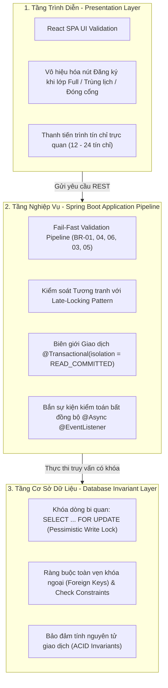

# TÀI LIỆU ĐẶC TẢ QUY TẮC NGHIỆP VỤ CỐT LÕI (BUSINESS RULES SPECIFICATION)
## DỰ ÁN: HỆ THỐNG ĐĂNG KÝ HỌC PHẦN TRỰC TUYẾN CHUẨN ĐẠI HỌC (UNIENROLL)
**Phiên bản:** 2.0 (Đồng bộ 100% với Mã Nguồn Backend & Frontend)  
**Ngày cập nhật:** 29/10/2026  
**Mục đích:** Chuẩn hóa toàn bộ các Bất biến (Invariants) bắt buộc thực thi xuyên suốt tầng Presentation, Service Pipeline và Database Concurrency Control.

---

## 1. TRIẾT LÝ THIẾT KẾ & KIẾN TRÚC BẢO VỆ 3 TẦNG (DEFENSE-IN-DEPTH)

Mọi quy tắc nghiệp vụ trong UniEnroll được coi là các **Bất biến (Invariants)** không thể bị phá vỡ trong bất kỳ điều kiện tải hay tương tranh nào. Hệ thống thiết lập mô hình bảo vệ 3 tầng độc lập:



### Chiến lược Thực thi Pipeline: Fail-Fast & Late-Locking
Để tối ưu hóa hiệu năng chịu tải cao (High Concurrency), giảm thiểu tối đa thời gian chiếm giữ khóa dòng CSDL (Lock Hold Time), thứ tự thẩm tra các quy tắc được sắp xếp theo nguyên tắc:
1. **Kiểm tra I/O nhẹ & Không chiếm khóa trước:** Khung thời gian mở cổng (**BR-01**), Môn tiên quyết (**BR-04**), Trùng môn học trong kỳ (**BR-06**).
2. **Kiểm tra tính toán lịch và tín chỉ:** Trùng lặp lịch học (**BR-03**), Hạn mức tín chỉ 12 - 24 TC (**BR-05**).
3. **Kiểm tra sức chứa kèm Khóa bi quan cuối cùng (Late-Locking):** Giới hạn sức chứa (**BR-02**) đặt ở bước chốt cuối cùng bằng lệnh `entityManager.refresh(targetSection, LockModeType.PESSIMISTIC_WRITE)`. Khóa chỉ tồn tại trong vài mili-giây trước khi `COMMIT` giao dịch.

---

## 2. CHI TIẾT 6 QUY TẮC NGHIỆP VỤ CỐT LÕI (BR-01 ĐẾN BR-06)

---

### BR-01: RÀNG BUỘC KHUNG THỜI GIAN ĐĂNG KÝ (TEMPORAL WINDOW INVARIANT)

* **1. Định nghĩa Toán học / Logic:**
  Giao dịch chỉ hợp lệ khi thời điểm thực thi giao dịch $T_{trans}$ (tính theo giờ hệ thống chuẩn UTC / máy chủ) nằm trọn trong khoảng thời gian hiệu lực của đợt mở cổng đăng ký tương ứng:
  $$T_{start} \le T_{trans} \le T_{end}$$
* **2. Mô tả Nghiệp vụ:**
  - Sinh viên chỉ được phép thực hiện các thao tác Đăng ký mới (`ENROLL`) hoặc Hủy môn (`DROP`) trong khung thời gian mà Cán bộ Phòng Đào tạo đã thiết lập cho học kỳ và khóa của sinh viên (`cohort`).
  - Ngoài khoảng thời gian trên, nút thao tác trên giao diện sinh viên bị vô hiệu hóa (disabled), và Backend từ chối ngay lập tức mọi yêu cầu ghi nhận.
* **3. Hiện thực Mã nguồn:**
  - Service: `RegistrationPhaseService.isWithinActivePhase(Long semesterId, String cohort, Instant transTime)`
  - Query: Bảng `registration_phases` tìm đợt có `semester_id = :semesterId`, `(cohort IS NULL OR cohort = :cohort)`, và `startTime <= :transTime AND endTime >= :transTime`.
* **4. Mã lỗi & Phản hồi Chuẩn:**
  - **HTTP Status:** `400 Bad Request`
  - **Mã lỗi hệ thống (`ErrorCode`):** `ERR_REGISTRATION_WINDOW_CLOSED`
  - **Thông báo mặc định:** `"Cổng đăng ký học phần hiện đang đóng"`
  - **JSON Response:**
    ```json
    {
      "success": false,
      "timestamp": "2026-10-29T10:00:01Z",
      "data": null,
      "error": {
        "code": "ERR_REGISTRATION_WINDOW_CLOSED",
        "message": "Cổng đăng ký học phần hiện đang đóng",
        "details": null
      }
    }
    ```

---

### BR-02: RÀNG BUỘC GIỚI HẠN SỨC CHỨA LỚP (CAPACITY INVARIANT)

* **1. Định nghĩa Toán học / Logic:**
  Số lượng sinh viên đăng ký thành công hợp lệ ($N_{enrolled}$) vào một lớp học phần tại mọi thời điểm $t$ không được phép vượt quá chỉ tiêu sức chứa tối đa ($C_{max}$):
  $$N_{enrolled} \le C_{max}$$
  - Khi $N_{enrolled} = C_{max}$, lớp học phần tự động chuyển trạng thái `status = SectionStatus.CLOSED`.
  - Nghiêm cấm tuyệt đối hiện tượng bán vượt chỗ (Over-subscription / Overbooking) dưới mọi điều kiện tải tương tranh.
* **2. Cơ chế Kiểm soát Tương tranh (Concurrency Control Mechanism):**
  - **Kỹ thuật áp dụng:** Khóa ghi bi quan (**Pessimistic Write Lock**) trên dòng dữ liệu của `CourseSection`.
  - **Câu lệnh DB tương ứng:**
    ```sql
    SELECT * FROM course_sections WHERE id = :sectionId FOR UPDATE;
    ```
  - **Hiện thực Spring Data JPA / Hibernate trong `RegistrationEngineService`:**
    ```java
    // Nạp lại đối tượng với khóa bi quan độc quyền
    entityManager.refresh(targetSection, LockModeType.PESSIMISTIC_WRITE);
    
    if (lockedSection.getEnrolledCount() >= lockedSection.getCapacity()) {
        if (lockedSection.getStatus() != SectionStatus.CLOSED) {
            lockedSection.setStatus(SectionStatus.CLOSED);
            sectionRepository.save(lockedSection);
        }
        throw new BusinessException(ErrorCode.ERR_SECTION_CAPACITY_FULL, "Lớp học phần đã hết chỗ khả dụng");
    }
    
    // Tăng sĩ số và cập nhật trạng thái nếu chạm mốc
    lockedSection.setEnrolledCount(lockedSection.getEnrolledCount() + 1);
    if (lockedSection.getEnrolledCount().equals(lockedSection.getCapacity())) {
        lockedSection.setStatus(SectionStatus.CLOSED);
    }
    sectionRepository.save(lockedSection);
    ```
* **3. Cơ chế Thu Hồi Slot Nguyên Tử khi Hủy Môn (Drop Section):**
  - Sử dụng phương thức truy vấn có khóa: `sectionRepository.findByIdWithPessimisticLock(sectionId)`.
  - Giảm $N_{enrolled} = \max(0, N_{enrolled} - 1)$.
  - Nếu lớp trước đó đang ở trạng thái `CLOSED`, hệ thống tự động kích hoạt mở lại thành `OPEN`.
* **4. Mã lỗi & Phản hồi Chuẩn:**
  - **HTTP Status:** `409 Conflict`
  - **Mã lỗi hệ thống (`ErrorCode`):** `ERR_SECTION_CAPACITY_FULL`
  - **Thông báo mặc định:** `"Lớp học phần đã hết chỗ khả dụng"`
  - **JSON Response:**
    ```json
    {
      "success": false,
      "timestamp": "2026-10-29T10:00:02Z",
      "data": null,
      "error": {
        "code": "ERR_SECTION_CAPACITY_FULL",
        "message": "Lớp học phần đã hết chỗ khả dụng",
        "details": {
          "sectionId": 101,
          "currentEnrolled": 40,
          "maxCapacity": 40
        }
      }
    }
    ```

---

### BR-03: RÀNG BUỘC TRÙNG LẶP LỊCH HỌC (SCHEDULE CONFLICT INVARIANT)

* **1. Định nghĩa Toán học / Logic:**
  Hai khoảng tiết $[Start_1, End_1]$ và $[Start_2, End_2]$ trên cùng một ngày trong tuần ($Day_1 = Day_2$) bị coi là xung đột (trùng lịch) khi và chỉ khi:
  $$\max(Start_1, Start_2) \le \min(End_1, End_2)$$
* **2. Mô tả Nghiệp vụ & Phạm vi Áp dụng:**
  - **Đối với Sinh viên khi Đăng ký (UC-14):** Sinh viên không thể tham gia 2 lớp học diễn ra cùng thứ và có khoảng tiết giao thoa nhau trong cùng học kỳ.
  - **Đối với Cơ sở vật chất khi Xếp lịch (UC-10):** Một phòng học không thể bố trí cho 2 lớp học phần khác nhau trong cùng một khung giờ.
  - **Đối với Giảng viên khi Xếp lịch (UC-10):** Một giảng viên không thể dạy cùng lúc 2 lớp học phần trong cùng một khung giờ.
* **3. Hiện thực Mã nguồn:**
  - Phương thức kiểm tra giao thoa: `isTimeOverlap(int s1, int e1, int s2, int e2) { return Math.max(s1, s2) <= Math.min(e1, e2); }`
  - Khi sinh viên đăng ký: So khớp toàn bộ các `scheduleSlots` của lớp đăng ký với các `scheduleSlots` của các lớp mà sinh viên đang có trạng thái `status = EnrollmentStatus.ENROLLED`.
* **4. Mã lỗi & Phản hồi Chuẩn:**
  - **Trùng lịch sinh viên:**
    - **HTTP Status:** `409 Conflict`
    - **Mã lỗi hệ thống (`ErrorCode`):** `ERR_TIMETABLE_COLLISION`
    - **JSON Response:**
      ```json
      {
        "success": false,
        "timestamp": "2026-10-29T10:00:03Z",
        "data": null,
        "error": {
          "code": "ERR_TIMETABLE_COLLISION",
          "message": "Lịch học của lớp đăng ký xung đột với lớp 'CS102.N02' vào TUESDAY (Tiết 1-3)",
          "details": {
            "conflictedSectionId": 102,
            "conflictedSectionCode": "CS102.N02",
            "dayOfWeek": "TUESDAY"
          }
        }
      }
      ```
  - **Trùng lịch phòng học khi xếp lịch:**
    - **HTTP Status:** `409 Conflict`
    - **Mã lỗi hệ thống (`ErrorCode`):** `ERR_ROOM_SCHEDULE_COLLISION`
  - **Trùng lịch giảng viên khi xếp lịch:**
    - **HTTP Status:** `409 Conflict`
    - **Mã lỗi hệ thống (`ErrorCode`):** `ERR_LECTURER_SCHEDULE_COLLISION`

---

### BR-04: RÀNG BUỘC MÔN HỌC TIÊN QUYẾT (PREREQUISITE INVARIANT)

* **1. Định nghĩa Toán học / Logic:**
  Để đăng ký môn học $C$, sinh viên bắt buộc phải tích lũy thành công toàn bộ các môn học $P \in Prerequisites(C)$ với điểm kết luận đạt (`GradeStatus.PASSED`):
  $$\forall P \in Prerequisites(C), \exists g \in GradeRecords(Student): g.courseId = P \land g.status = GradeStatus.PASSED$$
* **2. Mô tả Nghiệp vụ:**
  - Sinh viên chưa từng học môn tiên quyết, hoặc đã học nhưng mang kết quả `FAILED`, `INCOMPLETE`, đều bị chặn đăng ký môn học kế tiếp.
  - Ngăn ngừa tình trạng thiếu hụt kiến thức nền tảng trong lộ trình đào tạo theo tín chỉ.
* **3. Cơ chế Ngăn chặn Chu trình Phụ thuộc (DFS Anti-Cycle Algorithm):**
  - Khi Cán bộ Đào tạo thiết lập điều kiện tiên quyết (UC-07), hàm `isReachable(prereqId, targetCourseId)` trong `PrerequisiteService` sử dụng thuật toán duyệt đồ thị (Graph Traversal) để kiểm tra:
    - Nếu đã tồn tại đường đi từ $P$ đến $C$ qua các điều kiện tiên quyết khác, việc thêm $C \rightarrow P$ sẽ tạo ra chu trình kín $C \rightarrow P \rightarrow ... \rightarrow C$.
    - Khi phát hiện chu trình, hệ thống ném mã lỗi `ERR_CIRCULAR_PREREQUISITE_DETECTED`.
* **4. Hiện thực Mã nguồn Thẩm định Đăng ký:**
  - Service: `GradeService.hasPassedAllPrerequisites(studentId, courseId)`
  - Truy xuất danh sách thiếu: `GradeService.getMissingPrerequisites(studentId, courseId)`
* **5. Mã lỗi & Phản hồi Chuẩn:**
  - **HTTP Status:** `400 Bad Request`
  - **Mã lỗi hệ thống (`ErrorCode`):** `ERR_PREREQUISITE_NOT_FULFILLED`
  - **JSON Response:**
    ```json
    {
      "success": false,
      "timestamp": "2026-10-29T10:00:04Z",
      "data": null,
      "error": {
        "code": "ERR_PREREQUISITE_NOT_FULFILLED",
        "message": "Sinh viên chưa đạt điều kiện tiên quyết cho môn: Cấu trúc dữ liệu và Giải thuật",
        "details": {
          "targetCourseCode": "CS102",
          "missingPrerequisites": [
            {
              "id": 1,
              "code": "CS101",
              "name": "Lập trình Cơ bản",
              "totalCredits": 3
            }
          ]
        }
      }
    }
    ```

---

### BR-05: RÀNG BUỘC NGƯỠNG TÍN CHỈ HỌC KỲ (CREDIT LIMIT INVARIANT)

* **1. Định nghĩa Toán học / Logic:**
  Tổng số tín chỉ đăng ký hợp lệ trong học kỳ của sinh viên ($Credits_{total}$) phải tuân thủ biên độ theo quy chế đào tạo:
  $$Credit_{min} \le Credits_{total} \le Credit_{max}$$
  - Mặc định: $Credit_{min} = 12$ tín chỉ, $Credit_{max} = 24$ tín chỉ.
  - **Khi Đăng ký Môn Mới:**
    $$Credits_{current} + Credits_{new} \le 24$$
  - **Khi Hủy Môn Đã Đăng Ký:**
    $$Credits_{current} - Credits_{dropped} \ge 12$$
* **2. Cơ chế Ngoại Lệ Đặc Quyền (Override Invariant):**
  - Nếu sinh viên có cờ đặc quyền `student.getIsCreditLimitOverridden() == true` do Cán bộ Đào tạo cấp (ví dụ: sinh viên học kỳ cuối làm đồ án tốt nghiệp hoặc diện học vượt xuất sắc), hệ thống sẽ bỏ qua bước chặn của BR-05.
* **3. Hiện thực Mã nguồn:**
  - Tính tổng tín chỉ hiện tại từ danh sách các bản ghi `EnrollmentRecord` có `status = EnrollmentStatus.ENROLLED` trong học kỳ.
* **4. Mã lỗi & Phản hồi Chuẩn:**
  - **Vượt quá tối đa khi Đăng ký (Max Limit):**
    - **HTTP Status:** `400 Bad Request`
    - **Mã lỗi hệ thống (`ErrorCode`):** `ERR_CREDIT_LIMIT_EXCEEDED`
    - **JSON Response:**
      ```json
      {
        "success": false,
        "timestamp": "2026-10-29T10:00:05Z",
        "data": null,
        "error": {
          "code": "ERR_CREDIT_LIMIT_EXCEEDED",
          "message": "Không thể đăng ký. Tổng số tín chỉ (25) vượt quá hạn mức tối đa cho phép trong học kỳ (24)",
          "details": {
            "currentCredits": 22,
            "additionalCredits": 3,
            "resultingCredits": 25,
            "maxAllowedCredits": 24
          }
        }
      }
      ```
  - **Thấp hơn tối thiểu khi Hủy Môn (Min Limit):**
    - **HTTP Status:** `400 Bad Request`
    - **Mã lỗi hệ thống (`ErrorCode`):** `ERR_MINIMUM_CREDIT_UNMET`
    - **JSON Response:**
      ```json
      {
        "success": false,
        "timestamp": "2026-10-29T10:00:06Z",
        "data": null,
        "error": {
          "code": "ERR_MINIMUM_CREDIT_UNMET",
          "message": "Không thể hủy lớp học phần này. Tổng số tín chỉ sau khi hủy (10) thấp hơn hạn mức tối thiểu yêu cầu (12)",
          "details": {
            "currentCredits": 13,
            "droppedCredits": 3,
            "resultingCredits": 10,
            "minAllowedCredits": 12
          }
        }
      }
      ```

---

### BR-06: RÀNG BUỘC TÍNH DUY NHẤT CỦA BẢN GHI ĐĂNG KÝ (IDEMPOTENCY INVARIANT)

* **1. Định nghĩa Toán học / Logic:**
  Một sinh viên không được phép đăng ký đồng thời 2 lớp học phần khác nhau của cùng 1 môn học trong cùng một học kỳ:
  $$\forall S_1, S_2 \in EnrolledSections(Student, Semester): S_1.courseId = S_2.courseId \implies S_1 = S_2$$
* **2. Mô tả Nghiệp vụ:**
  - Sinh viên chỉ được học môn $C$ tại một lớp duy nhất trong mỗi kỳ.
  - Ngăn ngừa hành vi đăng ký giữ chỗ ảo (ví dụ: đăng ký đồng thời cả lớp buổi sáng và lớp buổi chiều của cùng môn để giữ slot cho người khác).
* **3. Hiện thực Mã nguồn:**
  - Service: `enrollmentRepository.existsByStudentIdAndCourseIdAndSemesterIdAndStatus(studentId, course.getId(), semesterId, EnrollmentStatus.ENROLLED)`
  - CSDL: Khóa ngoại kết hợp và trạng thái đăng ký.
* **4. Mã lỗi & Phản hồi Chuẩn:**
  - **HTTP Status:** `409 Conflict`
  - **Mã lỗi hệ thống (`ErrorCode`):** `ERR_DUPLICATE_COURSE_REGISTRATION`
  - **Thông báo mặc định:** `"Sinh viên đã đăng ký một lớp học phần khác của môn học này trong kỳ"`
  - **JSON Response:**
    ```json
    {
      "success": false,
      "timestamp": "2026-10-29T10:00:07Z",
      "data": null,
      "error": {
        "code": "ERR_DUPLICATE_COURSE_REGISTRATION",
        "message": "Bạn đã đăng ký một lớp học phần khác của môn học này trong kỳ: CS101",
        "details": null
      }
    }
    ```

---

## 3. CÁC QUY TẮC NGHIỆP VỤ BỔ TRỢ (AUXILIARY INVARIANTS: BR-07 ĐẾN BR-10)

### BR-07: Ràng buộc Tính Nguyên tử Giao dịch (Transactional Atomicity)
- Mọi thao tác ghi danh hoặc hủy môn được bao bọc trong giao dịch `@Transactional(isolation = Isolation.READ_COMMITTED)`.
- Các bước cập nhật số lượng slot $N_{enrolled}$, cập nhật trạng thái lớp (`OPEN`/`CLOSED`), và lưu/đổi trạng thái `EnrollmentRecord` (`ENROLLED`/`DROPPED`) phải cùng thành công hoặc cùng `ROLLBACK` toàn bộ.
- Tuyệt đối không xảy ra tình trạng "mất slot ảo" hoặc "tăng slot mà không có sinh viên".

### BR-08: Ràng buộc Lưu vết Kiểm toán Bắt buộc (Mandatory Audit Trail Invariant)
- Mọi giao dịch can thiệp trạng thái đăng ký (`ENROLL`, `DROP`, `CANCEL`, `OVERRIDE_CAPACITY`) bắt buộc phải phát sinh một bản ghi kiểm toán trong bảng `registration_audit_logs`.
- Hệ thống áp dụng mô hình phát sự kiện bất đồng bộ qua Spring Event Publisher:
  ```java
  RegistrationAuditEvent event = RegistrationAuditEvent.builder()
          .actorId(...)
          .actionType(actionType)
          .targetSectionId(...)
          .ipAddress(...)
          .executionStatus(status) // SUCCESS hoặc FAILED
          .errorMessage(error)
          .build();
  eventPublisher.publishEvent(event);
  ```
- Tầng tiếp nhận `@Async @EventListener` tại `AuditLogService` lưu log độc lập vào CSDL, bảo đảm:
  - Bản ghi kiểm toán là bất biến (**Append-Only**), không thể chỉnh sửa hay xóa bởi bất kỳ ai kể cả Quản trị viên.
  - Giao dịch của sinh viên không bị suy giảm hiệu năng do việc ghi log.

### BR-09: Ràng buộc An toàn Sức chứa Phòng & Lớp (Capacity Mutation Safety)
- **Khi Mở Lớp hoặc Xếp Lịch (UC-09, UC-10):** Sức chứa của phòng học phải lớn hơn hoặc bằng chỉ tiêu sức chứa của lớp học phần:
  $$Capacity_{room} \ge Capacity_{section}$$
  - Vi phạm: Ném lỗi `ERR_ROOM_CAPACITY_INSUFFICIENT` (HTTP 400).
- **Khi Điều Chỉnh Sức Chứa (UC-11):** Cán bộ Đào tạo không thể giảm chỉ tiêu sức chứa $C_{max}$ xuống thấp hơn số lượng sinh viên hiện đã ghi danh thành công:
  $$newCapacity \ge N_{enrolled}$$
  - Vi phạm: Ném lỗi `ERR_CAPACITY_LOWER_THAN_ENROLLED` (HTTP 400).

### BR-10: Ràng buộc Phân quyền Dữ liệu Lớp học (Class Roster Access Control)
- **Giảng viên (`ROLE_LECTURER`):** Chỉ được xem danh sách sinh viên của lớp học phần mà chính mình được phân công giảng dạy ($section.lecturerId == currentUser.lecturerId$). Nếu cố tình truy cập lớp khác, hệ thống chặn với mã lỗi `ERR_ACCESS_DENIED_NOT_ASSIGNED_LECTURER` (HTTP 403 Forbidden).
- **Sinh viên (`ROLE_STUDENT`):** Chỉ được xem danh sách bạn cùng lớp đối với lớp mà mình đang chính thức theo học ($status = ENROLLED$). Nếu chưa đăng ký, hệ thống từ chối với `ERR_FORBIDDEN` (HTTP 403).

---

## 4. MA TRẬN TOÀN DIỆN TRA CỨU QUY TẮC & MÃ LỖI (ERROR CODE MATRIX)

Dưới đây là ma trận đối soát toàn diện giữa Quy tắc nghiệp vụ, Mã lỗi hệ thống trong file `ErrorCode.java`, HTTP Status Code và Tầng thực thi:

| Mã Quy Tắc | Tên Quy Tắc Nghiệp Vụ | Mã Lỗi Hệ Thống (`ErrorCode`) | HTTP Status | Tầng Kiểm Soát Chính | Vị Trí Hiện Thực trong Codebase |
| :--- | :--- | :--- | :---: | :--- | :--- |
| **BR-01** | Khung thời gian mở cổng | `ERR_REGISTRATION_WINDOW_CLOSED` | 400 | Service Pipeline | `RegistrationEngineService.java`, `RegistrationPhaseService.java` |
| **BR-02** | Giới hạn sức chứa lớp | `ERR_SECTION_CAPACITY_FULL` | 409 | DB Row Lock | `RegistrationEngineService.java` (`PESSIMISTIC_WRITE`) |
| **BR-03** | Trùng lịch học sinh viên | `ERR_TIMETABLE_COLLISION` | 409 | Service Pipeline | `RegistrationEngineService.isTimeOverlap()` |
| **BR-03** | Trùng lịch phòng học | `ERR_ROOM_SCHEDULE_COLLISION` | 409 | Service Pipeline | `CourseSectionService.java`, `ScheduleSlotRepository.java` |
| **BR-03** | Trùng lịch giảng viên | `ERR_LECTURER_SCHEDULE_COLLISION`| 409 | Service Pipeline | `CourseSectionService.java`, `ScheduleSlotRepository.java` |
| **BR-04** | Điều kiện môn tiên quyết | `ERR_PREREQUISITE_NOT_FULFILLED` | 400 | Service Pipeline | `GradeService.java`, `RegistrationEngineService.java` |
| **BR-04** | Chu trình tiên quyết (DFS) | `ERR_CIRCULAR_PREREQUISITE_DETECTED`| 400 | Graph DFS Alg | `PrerequisiteService.isReachable()` |
| **BR-05** | Vượt mức tín chỉ tối đa (24)| `ERR_CREDIT_LIMIT_EXCEEDED` | 400 | Service Pipeline | `RegistrationEngineService.java` |
| **BR-05** | Dưới mức tín chỉ tối thiểu (12)| `ERR_MINIMUM_CREDIT_UNMET` | 400 | Service Pipeline | `RegistrationEngineService.drop()` |
| **BR-06** | Trùng môn học trong học kỳ | `ERR_DUPLICATE_COURSE_REGISTRATION`| 409 | Service Pipeline | `EnrollmentRecordRepository.java` |
| **BR-07** | Tính nguyên tử giao dịch | `ERR_INTERNAL_SERVER_ERROR` | 500 | Transaction Mgr | `@Transactional(isolation = READ_COMMITTED)` |
| **BR-08** | Lưu vết kiểm toán Append-Only | *(Tự động qua Spring Event)*| - | Async Listener | `AuditLogService.java` (`@Async @EventListener`) |
| **BR-09** | Sức chứa phòng không đủ | `ERR_ROOM_CAPACITY_INSUFFICIENT` | 400 | Service Pipeline | `CourseSectionService.assignScheduleSlots()` |
| **BR-09** | Hạ sức chứa dưới mức đã ĐK | `ERR_CAPACITY_LOWER_THAN_ENROLLED`| 400 | Service Pipeline | `CourseSectionService.updateCapacity()` |
| **BR-10** | Giảng viên không phụ trách lớp| `ERR_ACCESS_DENIED_NOT_ASSIGNED_LECTURER` | 403 | RBAC Guard | `ClassRosterService.getClassRoster()` |
| **RBAC** | Sai thông tin đăng nhập | `ERR_AUTH_INVALID_CREDENTIALS` | 401 | Auth Security | `AuthService.login()` |
| **RBAC** | Tài khoản bị khóa | `ERR_AUTH_ACCOUNT_LOCKED` | 403 | Auth Security | `AuthService.login()` |
| **RBAC** | Token hết hạn / Giả mạo | `ERR_AUTH_UNAUTHORIZED` | 401 | JWT Filter | `JwtAuthenticationFilter.java` |
| **RBAC** | Refresh Token hết hạn | `ERR_AUTH_REFRESH_TOKEN_EXPIRED` | 401 | JWT Provider | `AuthService.refreshToken()` |
| **DATA** | Trùng mã môn học | `ERR_COURSE_CODE_DUPLICATE` | 409 | Data Validation | `CourseService.createCourse()` |
| **DATA** | Trùng mã khoa | `ERR_DEPARTMENT_CODE_DUPLICATE` | 409 | Data Validation | `DepartmentService.createDepartment()` |
| **DATA** | Trùng mã lớp học phần | `ERR_SECTION_CODE_DUPLICATE` | 409 | Data Validation | `CourseSectionService.createSection()` |

---
**Tài liệu Đặc Tả Quy Tắc Nghiệp Vụ UniEnroll - Chuẩn Hóa Bất Biến và Kiểm Soát Tương Tranh Cấp Độ Doanh Nghiệp!**
