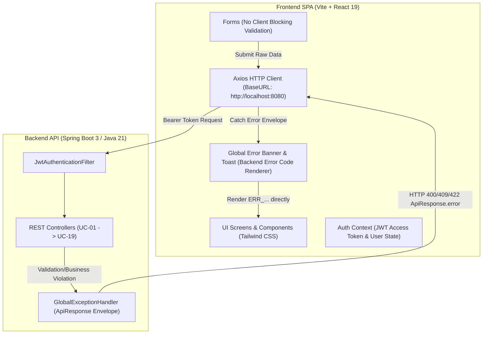
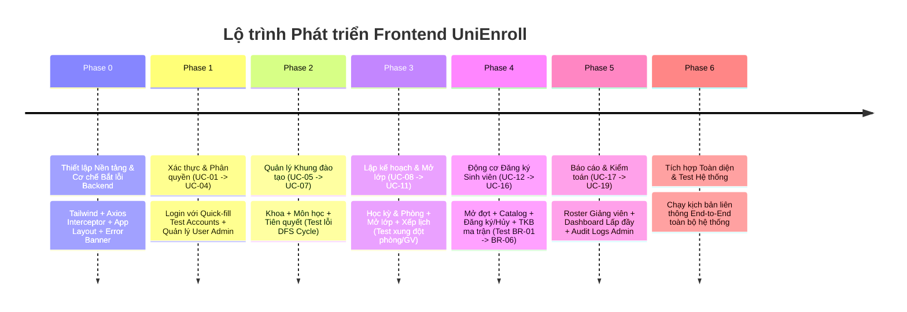

# KẾ HOẠCH PHÁT TRIỂN PHÂN HỆ FRONTEND (FRONTEND DEVELOPMENT PLAN)
**Dự án:** Hệ thống Đăng ký Học phần Trực tuyến - **UniEnroll**  
**Kiến trúc:** Single Page Application (SPA) với React 19 / Vite / Tailwind CSS  
**Tích hợp Backend:** Spring Boot 3.3.5 / Java 21 RESTful API (`http://localhost:8080`)  
**Tài liệu tham chiếu:** [README_USE_CASES.md](file:///d:/UniEnroll/README_USE_CASES.md), [README_BUSINESS_RULES.md](file:///d:/UniEnroll/README_BUSINESS_RULES.md), [README_BACKEND_PLAN.md](file:///d:/UniEnroll/README_BACKEND_PLAN.md)

---

## 1. MỤC TIÊU & NGUYÊN TẮC THIẾT KẾ CỐT LÕI

### 1.1. Mục tiêu Tổng quát
- Xây dựng giao diện Web SPA hoàn chỉnh cho **19 Use Cases (UC-01 đến UC-19)** theo 4 nhóm đối tượng:
  1. **Sinh viên (STUDENT):** Tra cứu danh mục, đăng ký / hủy học phần thời gian thực, xem thời khóa biểu tuần trực quan.
  2. **Giảng viên (LECTURER):** Xem danh sách điểm danh lớp học phần được phân công.
  3. **Phòng Đào tạo (ACADEMIC_STAFF):** Quản lý khung đào tạo, mở lớp, xếp lịch phòng/GV, mở đợt đăng ký, xem báo cáo lấp đầy.
  4. **Quản trị viên (ADMIN):** Quản trị tài khoản người dùng, tra cứu nhật ký kiểm toán hệ thống (Audit Logs).

### 1.2. Định hướng Giao diện (UI/UX Direction)
> [!NOTE]
> **TIÊU CHÍ GIAO DIỆN: CHUYÊN NGHIỆP - GỌN GÀNG - KHÔNG "HỌC SINH/BÀI TẬP LỚN"**  
> - Bố cục chuẩn Dashboard Doanh nghiệp/Đại học (Enterprise Portal Layout): Sidebar điều hướng bên trái có thể thu gọn, Header trên cùng chứa breadcrumbs + thông tin người dùng + nút Đăng xuất nhanh.
> - Bảng màu hiện đại (Modern Academic Slate & Indigo): Màu chủ đạo Indigo/Blue (`#4F46E5`), nền xám dịu Slate (`#F8FAFC`), viền tinh tế (`#E2E8F0`), điểm nhấn Emerald (`#10B981`) cho trạng thái thành công/còn chỗ, Amber (`#F59E0B`) cho cảnh báo/sắp đầy, Rose (`#EF4444`) cho lỗi/hết chỗ/xung đột.
> - Bảng dữ liệu (Data Tables) có phân trang, thanh tìm kiếm tức thì, lọc theo trạng thái (Chips/Badges), không dùng bảng HTML thô sơ.
> - Thời khóa biểu dạng lưới ma trận (Matrix Grid: Thứ 2 $\rightarrow$ Thứ 7 $\times$ Tiết 1 $\rightarrow$ Tiết 12) hiển thị trực quan các block học phần.

### 1.3. NGUYÊN TẮC BẮT BUỘC: "BACKEND-DRIVEN VALIDATION & SYSTEM TESTING"
> [!IMPORTANT]
> **KHÔNG VALIDATE CHẶN Ở FRONTEND - ĐẨY TOÀN BỘ VALIDATION VỀ BACKEND ĐỂ TEST TỔNG THỂ HỆ THỐNG**  
> - **Mục đích:** Vừa phát triển giao diện, vừa đóng vai trò bộ test harness trực quan để nghiệm thu toàn bộ cơ chế bắt lỗi, mã lỗi (`ERR_...`), thông báo tiếng Việt và các Business Invariants (BR-01 $\rightarrow$ BR-09) của backend.
> - **Cách thức thực thi:**
>   - Không chặn submit khi bỏ trống trường bắt buộc, không chặn khi nhập số âm hoặc số tín chỉ sai quy định.
>   - Gửi payload nguyên trạng về Backend (`/api/v1/...`).
>   - Axios Response Interceptor bắt cấu trúc lỗi chuẩn `ApiResponse.error`:
>     ```json
>     {
>       "success": false,
>       "timestamp": "2026-10-28T19:00:00",
>       "data": null,
>       "error": {
>         "code": "ERR_PREREQUISITE_NOT_MET",
>         "message": "Sinh viên chưa hoàn thành môn học tiên quyết bắt buộc [CS101 - Nhập môn Lập trình]",
>         "fieldErrors": [
>           { "field": "credits", "message": "Số tín chỉ phải từ 1 đến 6" }
>         ]
>       }
>     }
>     ```
>   - Hiển thị trực tiếp mã lỗi (`code`) và thông điệp lỗi (`message`) từ backend lên UI thông qua **Backend Error Banner** hoặc **Toast Notification** có gắn tag mã lỗi màu đỏ nổi bật.

---

## 2. KIẾN TRÚC KỸ THUẬT PHÂN HỆ FRONTEND



### 2.1. Tech Stack
- **Framework:** React 19 + Vite (đã khởi tạo trong thư mục `frontend/`).
- **Routing:** `react-router-dom` v6/v7 (Hỗ trợ Route Guards theo Role).
- **Styling:** `tailwindcss` + `@tailwindcss/forms` + `clsx` / `tailwind-merge`.
- **Icons:** `lucide-react` (Bộ icon hiện đại, chuẩn enterprise).
- **HTTP Client:** `axios` (Cấu hình Interceptors tự động đính kèm Bearer Token và tự động refresh token khi nhận HTTP 401).
- **Feedback & Notifications:** `react-hot-toast` kết hợp với Custom Error Modal/Banner hỗ trợ hiển thị chi tiết `fieldErrors`.

### 2.2. Cấu trúc Thư mục Frontend (`frontend/src/`)
```
frontend/src/
├── api/                        # Cấu hình Axios & Endpoints API
│   ├── axiosClient.js          # Axios instance, Bearer Token interceptor, Refresh Token logic
│   ├── authApi.js              # UC-01, UC-02, UC-03
│   ├── adminApi.js             # UC-04, UC-19
│   ├── curriculumApi.js        # UC-05, UC-06, UC-07
│   ├── schedulingApi.js        # UC-08, UC-09, UC-10, UC-11
│   ├── registrationApi.js      # UC-12, UC-13, UC-14, UC-15, UC-16
│   └── reportingApi.js         # UC-17, UC-18
├── assets/                     # Logo, favicon, hình ảnh minh họa
├── components/                 # Các Component dùng chung
│   ├── common/
│   │   ├── BackendErrorAlert.jsx # Component hiển thị mã lỗi & chi tiết lỗi từ Backend
│   │   ├── Badge.jsx           # Hiển thị trạng thái (OPEN, DRAFT, ENROLLED, FULL, etc.)
│   │   ├── Button.jsx          # Nút bấm chuẩn UI với loading spinner
│   │   ├── Card.jsx            # Khung chứa nội dung
│   │   ├── Modal.jsx           # Hộp thoại popup
│   │   └── Table.jsx           # Bảng dữ liệu chuẩn responsive
│   ├── layout/
│   │   ├── AppLayout.jsx       # Layout tổng thể (Sidebar + Header + Content)
│   │   ├── Header.jsx          # Header chứa tên user, role badge, quick logout
│   │   ├── Sidebar.jsx         # Menu điều hướng động theo vai trò (RBAC)
│   │   └── RoleProtectedRoute.jsx # Chặn truy cập trái thẩm quyền
├── context/
│   └── AuthContext.jsx         # Lưu trữ user, role, token, login, logout, refresh
├── pages/                      # Các trang màn hình theo vai trò
│   ├── auth/
│   │   └── LoginPage.jsx       # Màn hình đăng nhập + Nút chọn nhanh tài khoản test
│   ├── admin/
│   │   ├── UserManagementPage.jsx # UC-04: Quản lý người dùng & phân quyền
│   │   └── AuditLogsPage.jsx      # UC-19: Nhật ký kiểm toán hệ thống
│   ├── staff/
│   │   ├── DepartmentsPage.jsx    # UC-05: Quản lý Khoa
│   │   ├── CoursesPage.jsx        # UC-06, UC-07: Môn học & Tiên quyết
│   │   ├── InfrastructurePage.jsx # UC-08: Học kỳ & Phòng học
│   │   ├── SectionsPage.jsx       # UC-09, UC-10, UC-11: Quản lý Lớp học phần
│   │   ├── PhasesPage.jsx         # UC-12: Cấu hình Đợt đăng ký
│   │   └── OccupancyReportPage.jsx# UC-18: Báo cáo tỷ lệ lấp đầy lớp
│   ├── student/
│   │   ├── RegistrationStudioPage.jsx # UC-13, UC-14, UC-15: Đăng ký & Hủy học phần
│   │   └── TimetablePage.jsx          # UC-16: Thời khóa biểu tuần trực quan
│   └── lecturer/
│       └── ClassRosterPage.jsx        # UC-17: Danh sách điểm danh lớp học
├── utils/
│   ├── formatters.js           # Format ngày giờ, mã lớp, tỷ lệ %
│   └── timetableHelper.js      # Chuyển đổi slot học sang tọa độ ma trận TKB
├── App.jsx                     # Khai báo Route & Provider
├── index.css                   # Tailwind directives & CSS biến thể
└── main.jsx                    # Entry point React
```

---

## 3. LỘ TRÌNH TRIỂN KHAI THEO GIAI ĐOẠN (PHASED PLAN)



---

### GIAI ĐOẠN 0: THIẾT LẬP NỀN TẢNG, LAYOUT & CƠ CHẾ BẮT LỖI BACKEND
*Mục tiêu: Dựng khung sườn ứng dụng, định tuyến, phân quyền và bộ công cụ chặn/hiển thị lỗi từ Backend.*

- [ ] **Task 0.1: Cài đặt thư viện phụ trợ**
  - Cài đặt `tailwindcss`, `react-router-dom`, `axios`, `lucide-react`, `react-hot-toast`.
  - Cấu hình file `tailwind.config.js` với hệ màu Academic Slate / Indigo.
- [ ] **Task 0.2: Xây dựng `axiosClient.js` và Response Interceptor**
  - Base URL trỏ về `http://localhost:8080`.
  - Request Interceptor: Tự động chèn header `Authorization: Bearer <accessToken>`.
  - Response Interceptor:
    - Nếu thành công: Trả về `response.data` (chính là `ApiResponse<T>`).
    - Nếu HTTP 401 (Hết hạn token): Tự động gọi `POST /api/v1/auth/refresh` bằng refreshToken để lấy token mới và retry request gốc.
    - Nếu thất bại (HTTP 400, 403, 404, 409, 422, 500): Trích xuất đối tượng `error` từ backend (`code`, `message`, `fieldErrors`) ném về cho Component.
- [ ] **Task 0.3: Xây dựng Component `BackendErrorAlert.jsx`**
  - Hiển thị trực quan khung cảnh báo màu đỏ với mã lỗi in đậm (`[ERR_PREREQUISITE_NOT_MET]`), thông báo chi tiết và danh sách các trường vi phạm (`fieldErrors`).
- [ ] **Task 0.4: Xây dựng Shell Layout (`AppLayout`, `Sidebar`, `Header`)**
  - Sidebar hiển thị danh mục chức năng theo đúng vai trò (`ADMIN`, `ACADEMIC_STAFF`, `LECTURER`, `STUDENT`).
  - Header hiển thị Họ tên người dùng, Mã định danh, Pill vai trò, nút Đăng xuất.

---

### GIAI ĐOẠN 1: XÁC THỰC & PHÂN QUYỀN (UC-01 ĐẾN UC-04)
*Mục tiêu: Đăng nhập đa vai trò, lưu phiên làm việc, quản lý tài khoản người dùng.*

- [ ] **Task 1.1: Màn hình Đăng nhập (`LoginPage.jsx` - UC-01, UC-02)**
  - Form nhập `username` và `password`. Không chặn required ở client, nhấn submit để test backend validate `ERR_VALIDATION_FAILED`.
  - **Khu vực Quick-Fill Nhanh (Hỗ trợ Test):**
    - Nút 1: `Sinh viên (student01 / 123456)`
    - Nút 2: `Phòng Đào tạo (staff01 / 123456)`
    - Nút 3: `Giảng viên (lecturer01 / 123456)`
    - Nút 4: `Quản trị viên (admin / 123456)`
    - *Bấm 1 click tự điền tài khoản để chuyển đổi vai trò test nhanh chóng.*
- [ ] **Task 1.2: Modal Thông tin Tài khoản (`/users/me` - UC-03)**
  - Hiển thị thông tin hồ sơ: Sinh viên (Mã SV, Điểm TB tích lũy, Ngành), Giảng viên (Học hàm, Mã GV), Cán bộ (Mã NV).
- [ ] **Task 1.3: Màn hình Quản trị Tài khoản (`UserManagementPage.jsx` - UC-04)**
  - Danh sách người dùng: Username, Họ tên, Email, Vai trò, Trạng thái (ACTIVE / LOCKED).
  - Modal tạo tài khoản: Chọn vai trò, nhập thông tin hồ sơ tương ứng. Submit dữ liệu trống để test backend validation.
  - Nút chuyển trạng thái tài khoản: Khóa / Mở khóa người dùng.

---

### GIAI ĐOẠN 2: QUẢN LÝ KHUNG ĐÀO TẠO & MÔN HỌC (UC-05 ĐẾN UC-07)
*Mục tiêu: Quản lý Khoa, Môn học, thiết lập Tiên quyết và nghiệm thu thuật toán chặn chu trình DFS của Backend.*

- [ ] **Task 2.1: Màn hình Quản lý Khoa / Bộ môn (`DepartmentsPage.jsx` - UC-05)**
  - Bảng danh sách Khoa (Mã khoa, Tên khoa).
  - Form tạo Khoa: Nhập trùng mã để test lỗi `ERR_DEPARTMENT_CODE_EXISTS`.
- [ ] **Task 2.2: Màn hình Quản lý Môn học (`CoursesPage.jsx` - UC-06)**
  - Bảng môn học: Mã môn, Tên môn, Số tín chỉ, Khoa quản lý.
  - Form tạo Môn học: Thử nhập tín chỉ âm hoặc > 6 để test lỗi `ERR_INVALID_CREDITS`.
- [ ] **Task 2.3: Drawer Thiết lập Môn Tiên quyết (`PrerequisitesDrawer.jsx` - UC-07)**
  - Chọn môn học mục tiêu $\rightarrow$ Xem danh sách các môn tiên quyết hiện có.
  - Chọn môn tiên quyết cần thêm.
  - **Kiểm thử Chu trình (Cycle Test):** Thiết lập $A \rightarrow B \rightarrow C \rightarrow A$, submit để kiểm tra xem Backend có trả về chính xác `ERR_PREREQUISITE_CYCLE_DETECTED` hay không.

---

### GIAI ĐOẠN 3: LẬP KẾ HOẠCH & QUẢN LÝ LỚP HỌC PHẦN (UC-08 ĐẾN UC-11)
*Mục tiêu: Cấu hình Học kỳ, Phòng học, mở Lớp học phần, xếp TKB và kiểm thử phát hiện xung đột lịch.*

- [ ] **Task 3.1: Màn hình Học kỳ & Phòng học (`InfrastructurePage.jsx` - UC-08)**
  - Quản lý Học kỳ: Mã kỳ (e.g. `2026_1`), Tên học kỳ, Ngày bắt đầu, Ngày kết thúc.
  - Quản lý Phòng học: Tòa nhà, Số phòng, Sức chứa phòng ($C_{room}$).
- [ ] **Task 3.2: Màn hình Lớp học phần (`SectionsPage.jsx` - UC-09, UC-10, UC-11)**
  - Bảng lớp học phần: Mã lớp, Môn học, Học kỳ, Phòng học, Giảng viên, Sức chứa ($N_{enrolled} / C_{max}$), Trạng thái (OPEN, DRAFT, CANCELLED).
  - **Modal Mở lớp mới (UC-09):** Chọn Môn, Học kỳ, Phòng học, Sức chứa. Thử đặt $C_{max} > C_{room}$ để test luật BR-09 (`ERR_SECTION_CAPACITY_EXCEEDS_ROOM`).
  - **Modal Thêm Lịch học (UC-10):** Chọn Thứ (2-7), Tiết bắt đầu (1-12), Tiết kết thúc, Giảng viên. Thử xếp trùng phòng hoặc trùng giảng viên cùng tiết để test lỗi `ERR_ROOM_SCHEDULE_CONFLICT` và `ERR_LECTURER_SCHEDULE_CONFLICT`.
  - **Modal Điều chỉnh Sức chứa / Hủy lớp (UC-11):** Sửa sức chứa $C_{new} < N_{enrolled}$ để test lỗi `ERR_INVALID_CAPACITY_BOUND`. Nút Hủy lớp (chuyển sang CANCELLED).
- [ ] **Task 3.3: Trang Tiện ích Nhập điểm (`GradeEntryModal.jsx` - Phục vụ Test Tiên quyết)**
  - Giao diện nhanh cho phép Staff/Admin nhập điểm môn học (PASSED / FAILED) cho sinh viên để phục vụ kịch bản kiểm thử điều kiện tiên quyết ở Phase 4.

---

### GIAI ĐOẠN 4: ĐỘNG CƠ ĐĂNG KÝ HỌC PHẦN THỜI GIAN THỰC (UC-12 ĐẾN UC-16)
*Mục tiêu: Sinh viên tra cứu lớp mở, đăng ký / hủy học phần với phản hồi thời gian thực, hiển thị ma trận Thời khóa biểu tuần.*

- [ ] **Task 4.1: Màn hình Cấu hình Đợt Đăng ký (`PhasesPage.jsx` - UC-12)**
  - Dành cho Staff: Tạo đợt đăng ký, chọn học kỳ, cấu hình thời gian bắt đầu - kết thúc, giới hạn tín chỉ tối thiểu - tối đa ($N_{min} - N_{max}$).
- [ ] **Task 4.2: Studio Đăng ký Học phần Sinh viên (`RegistrationStudioPage.jsx` - UC-13, UC-14, UC-15)**
  - **Banner Trạng thái Đợt:** Hiển thị thời gian đợt, số tín chỉ đã chọn / tối đa ($N_{current} / N_{max}$), thanh tiến độ tín chỉ.
  - **Danh mục Lớp học phần Mở (`UC-13`):**
    - Bộ lọc theo Học kỳ, Khoa, tìm kiếm theo Tên/Mã môn.
    - Mỗi dòng lớp học phần hiển thị: Mã lớp, Môn, Số tín chỉ, Lịch học, Giảng viên, Sức chứa thời gian thực (e.g. `Đã đăng ký: 29/30 (Còn 1 chỗ)` kèm màu cảnh báo).
    - Nút **"Đăng ký"** $\rightarrow$ Gửi trực tiếp `POST /api/v1/registration/enroll`.
  - **Nghiệm thu trực quan các Business Rules (BR-01 -> BR-06):**
    - Nếu đợt chưa mở / đã đóng $\rightarrow$ Hiển thị lỗi `ERR_REGISTRATION_PHASE_CLOSED`.
    - Nếu chưa học môn tiên quyết $\rightarrow$ Hiển thị lỗi `ERR_PREREQUISITE_NOT_MET`.
    - Nếu trùng lịch học với lớp khác $\rightarrow$ Hiển thị lỗi `ERR_SCHEDULE_CONFLICT`.
    - Nếu vượt quá số tín chỉ tối đa $\rightarrow$ Hiển thị lỗi `ERR_CREDIT_LIMIT_EXCEEDED`.
    - Nếu đăng ký trùng môn đã học/đã đăng ký $\rightarrow$ Hiển thị lỗi `ERR_DUPLICATE_COURSE_REGISTRATION`.
    - Nếu lớp vừa hết chỗ $\rightarrow$ Hiển thị lỗi `ERR_SECTION_CAPACITY_FULL`.
  - **Danh sách Lớp đã Đăng ký & Nút Hủy (`UC-15`):**
    - Hiển thị danh sách các lớp sinh viên đang theo học trong kỳ.
    - Nút **"Hủy môn"** $\rightarrow$ Gọi `POST /api/v1/registration/drop`, cập nhật lại số tín chỉ và trả slot trống cho lớp.
- [ ] **Task 4.3: Màn hình Thời khóa biểu Tuần Ma trận (`TimetablePage.jsx` - UC-16)**
  - Bảng ma trận 7 cột (Thứ 2 $\rightarrow$ Chủ nhật) và 12 hàng (Tiết 1 $\rightarrow$ Tiết 12).
  - Tự động định vị và vẽ các thẻ học phần (Block thẻ màu theo môn) dựa trên `dayOfWeek`, `startPeriod`, `endPeriod`.
  - Hiển thị thông tin ngắn gọn trên thẻ: Mã lớp, Tên môn, Phòng học, Tên giảng viên.

---

### GIAI ĐOẠN 5: BÁO CÁO, DANH SÁCH LỚP & NHẬT KÝ KIỂM TOÁN (UC-17 ĐẾN UC-19)
*Mục tiêu: Giảng viên điểm danh lớp, Staff theo dõi lấp đầy, Admin giám sát Audit Logs.*

- [ ] **Task 5.1: Màn hình Danh sách Điểm danh Giảng viên (`ClassRosterPage.jsx` - UC-17)**
  - Dropdown chọn lớp học phần do chính giảng viên đang đăng nhập phụ trách.
  - Thẻ thống kê: Sĩ số thực tế / Sức chứa tối đa.
  - Bảng danh sách sinh viên: STT, Mã SV, Họ tên, Email, Chuyên ngành, Ngày đăng ký.
  - *Kiểm thử bảo mật:* Thử truyền `sectionId` của giảng viên khác trên URL để kiểm tra lỗi `ERR_UNAUTHORIZED_SECTION_ACCESS`.
- [ ] **Task 5.2: Báo cáo Tỷ lệ Lấp đầy Lớp học phần (`OccupancyReportPage.jsx` - UC-18)**
  - Các thẻ chỉ số tổng hợp: Tổng số lớp, Tổng chỗ ngồi, Tổng lượt đăng ký, Tỷ lệ lấp đầy bình quân toàn trường.
  - Bảng thống kê chi tiết từng lớp kèm thanh tiến trình (Progress Bar) % lấp đầy.
  - Bộ lọc cảnh báo nhanh các lớp có tỷ lệ đăng ký dưới ngưỡng (e.g. < 30%) để PĐT xem xét hủy lớp.
- [ ] **Task 5.3: Màn hình Tra cứu Nhật ký Kiểm toán (`AuditLogsPage.jsx` - UC-19)**
  - Bộ lọc tra cứu: Mã sinh viên, Mã lớp, Hành động (ENROLL / DROP), Trạng thái (SUCCESS / FAILED), Khoảng thời gian.
  - Bảng hiển thị: Thời gian ghi log, Sinh viên, Lớp học phần, Hành động, Trạng thái (Badge Xanh/Đỏ), Mã lỗi (nếu có), Địa chỉ IP.
  - Nút xem chi tiết JSON Snapshot của từng giao dịch đăng ký.

---

### GIAI ĐOẠN 6: TEST HỆ THỐNG LIÊN THÔNG TOÀN DIỆN (SYSTEM INTEGRATION TEST)
*Mục tiêu: Đóng vai người dùng thực hiện kịch bản liên thông từ đầu đến cuối trên giao diện.*

- [ ] **Kịch bản 1:** Admin đăng nhập $\rightarrow$ Tạo tài khoản Sinh viên, Giảng viên, Staff $\rightarrow$ Đổi trạng thái.
- [ ] **Kịch bản 2:** Staff đăng nhập $\rightarrow$ Tạo Khoa $\rightarrow$ Tạo Môn A, Môn B $\rightarrow$ Gán A là tiên quyết của B $\rightarrow$ Thử tạo vòng lặp để test lỗi `ERR_PREREQUISITE_CYCLE_DETECTED`.
- [ ] **Kịch bản 3:** Staff tạo Học kỳ, Phòng học $\rightarrow$ Mở 2 lớp học phần $\rightarrow$ Xếp lịch thử nghiệm trùng phòng/GV để test lỗi xung đột.
- [ ] **Kịch bản 4:** Staff mở đợt đăng ký học phần (Phase).
- [ ] **Kịch bản 5:** Sinh viên đăng nhập $\rightarrow$ Thực hiện đăng ký lớp:
  - Cố tình đăng ký môn chưa thỏa tiên quyết $\rightarrow$ Kiểm tra thông báo lỗi.
  - Cố tình đăng ký 2 lớp trùng giờ $\rightarrow$ Kiểm tra thông báo lỗi.
  - Đăng ký hợp lệ $\rightarrow$ Kiểm tra số tín chỉ tăng lên và slot lớp giảm đi.
  - Chuyển sang trang Thời khóa biểu $\rightarrow$ Kiểm tra lớp hiển thị đúng ô trên ma trận.
- [ ] **Kịch bản 6:** Giảng viên đăng nhập $\rightarrow$ Chọn lớp $\rightarrow$ Kiểm tra sinh viên vừa đăng ký có xuất hiện trong danh sách điểm danh.
- [ ] **Kịch bản 7:** Staff đăng nhập $\rightarrow$ Xem Báo cáo lấp đầy $\rightarrow$ Kiểm tra số liệu % cập nhật đúng.
- [ ] **Kịch bản 8:** Admin đăng nhập $\rightarrow$ Vào Nhật ký Kiểm toán $\rightarrow$ Kiểm tra các sự kiện ENROLL / DROP (cả Success và Failed) đã được ghi lại đầy đủ.

---

## 4. QUY CHUẨN THIẾT KẾ GIAO DIỆN & TRẢ LỖI (UI ERROR PATTERNS)

### 4.1. Quy chuẩn Thẻ Thông báo Lỗi Backend (`BackendErrorAlert`)
Khi Backend trả về lỗi (HTTP 4xx / 5xx), giao diện sẽ render component thông báo với format:

```
┌────────────────────────────────────────────────────────────────────────┐
│  [!] ĐĂNG KÝ KHÔNG THÀNH CÔNG                                          │
│  Mã lỗi: ERR_PREREQUISITE_NOT_MET (HTTP 422)                           │
│  Thông báo: Sinh viên chưa hoàn thành môn học tiên quyết [CS101]       │
│  Chi tiết vi phạm:                                                     │
│    • courseId: Môn học yêu cầu điều kiện tiên quyết chưa đạt điểm ĐẠT  │
└────────────────────────────────────────────────────────────────────────┘
```

### 4.2. Bảng Phối màu Trạng thái (Status Badges)
| Trạng thái | Nền | Chữ | Ý nghĩa nghiệp vụ |
| :--- | :---: | :---: | :--- |
| `OPEN` | `bg-emerald-100` | `text-emerald-800` | Lớp đang mở nhận đăng ký |
| `DRAFT` | `bg-slate-100` | `text-slate-700` | Lớp đang soạn thảo, chưa mở |
| `CLOSED` | `bg-amber-100` | `text-amber-800` | Lớp đã đóng đăng ký |
| `CANCELLED` | `bg-rose-100` | `text-rose-800` | Lớp đã bị hủy bởi Phòng Đào tạo |
| `ENROLLED` | `bg-blue-100` | `text-blue-800` | Sinh viên đã ghi danh thành công |
| `DROPPED` | `bg-gray-100` | `text-gray-600` | Sinh viên đã hủy môn học |
| `FULL` | `bg-red-100` | `text-red-800` | Lớp đã hết chỗ ($N_{enrolled} = C_{max}$) |

---

## 5. ĐỊNH NGHĨA HOÀN THÀNH (DEFINITION OF DONE - DOD)
Một Use Case phía Frontend chỉ được coi là hoàn thành khi thỏa mãn đầy đủ các tiêu chí:
1. **API Integration:** Gọi đúng endpoint, đúng method, gửi đúng DTO lên backend.
2. **Docs-First & Scope Compliance:** Chỉ làm các tính năng trong phạm vi UC-01 $\rightarrow$ UC-19, không làm tính năng ngoài lề.
3. **No Client Blocking Validation:** Không chặn submit ở frontend; cho phép gửi dữ liệu lỗi để backend bắt và phản hồi.
4. **Backend Error Visibility:** Hiển thị rõ ràng mã lỗi `code`, thông báo `message`, và `fieldErrors` của backend lên giao diện khi thao tác không hợp lệ.
5. **Role-Based Protection:** Chặn đúng quyền truy cập URL theo vai trò (`STUDENT`, `LECTURER`, `ACADEMIC_STAFF`, `ADMIN`).
6. **Responsive & Clean UI:** Giao diện hiển thị rõ ràng, bảng biểu có căn lề chuẩn, không vỡ layout trên độ phân giải máy tính thông dụng (1366x768 trở lên).
