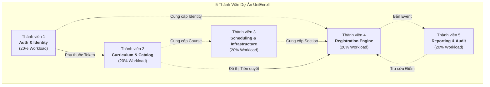
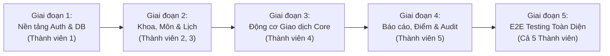

# KẾ HOẠCH PHÂN CHIA NHIỆM VỤ 5 PHÂN HỆ CHO 5 THÀNH VIÊN
## DỰ ÁN: HỆ THỐNG ĐĂNG KÝ HỌC PHẦN TRỰC TUYẾN CHUẨN ĐẠI HỌC (UNIENROLL)
**Phiên bản:** 1.0 (Chuẩn hóa Toàn diện theo Kiến trúc Codebase)  
**Ngày cập nhật:** 29/10/2026  
**Quy mô nhóm:** 5 Thành viên | **Mô hình triển khai:** Full-Stack Feature-Driven Development

---

## 📌 MỤC LỤC
1. [Nguyên tắc Phân bổ Khối lượng Công việc (Fair Workload Principle)](#1-nguyên-tắc-phân-bổ-khối-lượng-công-việc)
2. [Ma trận Tổng hợp Phân công 5 Thành viên (Overview Matrix)](#2-ma-trận-tổng-hợp-phân-công-5-thành-viên)
3. [Chi tiết Trách nhiệm Từng Thành viên (Member Specifications)](#3-chi-tiết-trách-nhiệm-từng-thành-viên)
   - [Thành viên 1: Module 1 - Định danh, Xác thực & Phân quyền Người dùng](#thành-viên-1-module-1---định-danh-xác-thực--phân-quyền-người-dùng)
   - [Thành viên 2: Module 2 - Chương trình Đào tạo & Đồ thị Tiên quyết](#thành-viên-2-module-2---chương-trình-đào-tạo--đồ-thị-tiên-quyết)
   - [Thành viên 3: Module 3 - Cơ sở Hạ tầng, Học kỳ & Xếp lịch Học phần](#thành-viên-3-module-3---cơ-sở-hạ-tầng-học-kỳ--xếp-lịch-học-phần)
   - [Thành viên 4: Module 4 - Động cơ Đăng ký Tín chỉ & Kiểm soát Tương tranh](#thành-viên-4-module-4---động-cơ-đăng-ký-tín-chỉ--kiểm-soát-tương-tranh)
   - [Thành viên 5: Module 5 - Sổ Điểm danh, Điểm số, Báo cáo & Kiểm toán](#thành-viên-5-module-5---sổ-điểm-danh-điểm-số-báo-cáo--kiểm-toán)
4. [Ma trận Phân định Trách nhiệm RACI (RACI Responsibility Matrix)](#4-ma-trận-phân-định-trách-nhiệm-raci)
5. [Quy trình Phối hợp Tích hợp & Kiểm thử (Integration & Git Workflow)](#5-quy-trình-phối-hợp-tích-hợp--kiểm-thử)

---

## 1. NGUYÊN TẮC PHÂN BỔ KHỐI LƯỢNG CÔNG VIỆC

Để bảo đảm tính công bằng, minh bạch và rèn luyện kỹ năng toàn diện cho từng thành viên:
1. **Phân bổ Theo Chiều Dọc (Full-Stack Ownership):** Mỗi thành viên chịu trách nhiệm trọn vẹn từ CSDL $\rightarrow$ Backend (Entities, DTOs, Repository, Service, Controller, Exception Handling) $\rightarrow$ Frontend (API Client, UI Pages, Modals, State Management, Validation) $\rightarrow$ Unit/Integration Test cho module được phân công.
2. **Cân Bằng Độ Phức Tạp (Workload & Complexity Balance):**
   - Các module có độ phức tạp thuật toán cao (như DFS Anti-Cycle ở Module 2, Pessimistic Locking Concurrency ở Module 4) sẽ được cân đối với số lượng màn hình UI vừa phải.
   - Các module có logic nghiệp vụ phân quyền hoặc nhiều biểu mẫu CRUD phức tạp (như Module 1, Module 3, Module 5) sẽ phụ trách nhiều endpoints và màn hình giao diện hơn để đảm bảo tổng số giờ công (Story Points) của cả 5 thành viên là ngang bằng nhau (~20% mỗi người).

---

## 2. MA TRẬN TỔNG HỢP PHÂN CÔNG 5 THÀNH VIÊN

| Thành Viên | Phân Hệ Phụ Trách | Danh Mục Use Cases | Trọng Tâm Kỹ Thuật Cốt Lõi | Màn Hình UI Phụ Trách | Tỷ Lệ Đóng Góp |
| :---: | :--- | :--- | :--- | :--- | :---: |
| **Thành viên 1** | **Module 1:** Auth, Security & User Identity | **UC-01, UC-02, UC-03, UC-04** | Spring Security 6, JWT HMAC-SHA256, Refresh Token Rotation, BCrypt, RBAC Matrix | `LoginPage.jsx` `UserManagementPage.jsx` `Header.jsx` | **20%** |
| **Thành viên 2** | **Module 2:** Curriculum & Academic Catalog | **UC-05, UC-06, UC-07** | Directed Graph Anti-Cycle (Thuật toán DFS kiểm tra chu trình), Unique Code, Ràng buộc Tín chỉ | `DepartmentsPage.jsx` `CoursesPage.jsx` Prereq Modal | **20%** |
| **Thành viên 3** | **Module 3:** Scheduling & Infrastructure | **UC-08, UC-09, UC-10, UC-11** | Room & Lecturer Collision Detection, Schedule Slot Mapping, Capacity Safety Mutation | `InfrastructurePage.jsx` `SectionsPage.jsx` Slot & Capacity Modals | **20%** |
| **Thành viên 4** | **Module 4:** Course Registration Engine | **UC-12, UC-13, UC-14, UC-15, UC-16** | Concurrency Control (Khóa bi quan `PESSIMISTIC_WRITE`), Pipeline 6 Bất biến, Atomic Drop | `RegistrationStudioPage.jsx` `TimetablePage.jsx` `PhasesPage.jsx` | **20%** |
| **Thành viên 5** | **Module 5:** Records, Reporting & Auditing | **UC-17, UC-18, UC-19, UC-20** | Append-Only Audit Trail (Spring Async Event), Lecturer Authorization Guard, Occupancy Analytics | `ClassRosterPage.jsx` `OccupancyReportPage.jsx` `AuditLogsPage.jsx` `GradesPage.jsx` `StudentGradesPage.jsx` | **20%** |

---

## 3. CHI TIẾT TRÁCH NHIỆM TỪNG THÀNH VIÊN

---

### THÀNH VIÊN 1: MODULE 1 - ĐỊNH DANH, XÁC THỰC & PHÂN QUYỀN NGƯỜI DÙNG
> **Chức danh vai trò:** *Authentication, Security & Identity Management Specialist*  
> **Package Backend:** `com.unienroll.modules.auth`, `com.unienroll.security`, `com.unienroll.config`  
> **Module Frontend:** `frontend/src/pages/auth`, `frontend/src/pages/admin/UserManagementPage.jsx`, `frontend/src/context/AuthContext.jsx`

#### 1. Phạm vi Use Cases phụ trách
* **UC-01:** Đăng nhập Hệ thống & Cấp phát JWT (User Login).
* **UC-02:** Làm mới Access Token tự động (Token Refresh & Axios Interceptor).
* **UC-03:** Tra cứu Hồ sơ Người dùng Hiện hành (`GET /api/v1/users/me`).
* **UC-04:** Quản trị Người dùng, Khởi tạo Profile & Phân bổ Vai trò (User Management).

#### 2. Các Tệp Mã Nguồn Chịu Trách Nhiệm
* **Backend:**
  - Controllers: `AuthController.java`, `AdminUserController.java`
  - Services: `AuthService.java`, `AdminUserService.java`
  - Entities: `User.java`, `Role.java`, `UserStatus.java`, `StudentProfile.java`, `LecturerProfile.java`, `StaffProfile.java`
  - Repositories: `UserRepository.java`, `StudentProfileRepository.java`, `LecturerProfileRepository.java`, `StaffProfileRepository.java`
  - Security Infrastructure: `JwtTokenProvider.java`, `JwtAuthenticationFilter.java`, `CustomUserDetails.java`, `CustomUserDetailsService.java`, `SecurityConfig.java`, `CustomAuthenticationEntryPoint.java`, `CustomAccessDeniedHandler.java`
  - DTOs: `LoginRequest.java`, `LoginResponse.java`, `RefreshTokenRequest.java`, `RefreshTokenResponse.java`, `CreateUserRequest.java`, `UpdateUserStatusRequest.java`, `UserProfileResponse.java`, `UserSummaryDto.java`
* **Frontend:**
  - `frontend/src/pages/auth/LoginPage.jsx`
  - `frontend/src/pages/admin/UserManagementPage.jsx`
  - `frontend/src/context/AuthContext.jsx`
  - `frontend/src/components/layout/RoleProtectedRoute.jsx`
  - `frontend/src/api/authApi.js`, `frontend/src/api/adminApi.js`

#### 3. Trách nhiệm Dữ liệu & Quy tắc Nghiệp vụ (Invariants)
* Quản lý các bảng CSDL: `users`, `student_profiles`, `lecturer_profiles`, `staff_profiles`.
* Bảo đảm tính duy nhất của `username`, `email`, `student_code`, `lecturer_code`, `staff_code`.
* Mã hóa toàn bộ mật khẩu qua `BCryptPasswordEncoder` (độ mạnh 10 rounds).
* Cấp phát Access Token (HMAC-SHA256, thời hạn 15 phút) và Refresh Token (7 ngày).
* Chặn truy cập ngay lập tức nếu tài khoản có trạng thái `status == UserStatus.LOCKED` (`ERR_AUTH_ACCOUNT_LOCKED`).

#### 4. Tiêu chí Nghiệm thu (Acceptance Criteria)
- [ ] Đăng nhập thành công với 4 tài khoản mẫu (`admin`, `staff`, `lecturer`, `student` / `123456`) và chuyển hướng đúng Portal theo vai trò.
- [ ] Tự động refresh token thành công khi Access Token hết hạn mà không ngắt quãng phiên làm việc.
- [ ] Admin tạo mới được người dùng của cả 4 vai trò kèm đầy đủ thông tin profile mở rộng.
- [ ] Khóa tài khoản thành công; tài khoản bị khóa bị từ chối đăng nhập ngay lập tức.

---

### THÀNH VIÊN 2: MODULE 2 - CHƯƠNG TRÌNH ĐÀO TẠO & ĐỒ THỊ TIÊN QUYẾT
> **Chức danh vai trò:** *Curriculum & Academic Catalog Specialist*  
> **Package Backend:** `com.unienroll.modules.curriculum`  
> **Module Frontend:** `frontend/src/pages/staff/DepartmentsPage.jsx`, `frontend/src/pages/staff/CoursesPage.jsx`

#### 1. Phạm vi Use Cases phụ trách
* **UC-05:** Quản lý Khoa / Đơn vị Đào tạo (Department Management).
* **UC-06:** Quản lý Danh mục Môn học trong Chương trình (Course Management).
* **UC-07:** Thiết lập Điều kiện Môn học Tiên quyết & Kiểm soát Chu trình DFS (Prerequisite Management).

#### 2. Các Tệp Mã Nguồn Chịu Trách Nhiệm
* **Backend:**
  - Controllers: `DepartmentController.java`, `CourseController.java`
  - Services: `DepartmentService.java`, `CourseService.java`, `PrerequisiteService.java`
  - Entities: `Department.java`, `Course.java`, `PrerequisiteCondition.java`
  - Repositories: `DepartmentRepository.java`, `CourseRepository.java`, `PrerequisiteConditionRepository.java`
  - DTOs: `DepartmentRequest.java`, `DepartmentResponse.java`, `CourseRequest.java`, `CourseResponse.java`, `CourseSummaryDto.java`
* **Frontend:**
  - `frontend/src/pages/staff/DepartmentsPage.jsx`
  - `frontend/src/pages/staff/CoursesPage.jsx` (kèm Modal Cấu hình Tiên quyết và Drawer xem chi tiết)
  - `frontend/src/api/curriculumApi.js`

#### 3. Trách nhiệm Dữ liệu & Quy tắc Nghiệp vụ (Invariants)
* Quản lý các bảng CSDL: `departments`, `courses`, `prerequisite_conditions`.
* Đảm bảo tính duy nhất của Mã khoa (`code`) và Mã môn học (`code`).
* Ràng buộc tín chỉ: Tổng tín chỉ $TotalCredits = TheoryCredits + PracticalCredits > 0$.
* **Hiện thực Thuật toán DFS Anti-Cycle (BR-04):**
  - Cài đặt phương thức `isReachable(Long startCourseId, Long targetCourseId)` bằng thuật toán tìm kiếm theo chiều sâu/rộng trên đồ thị có hướng của các điều kiện tiên quyết.
  - Ngăn chặn tuyệt đối việc tạo chu trình phụ thuộc vòng tròn (ví dụ $A \rightarrow B \rightarrow C \rightarrow A$). Khi phát hiện chu trình, ném mã lỗi `ERR_CIRCULAR_PREREQUISITE_DETECTED`.
* Bảo vệ toàn vẹn tham chiếu: Không cho phép xóa Khoa nếu đang có Môn học; Không cho phép xóa Môn học nếu đã phát sinh Lớp học phần hoặc Bảng điểm.

#### 4. Tiêu chí Nghiệm thu (Acceptance Criteria)
- [ ] Thêm, sửa, xóa, tìm kiếm Khoa/Bộ môn và nạp danh sách trực quan.
- [ ] Thêm, sửa môn học với tự động tính tổng tín chỉ; kiểm tra trùng mã môn ném `ERR_COURSE_CODE_DUPLICATE`.
- [ ] Gán môn tiên quyết thành công; nếu gán chu trình lặp (A cần B, B cần A) thì hệ thống chặn và hiển thị thông báo lỗi `ERR_CIRCULAR_PREREQUISITE_DETECTED`.
- [ ] Xóa bỏ điều kiện tiên quyết thành công khi chương trình đào tạo thay đổi.

---

### THÀNH VIÊN 3: MODULE 3 - CƠ SỞ HẠ TẦNG, HỌC KỲ & XẾP LỊCH HỌC PHẦN
> **Chức danh vai trò:** *Scheduling & Infrastructure Specialist*  
> **Package Backend:** `com.unienroll.modules.scheduling`  
> **Module Frontend:** `frontend/src/pages/staff/InfrastructurePage.jsx`, `frontend/src/pages/staff/SectionsPage.jsx`

#### 1. Phạm vi Use Cases phụ trách
* **UC-08:** Quản lý Học kỳ & Cơ sở vật chất Phòng học (Semester & Room Management).
* **UC-09:** Mở Lớp Học phần Mới & Phân công Giảng viên (Open Course Section).
* **UC-10:** Cấu hình Lịch học Chi tiết & Thẩm định Xung đột Phòng / Giảng viên (Schedule Slots Assignment).
* **UC-11:** Điều chỉnh Chỉ tiêu Sức chứa Lớp học phần & Hủy Lớp (Capacity Adjustment & Cancellation).

#### 2. Các Tệp Mã Nguồn Chịu Trách Nhiệm
* **Backend:**
  - Controllers: `AcademicSemesterController.java`, `AcademicRoomController.java`, `AcademicSectionController.java`
  - Services: `SemesterService.java`, `RoomService.java`, `CourseSectionService.java`
  - Entities: `Semester.java`, `SemesterStatus.java`, `Room.java`, `CourseSection.java`, `SectionStatus.java`, `ScheduleSlot.java`
  - Repositories: `SemesterRepository.java`, `RoomRepository.java`, `CourseSectionRepository.java`, `ScheduleSlotRepository.java`
  - DTOs: `SemesterRequest.java`, `SemesterResponse.java`, `RoomRequest.java`, `RoomResponse.java`, `CourseSectionRequest.java`, `CourseSectionResponse.java`, `ScheduleSlotRequest.java`, `ScheduleSlotResponse.java`, `UpdateCapacityRequest.java`
* **Frontend:**
  - `frontend/src/pages/staff/InfrastructurePage.jsx` (Quản lý Học kỳ và Danh mục Phòng học)
  - `frontend/src/pages/staff/SectionsPage.jsx` (Quản lý Lớp học phần, Xếp lịch slot, Đổi chỉ tiêu, Hủy lớp)
  - `frontend/src/api/schedulingApi.js`

#### 3. Trách nhiệm Dữ liệu & Quy tắc Nghiệp vụ (Invariants)
* Quản lý các bảng CSDL: `semesters`, `rooms`, `course_sections`, `schedule_slots`.
* **Thẩm định Xung đột Lịch học (BR-03):**
  - **Xung đột phòng học:** Phòng học không được trùng lịch với lớp khác trong cùng học kỳ trên cùng thứ và giao thoa tiết (`ERR_ROOM_SCHEDULE_COLLISION`).
  - **Xung đột giảng viên:** Giảng viên không được có lịch dạy trùng ở 2 lớp khác nhau trong cùng khung giờ (`ERR_LECTURER_SCHEDULE_COLLISION`).
* **Thẩm định Hạ tầng & Sức chứa (BR-09):**
  - Sức chứa phòng học bố trí phải $\ge$ chỉ tiêu lớp học phần ($Capacity_{room} \ge Capacity_{section}$), nếu không ném `ERR_ROOM_CAPACITY_INSUFFICIENT`.
  - Khi điều chỉnh sức chứa (UC-11): Chỉ tiêu mới không được thấp hơn số sinh viên đã đăng ký ($newCapacity \ge N_{enrolled}$), nếu vi phạm ném `ERR_CAPACITY_LOWER_THAN_ENROLLED`.
  - Tự động mở lại trạng thái `OPEN` nếu lớp trước đó đang `CLOSED` và được tăng thêm chỉ tiêu.

#### 4. Tiêu chí Nghiệm thu (Acceptance Criteria)
- [ ] Tạo học kỳ mới ($StartDate < EndDate$) và tạo phòng học có sức chứa chỗ ngồi.
- [ ] Mở lớp học phần cho môn học trong học kỳ, gán chỉ tiêu và phân công giảng viên.
- [ ] Xếp lịch học (Thứ, Tiết 1-3, Phòng): Hệ thống chặn thành công khi phòng hoặc giảng viên bị trùng lịch.
- [ ] Đổi chỉ tiêu lớp: Chặn không cho giảm chỉ tiêu xuống dưới số lượng sinh viên đã đăng ký thực tế.

---

### THÀNH VIÊN 4: MODULE 4 - ĐỘNG CƠ ĐĂNG KÝ TÍN CHỈ & KIỂM SOÁT TƯƠNG TRANH
> **Chức danh vai trò:** *Core Registration Engine & Concurrency Specialist*  
> **Package Backend:** `com.unienroll.modules.engine`  
> **Module Frontend:** `frontend/src/pages/staff/PhasesPage.jsx`, `frontend/src/pages/student/RegistrationStudioPage.jsx`, `frontend/src/pages/student/TimetablePage.jsx`

#### 1. Phạm vi Use Cases phụ trách
* **UC-12:** Quản lý Đợt Mở Cổng Đăng ký Học phần (Registration Phase Management).
* **UC-13:** Tra cứu & Lọc Danh mục Lớp Học phần Mở cho Sinh viên (Catalog Search & Filter).
* **UC-14:** **ĐĂNG KÝ LỚP HỌC PHẦN (CORE TRANSACTION PIPELINE VỚI KHÓA BI QUAN)**.
* **UC-15:** **HỦY ĐĂNG KÝ LỚP HỌC PHẦN (DROP SECTION & RECOVER CAPACITY)**.
* **UC-16:** Xem Thời khóa biểu Tuần Trực quan & Môn Đã Đăng ký (Weekly Timetable Matrix).

#### 2. Các Tệp Mã Nguồn Chịu Trách Nhiệm
* **Backend:**
  - Controllers: `AcademicPhaseController.java`, `SectionCatalogController.java`, `StudentRegistrationController.java`
  - Services: `RegistrationEngineService.java`, `RegistrationPhaseService.java`
  - Entities: `RegistrationPhase.java`, `EnrollmentRecord.java`, `EnrollmentStatus.java`
  - Repositories: `RegistrationPhaseRepository.java`, `EnrollmentRecordRepository.java`
  - DTOs: `RegistrationPhaseRequest.java`, `RegistrationPhaseResponse.java`, `EnrollmentRequest.java`, `EnrollmentResponse.java`, `ActiveRegistrationsResponse.java`
* **Frontend:**
  - `frontend/src/pages/staff/PhasesPage.jsx` (Cấu hình thời gian mở cổng đợt đăng ký)
  - `frontend/src/pages/student/RegistrationStudioPage.jsx` (Giao diện đăng ký tín chỉ chính của sinh viên)
  - `frontend/src/pages/student/TimetablePage.jsx` (Ma trận thời khóa biểu tuần từ Thứ 2 đến Chủ nhật, Tiết 1 đến 12)
  - `frontend/src/api/registrationApi.js`

#### 3. Trách nhiệm Dữ liệu & Quy tắc Nghiệp vụ (Invariants Cốt Lõi)
* Quản lý các bảng CSDL: `registration_phases`, `enrollment_records`.
* **Hiện thực Toàn diện Pipeline Thẩm định 6 Bất biến (BR-01 đến BR-06):**
  - **BR-01:** Khung thời gian đợt đăng ký ($T_{start} \le T_{trans} \le T_{end}$) $\rightarrow$ `ERR_REGISTRATION_WINDOW_CLOSED`.
  - **BR-04:** Điều kiện môn tiên quyết đã đạt (`PASSED`) $\rightarrow$ `ERR_PREREQUISITE_NOT_FULFILLED`.
  - **BR-06:** Không trùng môn học trong học kỳ $\rightarrow$ `ERR_DUPLICATE_COURSE_REGISTRATION`.
  - **BR-03:** Trùng lặp lịch học tuần của sinh viên $\rightarrow$ `ERR_TIMETABLE_COLLISION`.
  - **BR-05:** Ngưỡng tín chỉ ($12 \le \text{Credits} \le 24$ TC, có xét cờ ghi đè) $\rightarrow$ `ERR_CREDIT_LIMIT_EXCEEDED` khi đăng ký, `ERR_MINIMUM_CREDIT_UNMET` khi hủy.
  - **BR-02 & Khóa bi quan:** Khóa dòng `CourseSection` bằng `entityManager.refresh(targetSection, LockModeType.PESSIMISTIC_WRITE)`, chống tuyệt đối race condition bán vượt số chỗ $\rightarrow$ `ERR_SECTION_CAPACITY_FULL`.
* Phát sự kiện kiểm toán bất đồng bộ `RegistrationAuditEvent` sang Module 5 sau mỗi giao dịch thành công hoặc thất bại.

#### 4. Tiêu chí Nghiệm thu (Acceptance Criteria)
- [ ] Thiết lập đợt đăng ký theo ngày giờ; sinh viên đăng ký ngoài giờ bị từ chối chính xác.
- [ ] Sinh viên đăng ký lớp thỏa mãn 6 quy tắc thành công, sĩ số lớp tăng 1, hiển thị tức thì trong TKB.
- [ ] Chặn thành công các vi phạm: hết chỗ (409), trùng lịch (409), thiếu tiên quyết (400), trùng môn (409), quá 24 TC (400).
- [ ] Hủy lớp thành công, thu hồi slot trống, mở lại trạng thái `OPEN` nếu lớp từng bị `CLOSED`, chặn nếu sau khi hủy số tín chỉ < 12 TC.
- [ ] Hiển thị chính xác ma trận Thời khóa biểu tuần 7 ngày x 12 tiết học.

---

### THÀNH VIÊN 5: MODULE 5 - SỔ ĐIỂM DANH, ĐIỂM SỐ, BÁO CÁO & KIỂM TOÁN
> **Chức danh vai trò:** *Records, Analytics & Auditing Specialist*  
> **Package Backend:** `com.unienroll.modules.reporting`  
> **Module Frontend:** `frontend/src/pages/lecturer/ClassRosterPage.jsx`, `frontend/src/pages/staff/OccupancyReportPage.jsx`, `frontend/src/pages/admin/AuditLogsPage.jsx`, `frontend/src/pages/staff/GradesPage.jsx`, `frontend/src/pages/student/StudentGradesPage.jsx`

#### 1. Phạm vi Use Cases phụ trách
* **UC-17:** Tra cứu & Xuất Danh sách Sinh viên Lớp học phần (Class Roster).
* **UC-18:** Báo cáo Thống kê Tỷ lệ Lấp đầy Lớp học phần (Occupancy Dashboard).
* **UC-19:** Tra cứu & Phân tích Nhật ký Kiểm toán Đăng ký (Audit Logs Inquiry).
* **UC-20:** Quản lý Điểm & Tra cứu Bảng điểm Tích lũy Cá nhân (Grade & Transcript Management / Test Harness).

#### 2. Các Tệp Mã Nguồn Chịu Trách Nhiệm
* **Backend:**
  - Controllers: `LecturerRosterController.java`, `OccupancyReportController.java`, `AdminAuditLogController.java`, `GradeController.java`
  - Services: `ClassRosterService.java`, `OccupancyReportService.java`, `AuditLogService.java`, `GradeService.java`
  - Entities: `GradeRecord.java`, `GradeStatus.java`, `RegistrationAuditLog.java`, `AuditActionType.java`, `AuditExecutionStatus.java`
  - Events: `RegistrationAuditEvent.java`
  - Repositories: `GradeRecordRepository.java`, `RegistrationAuditLogRepository.java`
  - DTOs: `ClassRosterResponse.java`, `ClassRosterStudentDto.java`, `OccupancyDashboardResponse.java`, `SectionOccupancyDto.java`, `AuditLogResponse.java`, `GradeRecordRequest.java`, `GradeRecordResponse.java`
* **Frontend:**
  - `frontend/src/pages/lecturer/ClassRosterPage.jsx` (Giảng viên xem danh sách sinh viên lớp và in ấn điểm danh)
  - `frontend/src/pages/staff/OccupancyReportPage.jsx` (Dashboard tỷ lệ lấp đầy toàn trường)
  - `frontend/src/pages/admin/AuditLogsPage.jsx` (Tra cứu và lọc nhật ký kiểm toán hệ thống)
  - `frontend/src/pages/staff/GradesPage.jsx` (Tiện ích nhập điểm tiên quyết phục vụ kiểm thử)
  - `frontend/src/pages/student/StudentGradesPage.jsx` (Sinh viên tra cứu bảng điểm tích lũy)
  - `frontend/src/api/reportingApi.js`

#### 3. Trách nhiệm Dữ liệu & Quy tắc Nghiệp vụ (Invariants)
* Quản lý các bảng CSDL: `grade_records`, `registration_audit_logs`.
* **Phân quyền Danh sách Sinh viên (BR-10):**
  - Giảng viên chỉ được xem lớp mình được phân công giảng dạy; truy cập lớp khác bị chặn với `ERR_ACCESS_DENIED_NOT_ASSIGNED_LECTURER`.
  - Sinh viên chỉ được xem danh sách bạn cùng lớp nếu mình đang theo học lớp đó; người ngoài bị chặn với `ERR_FORBIDDEN`.
* **Bất biến Lưu vết Kiểm toán Bất đồng bộ (BR-08):**
  - Đón nhận sự kiện `RegistrationAuditEvent` qua cơ chế Spring `@Async @EventListener`.
  - Ghi bản ghi vào bảng `registration_audit_logs` ở chế độ bất biến (**Append-Only**), lưu lại actor, action, timestamp, IP máy trạm, trạng thái và nguyên nhân lỗi.
* **Báo cáo Thống kê Lấp đầy (Occupancy):** Phân loại chuẩn xác 3 nhóm: Đầy 100%, Ổn định, Nguy cơ hủy (< 15 sinh viên).
* **Quản trị Bảng điểm (UC-20):** Cung cấp API cho phép sinh viên xem bảng điểm và cung cấp tiện ích nhập điểm để hỗ trợ kiểm thử điều kiện tiên quyết (**BR-04**).

#### 4. Tiêu chí Nghiệm thu (Acceptance Criteria)
- [ ] Giảng viên đăng nhập thấy đúng các lớp của mình và danh sách sinh viên chính thức; in danh sách điểm danh đẹp mắt.
- [ ] Dashboard lấp đầy thống kê chính xác tổng số lớp, tổng chỉ tiêu, % lấp đầy và phân loại chuẩn 3 nhóm.
- [ ] Nhật ký kiểm toán hiển thị đầy đủ mọi giao dịch `ENROLL`, `DROP` kèm IP, thời gian chính xác đến từng giây.
- [ ] Sinh viên tra cứu được bảng điểm cá nhân; Cán bộ đào tạo nhập điểm đạt `PASSED` giúp sinh viên đủ điều kiện học tiếp môn tiên quyết.

---

## 4. MA TRẬN PHÂN ĐỊNH TRÁCH NHIỆM RACI

*Ký hiệu:*
- **R (Responsible):** Người chịu trách nhiệm chính thực hiện và hoàn thành chức năng.
- **A (Accountable):** Người chịu trách nhiệm giải trình và phê duyệt cuối cùng về chất lượng.
- **C (Consulted):** Người được tham vấn ý kiến kỹ thuật / nghiệp vụ liên quan.
- **I (Informed):** Người được thông báo khi có thay đổi API / DTO liên quan.

| Hạng Mục Nhiệm Vụ | Thành Viên 1 (Auth) | Thành Viên 2 (Curriculum) | Thành Viên 3 (Scheduling) | Thành Viên 4 (Engine) | Thành Viên 5 (Reporting) |
| :--- | :---: | :---: | :---: | :---: | :---: |
| **Xác thực JWT & Cấp Quyền RBAC** | **R / A** | I | I | C | I |
| **Quản trị Tài khoản & Phân quyền Profile** | **R / A** | I | C | C | I |
| **Quản lý Khoa & Danh mục Môn học** | I | **R / A** | C | C | I |
| **Cấu hình Tiên quyết & Thuật toán DFS** | I | **R / A** | I | C | C |
| **Học kỳ & Quản lý Phòng học** | I | I | **R / A** | C | I |
| **Mở Lớp Học phần & Xếp Lịch Xung Đột** | I | C | **R / A** | C | C |
| **Đợt Mở Cổng Đăng ký & Catalog Lớp** | I | I | C | **R / A** | I |
| **Đăng ký Học phần (Khóa Bi Quan - BR 01-06)**| C | C | C | **R / A** | C |
| **Hủy Học phần & Thu Hồi Slot** | I | I | C | **R / A** | C |
| **Thời khóa biểu Tuần Sinh viên** | I | I | C | **R / A** | I |
| **Danh sách Điểm danh Lớp (Class Roster)** | C | I | C | C | **R / A** |
| **Báo cáo Tỷ lệ Lấp đầy Lớp học phần** | I | I | C | C | **R / A** |
| **Ghi vết & Tra cứu Nhật ký Kiểm toán** | C | I | I | C | **R / A** |
| **Quản lý Điểm & Tra cứu Bảng điểm** | I | C | I | C | **R / A** |

---

## 5. QUY TRÌNH PHỐI HỢP TÍCH HỢP & KIỂM THỬ (GIT WORKFLOW)

### 5.1. Chiến Lược Phân Nhánh Git (Git Feature Branching)
* Nhánh chính: `main` (mã nguồn ổn định sẵn sàng demo).
* Nhánh tích hợp: `develop` (nhánh gộp các tính năng mới).
* Nhánh cá nhân theo module:
  - Thành viên 1: `feature/module-1-auth`
  - Thành viên 2: `feature/module-2-curriculum`
  - Thành viên 3: `feature/module-3-scheduling`
  - Thành viên 4: `feature/module-4-engine`
  - Thành viên 5: `feature/module-5-reporting`

### 5.2. Thứ Tự Tích Hợp Đề Xuất (Integration Milestones)

### 5.3. Tiêu Chuẩn Phê Duyệt Pull Request (Definition of Done)
1. Mã nguồn biên dịch thành công (`mvn clean compile` không phát sinh lỗi).
2. Frontend build thành công không lỗi syntax hay missing import (`npm run build`).
3. Khớp 100% tài liệu đặc tả:
   - Các API tuân thủ đúng định dạng DTO trong [README_USE_CASES.md](file:///d:/UniEnroll/README_USE_CASES.md).
   - Các mã lỗi và cơ chế tương tranh tuân thủ đúng [README_BUSINESS_RULES.md](file:///d:/UniEnroll/README_BUSINESS_RULES.md).
4. Có ít nhất 1 thành viên khác duyệt (Code Review Approved) trước khi gộp vào `develop`.

---
**UniEnroll Team - Hợp tác Chặt chẽ, Phân công Rõ ràng, Về đích Xuất sắc!**
