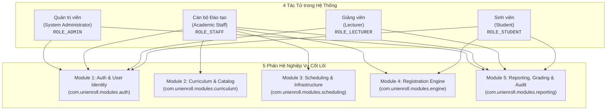

# TÀI LIỆU ĐẶC TẢ USE CASE CHI TIẾT (USE CASE SPECIFICATION)
## DỰ ÁN: HỆ THỐNG ĐĂNG KÝ HỌC PHẦN TRỰC TUYẾN CHUẨN ĐẠI HỌC (UNIENROLL)
**Phiên bản:** 2.0 (Đồng bộ 100% với Codebase Hiện tại)  
**Ngày cập nhật:** 29/10/2026  
**Trạng thái:** Đầy đủ 20/20 Use Cases (Toàn bộ 5 Modules Nghiệp vụ)

---

## 1. TỔNG QUAN HỆ THỐNG VÀ CÁC TÁC TỬ (ACTORS)

Hệ thống UniEnroll phục vụ 4 nhóm tác tử (Actors) chính với phạm vi quyền hạn và trách nhiệm được phân tách nghiêm ngặt thông qua cơ chế Role-Based Access Control (RBAC):

### Danh mục Tác tử (Actors Catalog)
1. **Quản trị viên (System Administrator - `ROLE_ADMIN`):** Quản trị tài khoản, cấp phát vai trò người dùng, quản lý khoa/bộ môn, giám sát và truy vấn toàn diện nhật ký kiểm toán hệ thống (Audit Logs).
2. **Cán bộ Đào tạo (Academic Staff - `ROLE_STAFF`):** Quản lý cơ cấu tổ chức khoa, danh mục môn học, cấu hình cây môn tiên quyết (DFS Anti-Cycle), thiết lập học kỳ và phòng học, mở lớp học phần, xếp lịch chi tiết, phân công giảng viên, thiết lập đợt mở cổng đăng ký, quản lý điểm và xem báo cáo tỷ lệ lấp đầy lớp.
3. **Giảng viên (Lecturer - `ROLE_LECTURER`):** Tra cứu thông tin cá nhân, xem và xuất danh sách sinh viên chính thức theo từng lớp học phần phụ trách (Class Roster) để quản lý điểm danh.
4. **Sinh viên (Student - `ROLE_STUDENT`):** Tra cứu chương trình học, tìm kiếm lớp mở theo thời gian thực; thực hiện giao dịch đăng ký/hủy học phần; xem thời khóa biểu tuần và tra cứu bảng điểm tích lũy cá nhân.

---

## 2. MA TRẬN TỔNG HỢP USE CASE TOÀN HỆ THỐNG (USE CASE MATRIX)

| Mã UC | Tên Use Case | Tác tử chính | Phân hệ (Module) | Độ ưu tiên | Ràng buộc / NFR / Bất biến liên quan | Màn hình Frontend tương ứng |
| :--- | :--- | :--- | :--- | :---: | :--- | :--- |
| **UC-01** | Đăng nhập Hệ thống & Cấp phát Token JWT | Toàn bộ 4 Actors | Module 1 (Auth) | Critical | BCrypt, HMAC-SHA256, UserStatus.ACTIVE | `LoginPage.jsx` (`/login`) |
| **UC-02** | Làm mới Access Token (Token Refresh) | Toàn bộ 4 Actors | Module 1 (Auth) | High | Refresh Token Rotation, Client Interceptor | Axios Interceptor |
| **UC-03** | Tra cứu Hồ sơ Người dùng Hiện hành (`/users/me`) | Toàn bộ 4 Actors | Module 1 (Auth) | High | Spring SecurityContext, Profile DTO | `Header.jsx`, `AppLayout.jsx` |
| **UC-04** | Quản trị Người dùng & Phân bổ Vai trò | Admin, Staff | Module 1 (Auth) | High | RBAC, Unique Username/Email, Status Toggle | `UserManagementPage.jsx` (`/admin/users`) |
| **UC-05** | Quản lý Khoa / Đơn vị Đào tạo (Department) | Staff, Admin | Module 2 (Curriculum) | Medium | Unique Code, Referential Integrity | `DepartmentsPage.jsx` (`/staff/departments`) |
| **UC-06** | Quản lý Danh mục Môn học (Course) | Staff | Module 2 (Curriculum) | High | Unique Code, TotalCredits = Theory + Practical | `CoursesPage.jsx` (`/staff/courses`) |
| **UC-07** | Thiết lập Điều kiện Môn Tiên quyết | Staff | Module 2 (Curriculum) | High | **BR-04**, Thuật toán DFS Chặn Chu trình Phụ thuộc | `CoursesPage.jsx` (Prereq Modal) |
| **UC-08** | Quản lý Học kỳ & Cơ sở vật chất Phòng học | Staff | Module 3 (Scheduling) | High | Temporal Sanity ($Start < End$), Room Capacity | `InfrastructurePage.jsx` (`/staff/infrastructure`) |
| **UC-09** | Mở Lớp Học phần Mới & Phân công Giảng viên | Staff | Module 3 (Scheduling) | Critical | Unique SectionCode in Semester, Capacity > 0 | `SectionsPage.jsx` (`/staff/sections`) |
| **UC-10** | Cấu hình Lịch học Chi tiết (Schedule Slots) | Staff | Module 3 (Scheduling) | Critical | **BR-03, BR-09**, Xung đột Phòng/Giảng viên | `SectionsPage.jsx` (Slot Modal) |
| **UC-11** | Điều chỉnh Chỉ tiêu Sức chứa & Hủy Lớp | Staff | Module 3 (Scheduling) | High | **BR-02, BR-09**, $C_{new} \ge N_{enrolled}$ | `SectionsPage.jsx` (Capacity Modal) |
| **UC-12** | Quản lý Đợt Mở Cổng Đăng ký Học phần | Staff | Module 4 (Engine) | Critical | **BR-01**, Khung giờ $[T_{start}, T_{end}]$, Cohort | `PhasesPage.jsx` (`/staff/phases`) |
| **UC-13** | Tra cứu & Lọc Danh mục Lớp Học phần Mở | Student, Staff | Module 4 (Engine) | High | Indexed Query, Available Slots, Latency < 200ms | `RegistrationStudioPage.jsx` (`/student/registration`) |
| **UC-14** | **Đăng ký Lớp Học phần (Core Transaction)** | Student | Module 4 (Engine) | Critical | **BR-01 đến BR-06**, Khóa bi quan Row-Lock | `RegistrationStudioPage.jsx` |
| **UC-15** | **Hủy Đăng ký Lớp Học phần (Drop Section)** | Student | Module 4 (Engine) | Critical | **BR-01, BR-05 (Min 12 TC)**, Thu hồi Slot | `RegistrationStudioPage.jsx` |
| **UC-16** | Xem Thời khóa biểu Tuần & Môn Đã Đăng ký | Student | Module 4 (Engine) | High | Weekly Timetable Matrix (T2-CN, Tiết 1-12) | `TimetablePage.jsx` (`/student/timetable`) |
| **UC-17** | Tra cứu & Xuất Danh sách Lớp (Class Roster) | Lecturer, Staff | Module 5 (Reporting) | High | Phân quyền Giảng viên phụ trách, In danh sách | `ClassRosterPage.jsx` (`/lecturer/roster`) |
| **UC-18** | Dashboard Báo cáo Tỷ lệ Lấp đầy Lớp HP | Staff | Module 5 (Reporting) | Medium | Thống kê: Đầy 100%, Ổn định, Nguy cơ hủy | `OccupancyReportPage.jsx` (`/staff/occupancy-report`) |
| **UC-19** | Tra cứu Nhật ký Kiểm toán Đăng ký (Audit Logs)| Admin, Staff | Module 5 (Reporting) | Medium | **BR-08**, Append-Only Log, Bộ lọc Đa tiêu chí | `AuditLogsPage.jsx` (`/admin/audit-logs`) |
| **UC-20** | Quản lý Điểm & Tra cứu Bảng điểm Tích lũy | Student, Staff | Module 5 (Reporting) | High | Hỗ trợ Test Tiên quyết (Harness), Transcript | `StudentGradesPage.jsx`, `GradesPage.jsx` |

---

## 3. ĐẶC TẢ CHI TIẾT ĐẦY ĐỦ TỪNG USE CASE (20/20 USE CASES)

---

### PHÂN HỆ 1: ĐỊNH DANH, XÁC THỰC & QUẢN TRỊ NGƯỜI DÙNG (MODULE 1)
*Package Backend:* `com.unienroll.modules.auth`  
*Controllers:* `AuthController.java`, `AdminUserController.java`  
*Services:* `AuthService.java`, `AdminUserService.java`  
*Entities:* `User`, `StudentProfile`, `LecturerProfile`, `StaffProfile`

#### UC-01: Đăng nhập Hệ thống & Cấp phát JWT (User Login)
* **Tác tử:** Toàn bộ 4 Actors (Student, Lecturer, Academic Staff, Admin).
* **Mô tả:** Tiếp nhận thông tin định danh (Username/Password), xác thực mật khẩu qua BCrypt, cấp phát cặp token JWT (Access Token & Refresh Token) và trả về thông tin profile định danh.
* **Tiền điều kiện:** Tài khoản đã tồn tại trong CSDL và mang trạng thái `status = UserStatus.ACTIVE`.
* **API Endpoint:** `POST /api/v1/auth/login` (Public)
* **Request DTO (`LoginRequest`):** `{ "username": "...", "password": "..." }`
* **Response DTO (`ApiResponse<LoginResponse>`):** Chứa `accessToken`, `refreshToken`, `tokenType: "Bearer"`, `userProfile` (id, username, email, fullName, role, specificCode).
* **Luồng sự kiện chính:**
  1. Người dùng nhập tên đăng nhập và mật khẩu tại giao diện `LoginPage.jsx`, nhấn "Đăng nhập".
  2. Frontend gửi request `POST /api/v1/auth/login`.
  3. `AuthService` tìm kiếm `User` theo username qua `UserRepository`.
  4. Kiểm tra mật khẩu bằng `BCryptPasswordEncoder.matches(rawPassword, encodedPassword)`.
  5. Kiểm tra trạng thái tài khoản `user.getStatus() == UserStatus.ACTIVE`.
  6. Sinh Access Token (hạn 15 phút, HMAC-SHA256, claim: userId, username, role) và Refresh Token (hạn 7 ngày).
  7. Truy vấn hồ sơ mở rộng (`StudentProfile`, `LecturerProfile`, hoặc `StaffProfile`) để trả về thông tin định danh đầy đủ.
  8. Trả về HTTP 200 OK kèm `LoginResponse`.
  9. Frontend lưu Access Token vào `localStorage` và `AuthContext`, tự động chuyển hướng theo vai trò (Student $\rightarrow$ `/student/registration`, Staff $\rightarrow$ `/staff/sections`, Lecturer $\rightarrow$ `/lecturer/roster`, Admin $\rightarrow$ `/admin/users`).
* **Luồng ngoại lệ:**
  * **E01.1 - Sai username hoặc mật khẩu:** Trả về HTTP 401 Unauthorized kèm mã lỗi `ERR_AUTH_INVALID_CREDENTIALS`.
  * **E01.2 - Tài khoản bị khóa hoặc vô hiệu hóa:** Trả về HTTP 403 Forbidden kèm mã lỗi `ERR_AUTH_ACCOUNT_LOCKED`.

---

#### UC-02: Làm mới Access Token (Token Refresh)
* **Tác tử:** Toàn bộ 4 Actors (gọi tự động bởi Axios Client Interceptor).
* **Mô tả:** Khi Access Token hết hạn (401), Client tự động dùng Refresh Token gửi yêu cầu cấp mới Access Token mà không làm gián đoạn phiên làm việc.
* **Tiền điều kiện:** Người dùng có Refresh Token hợp lệ còn thời hạn.
* **API Endpoint:** `POST /api/v1/auth/refresh` (Public)
* **Request DTO (`RefreshTokenRequest`):** `{ "refreshToken": "..." }`
* **Response DTO (`ApiResponse<RefreshTokenResponse>`):** `{ "accessToken": "...", "tokenType": "Bearer" }`
* **Luồng sự kiện chính:**
  1. `axiosClient` interceptor bắt lỗi HTTP 401 khi gọi API được bảo vệ.
  2. Interceptor gửi request `POST /api/v1/auth/refresh` kèm Refresh Token.
  3. `JwtTokenProvider` xác thực chữ ký số và tính hợp lệ của token.
  4. Trích xuất username, kiểm tra tài khoản vẫn tồn tại và `status == ACTIVE`.
  5. Sinh Access Token mới (hạn 15 phút).
  6. Trả về HTTP 200 OK.
  7. Client cập nhật Access Token trong bộ nhớ và tự động gửi lại request ban đầu.
* **Luồng ngoại lệ:**
  * **E02.1 - Refresh Token hết hạn hoặc không hợp lệ:** Trả về HTTP 401 `ERR_AUTH_REFRESH_TOKEN_EXPIRED`. Client xóa token và điều hướng về `/login`.

---

#### UC-03: Tra cứu Thông tin Tài khoản Hiện hành (Get Current User Profile)
* **Tác tử:** Toàn bộ 4 Actors.
* **Mô tả:** Lấy thông tin chi tiết của người dùng đang đăng nhập dựa trên token JWT trong Header.
* **Tiền điều kiện:** Request có gắn Header `Authorization: Bearer <token>` hợp lệ.
* **API Endpoint:** `GET /api/v1/users/me` (`isAuthenticated()`)
* **Response DTO (`ApiResponse<UserProfileResponse>`):** Gồm `id`, `username`, `email`, `role`, `fullName`, `specificCode`, `phone`, `additionalInfo` (major, cohort, departmentName, degree...).
* **Luồng sự kiện chính:**
  1. Frontend gọi `GET /api/v1/users/me`.
  2. `JwtAuthenticationFilter` giải mã token và đặt `CustomUserDetails` vào `SecurityContextHolder`.
  3. Controller lấy `CustomUserDetails`, nạp thông tin user và profile tương ứng từ DB.
  4. Trả về HTTP 200 OK kèm thông tin cá nhân.
* **Luồng ngoại lệ:**
  * **E03.1 - Token không hợp lệ:** Trả về HTTP 401 `ERR_AUTH_UNAUTHORIZED`.

---

#### UC-04: Quản trị Người dùng & Phân bổ Vai trò (User Management)
* **Tác tử:** System Administrator (`ROLE_ADMIN`), Cán bộ Đào tạo (`ROLE_STAFF` được quyền xem).
* **Mô tả:** Admin khởi tạo tài khoản mới cho các đối tượng, gán vai trò (`ROLE_STUDENT`, `ROLE_LECTURER`, `ROLE_STAFF`, `ROLE_ADMIN`), khởi tạo hồ sơ profile chi tiết, khóa hoặc mở khóa tài khoản.
* **Tiền điều kiện:** Người dùng thực hiện có vai trò phù hợp theo quy định bảo mật.
* **API Endpoints:**
  * `POST /api/v1/admin/users` (`hasRole('ADMIN')`): Tạo tài khoản mới kèm hồ sơ profile.
  * `GET /api/v1/admin/users` (`hasAnyRole('ADMIN', 'STAFF')`): Xem danh sách người dùng toàn hệ thống.
  * `PUT /api/v1/admin/users/{id}/status` (`hasRole('ADMIN')`): Cập nhật trạng thái người dùng (`ACTIVE`, `LOCKED`, `INACTIVE`).
* **Request DTO (`CreateUserRequest`):** Gồm `username`, `password`, `email`, `role`, `fullName`, `phone`, và các trường theo vai trò: `studentCode`, `cohort`, `major` (nếu là Sinh viên); `lecturerCode`, `departmentId`, `degree` (nếu là Giảng viên); `staffCode`, `departmentName` (nếu là Cán bộ Đào tạo).
* **Luồng sự kiện chính:**
  1. Admin điền biểu mẫu tạo tài khoản trên `UserManagementPage.jsx`, nhấn "Lưu Tài Khoản".
  2. Hệ thống kiểm tra: `username` và `email` không được trùng lặp trong bảng `users`.
  3. Mở transaction: Băm mật khẩu bằng BCrypt, lưu bản ghi vào `users`, tạo bản ghi profile tương ứng (`student_profiles`, `lecturer_profiles`, hoặc `staff_profiles`).
  4. Trả về HTTP 201 Created.
  5. Khi Admin bấm nút "Khóa/Kích hoạt": Backend cập nhật `user.status` và trả về kết quả cập nhật (HTTP 200).
* **Luồng ngoại lệ:**
  * **E04.1 - Trùng Username hoặc Email:** Trả về HTTP 409 Conflict `ERR_USER_ALREADY_EXISTS`.
  * **E04.2 - Vai trò không hợp lệ:** Trả về HTTP 400 Bad Request `ERR_INVALID_ROLE`.

---

### PHÂN HỆ 2: CHƯƠNG TRÌNH ĐÀO TẠO & MÔN HỌC (MODULE 2)
*Package Backend:* `com.unienroll.modules.curriculum`  
*Controllers:* `DepartmentController.java`, `CourseController.java`  
*Services:* `DepartmentService.java`, `CourseService.java`, `PrerequisiteService.java`  
*Entities:* `Department`, `Course`, `PrerequisiteCondition`

#### UC-05: Quản lý Khoa / Bộ môn (Department Management)
* **Tác tử:** Academic Staff (`ROLE_STAFF`), Admin (`ROLE_ADMIN`).
* **Mô tả:** Khởi tạo, cập nhật, xem danh sách và xóa các Khoa/Bộ môn trong cơ cấu tổ chức đào tạo của trường.
* **API Endpoints:**
  * `POST /api/v1/admin/departments` (`hasAnyRole('ADMIN', 'STAFF')`): Tạo khoa mới (hỗ trợ alias: `/api/v1/curriculum/departments`, `/api/v1/academic/departments`).
  * `GET /api/v1/admin/departments` (`isAuthenticated()`): Lấy toàn bộ danh sách khoa.
  * `GET /api/v1/admin/departments/{id}` (`isAuthenticated()`): Xem chi tiết khoa.
  * `PUT /api/v1/admin/departments/{id}` (`hasAnyRole('ADMIN', 'STAFF')`): Cập nhật thông tin khoa.
  * `DELETE /api/v1/admin/departments/{id}` (`hasAnyRole('ADMIN', 'STAFF')`): Xóa khoa.
* **Request DTO (`DepartmentRequest`):** `{ "code": "IT", "name": "Khoa Công nghệ Thông tin", "description": "..." }`
* **Quy tắc kiểm tra:** Mã khoa `code` là duy nhất toàn hệ thống. Không được xóa khoa nếu đang có môn học liên kết.
* **Luồng ngoại lệ:**
  * **E05.1 - Trùng mã khoa:** Trả về HTTP 409 Conflict `ERR_DEPARTMENT_CODE_DUPLICATE`.
  * **E05.2 - Xóa khoa đang có ràng buộc dữ liệu:** Trả về HTTP 400 Bad Request kèm chi tiết ràng buộc.

---

#### UC-06: Quản lý Danh mục Môn học (Course Management)
* **Tác tử:** Academic Staff (`ROLE_STAFF`).
* **Mô tả:** Định nghĩa thông tin môn học trong chương trình đào tạo: Mã môn học, tên môn, số tín chỉ lý thuyết, số tín chỉ thực hành, tổng số tín chỉ, khoa phụ trách và mô tả tóm tắt.
* **API Endpoints:**
  * `POST /api/v1/courses` (`hasRole('STAFF')`): Thêm môn học mới (hỗ trợ alias: `/api/v1/curriculum/courses`, `/api/v1/academic/courses`).
  * `GET /api/v1/courses` (`isAuthenticated()`): Lấy danh sách toàn bộ môn học.
  * `GET /api/v1/courses/{id}` (`isAuthenticated()`): Xem chi tiết môn học.
  * `GET /api/v1/courses/department/{departmentId}` (`isAuthenticated()`): Lấy danh sách môn theo khoa.
  * `PUT /api/v1/courses/{id}` (`hasRole('STAFF')`): Sửa thông tin môn học.
  * `DELETE /api/v1/courses/{id}` (`hasRole('STAFF')`): Xóa môn học.
* **Request DTO (`CourseRequest`):** `{ "code": "CS101", "name": "Lập trình Cơ bản", "theoryCredits": 3, "practicalCredits": 0, "departmentId": 1, "description": "..." }`
* **Quy tắc kiểm tra:**
  * Mã môn học `code` là duy nhất toàn trường.
  * Tổng tín chỉ: $TotalCredits = TheoryCredits + PracticalCredits > 0$.
  * Không thể xóa môn học nếu đã phát sinh lớp học phần liên quan hoặc đã có bản ghi điểm sinh viên.
* **Luồng ngoại lệ:**
  * **E06.1 - Trùng mã môn học:** Trả về HTTP 409 Conflict `ERR_COURSE_CODE_DUPLICATE`.
  * **E06.2 - Số tín chỉ không hợp lệ ($\le 0$):** Trả về HTTP 400 Bad Request `ERR_VALIDATION_FAILED`.

---

#### UC-07: Thiết lập Điều kiện Môn học Tiên quyết (Prerequisite Conditions Setup)
* **Tác tử:** Academic Staff (`ROLE_STAFF`).
* **Mô tả:** Thiết lập quy định: Để sinh viên có thể đăng ký môn học $C$ (Target Course), sinh viên bắt buộc phải hoàn thành và đạt (`PASSED`) ở môn $P$ (Prerequisite Course) trước đó (**BR-04**). Hệ thống tự động áp dụng thuật toán DFS Graph Traversal để chặn đứng mọi chu trình lặp phụ thuộc vòng tròn.
* **API Endpoints:**
  * `POST /api/v1/courses/{id}/prerequisites` (`hasRole('STAFF')`): Gán danh sách môn tiên quyết cho môn `{id}`.
  * `GET /api/v1/courses/{id}/prerequisites` (`isAuthenticated()`): Lấy danh sách môn tiên quyết của môn `{id}`.
  * `DELETE /api/v1/courses/{id}/prerequisites/{prerequisiteCourseId}` (`hasRole('STAFF')`): Xóa quan hệ tiên quyết.
* **Request Body:** `List<Long>` (Danh sách ID các môn học tiên quyết).
* **Thuật toán & Cơ chế Thẩm định (DFS Anti-Cycle Algorithm):**
  1. Kiểm tra tự tham chiếu: Nếu $P = C$, từ chối với lỗi tự làm tiên quyết cho chính mình.
  2. Kiểm tra đường đi có hướng: Gọi hàm `isReachable(prereqId, targetCourseId)`.
  3. Dùng Queue và Set Visited duyệt theo chiều sâu/rộng đồ thị phụ thuộc tiên quyết hiện có.
  4. Nếu tồn tại đường đi từ $P$ tới $C$, việc thêm cung $C \rightarrow P$ sẽ tạo thành chu trình có hướng khép kín $C \rightarrow P \rightarrow ... \rightarrow C$. Hệ thống từ chối ngay lập tức.
* **Luồng ngoại lệ:**
  * **E07.1 - Phát hiện chu trình lặp phụ thuộc:** Trả về HTTP 400 Bad Request `ERR_CIRCULAR_PREREQUISITE_DETECTED`.

---

### PHÂN HỆ 3: LỚP HỌC PHẦN, PHÒNG HỌC & LỊCH HỌC (MODULE 3)
*Package Backend:* `com.unienroll.modules.scheduling`  
*Controllers:* `AcademicSemesterController.java`, `AcademicRoomController.java`, `AcademicSectionController.java`  
*Services:* `SemesterService.java`, `RoomService.java`, `CourseSectionService.java`  
*Entities:* `Semester`, `Room`, `CourseSection`, `ScheduleSlot`

#### UC-08: Quản lý Học kỳ & Cơ sở vật chất Phòng học (Semester & Room Management)
* **Tác tử:** Academic Staff (`ROLE_STAFF`).
* **Mô tả:** Khởi tạo thông tin Học kỳ (Mã kỳ, tên kỳ, ngày bắt đầu, ngày kết thúc, trạng thái `UPCOMING`, `ACTIVE`, `COMPLETED`, `CLOSED`) và Quản lý danh mục Phòng học (Tòa nhà, số phòng, sức chứa chỗ ngồi).
* **API Endpoints Học kỳ (`AcademicSemesterController`):**
  * `POST /api/v1/academic/semesters` (`hasRole('STAFF')`): Tạo học kỳ mới.
  * `GET /api/v1/academic/semesters` (`isAuthenticated()`): Lấy danh sách toàn bộ học kỳ.
  * `GET /api/v1/academic/semesters/active` (`isAuthenticated()`): Lấy học kỳ đang kích hoạt hoạt động.
  * `GET /api/v1/academic/semesters/{id}` (`isAuthenticated()`): Lấy chi tiết học kỳ.
  * `PUT /api/v1/academic/semesters/{id}` (`hasRole('STAFF')`): Sửa thông tin học kỳ.
  * `PATCH /api/v1/academic/semesters/{id}/status` (`hasRole('STAFF')`): Đổi trạng thái học kỳ.
  * `DELETE /api/v1/academic/semesters/{id}` (`hasRole('STAFF')`): Xóa học kỳ.
* **API Endpoints Phòng học (`AcademicRoomController`):**
  * `POST /api/v1/academic/rooms` (`hasRole('STAFF')`): Tạo phòng học mới.
  * `GET /api/v1/academic/rooms` (`isAuthenticated()`): Lấy danh sách phòng học.
  * `GET /api/v1/academic/rooms/{id}` (`isAuthenticated()`): Xem chi tiết phòng học.
  * `PUT /api/v1/academic/rooms/{id}` (`hasRole('STAFF')`): Cập nhật phòng học.
  * `DELETE /api/v1/academic/rooms/{id}` (`hasRole('STAFF')`): Xóa phòng học.
* **Quy tắc thẩm định:** Ngày bắt đầu học kỳ phải trước ngày kết thúc ($StartDate < EndDate$); Sức chứa phòng học $Capacity > 0$.

---

#### UC-09: Mở Lớp Học phần Mới & Phân công Giảng viên (Open Course Section)
* **Tác tử:** Academic Staff (`ROLE_STAFF`).
* **Mô tả:** Tạo một lớp học phần cụ thể cho môn học trong học kỳ chỉ định, gán giảng viên chịu trách nhiệm giảng dạy (tùy chọn lúc mở) và thiết lập chỉ tiêu sức chứa ban đầu ($C_{max}$).
* **API Endpoints (`AcademicSectionController`):**
  * `POST /api/v1/academic/sections` (`hasRole('STAFF')`): Mở lớp học phần mới.
  * `GET /api/v1/academic/sections` (`isAuthenticated()`): Xem danh sách lớp học phần.
  * `GET /api/v1/academic/sections/{id}` (`isAuthenticated()`): Chi tiết lớp học phần.
  * `GET /api/v1/academic/sections/semester/{semesterId}` (`isAuthenticated()`): Danh sách lớp theo học kỳ.
  * `PUT /api/v1/academic/sections/{id}` (`hasRole('STAFF')`): Cập nhật lớp học phần.
  * `DELETE /api/v1/academic/sections/{id}` (`hasRole('STAFF')`): Xóa lớp học phần.
* **Request DTO (`CourseSectionRequest`):** `{ "sectionCode": "CS101.N01", "courseId": 1, "semesterId": 1, "capacity": 40, "lecturerId": 2 }`
* **Quy tắc thẩm định:**
  * Mã lớp học phần `sectionCode` là duy nhất trong cùng một học kỳ.
  * Chỉ tiêu sức chứa $Capacity > 0$.
  * Bản ghi khởi tạo với `enrolledCount = 0` và `status = SectionStatus.OPEN`.
* **Luồng ngoại lệ:**
  * **E09.1 - Trùng mã lớp trong cùng kỳ:** Trả về HTTP 409 Conflict `ERR_SECTION_CODE_DUPLICATE`.
  * **E09.2 - Sức chứa không hợp lệ:** Trả về HTTP 400 Bad Request `ERR_INVALID_SECTION_CAPACITY`.

---

#### UC-10: Cấu hình Lịch học Chi tiết & Thẩm định Xung đột (Schedule Slots Assignment)
* **Tác tử:** Academic Staff (`ROLE_STAFF`).
* **Mô tả:** Phân bổ các buổi học trong tuần cho lớp học phần: Thứ trong tuần (`dayOfWeek`), Tiết bắt đầu (`startPeriod`), Tiết kết thúc (`endPeriod`), Phòng học (`roomId`). Hệ thống kiểm tra đồng thời xung đột phòng học, xung đột giảng viên và quy cách sức chứa.
* **API Endpoints:**
  * `POST /api/v1/academic/sections/{id}/schedules` (`hasRole('STAFF')`): Gán toàn bộ danh sách lịch học.
  * `POST /api/v1/academic/sections/{id}/slots` (`hasRole('STAFF')`): Thêm 1 buổi học đơn lẻ vào lịch hiện tại.
  * `DELETE /api/v1/academic/sections/{id}/slots/{slotId}` (`hasRole('STAFF')`): Xóa 1 buổi học khỏi lớp.
* **Request DTO (`ScheduleSlotRequest`):** `{ "roomId": 1, "dayOfWeek": "MONDAY", "startPeriod": 1, "endPeriod": 3 }`
* **Cơ chế Thẩm định 3 Bất biến:**
  1. **Quy tắc BR-09 (Sức chứa phòng học):** $Capacity_{room} \ge Capacity_{section}$. Nếu phòng học nhỏ hơn chỉ tiêu của lớp, từ chối với `ERR_ROOM_CAPACITY_INSUFFICIENT`.
  2. **Quy tắc BR-03 (Xung đột phòng học):** Phòng học không được có bất kỳ lớp nào khác học cùng thứ và có khoảng tiết giao thoa trong cùng học kỳ ($Start_A \le End_B \land Start_B \le End_A$). Nếu có, từ chối với `ERR_ROOM_SCHEDULE_COLLISION`.
  3. **Quy tắc BR-03 (Xung đột giảng viên):** Nếu lớp đã phân công giảng viên, giảng viên đó không được có lịch dạy ở lớp khác trong cùng khung giờ. Nếu có, từ chối với `ERR_LECTURER_SCHEDULE_COLLISION`.
* **Luồng ngoại lệ:**
  * **E10.1 - Phòng không đủ sức chứa:** Trả về HTTP 400 `ERR_ROOM_CAPACITY_INSUFFICIENT`.
  * **E10.2 - Trùng lịch phòng học:** Trả về HTTP 409 `ERR_ROOM_SCHEDULE_COLLISION`.
  * **E10.3 - Trùng lịch giảng viên:** Trả về HTTP 409 `ERR_LECTURER_SCHEDULE_COLLISION`.

---

#### UC-11: Điều chỉnh Sức chứa Lớp học phần & Hủy Lớp (Adjust Capacity & Cancel Section)
* **Tác tử:** Academic Staff (`ROLE_STAFF`).
* **Mô tả:** Tăng hoặc giảm chỉ tiêu số lượng sinh viên tối đa ($C_{max}$) của lớp học phần đã mở, hoặc hủy lớp nếu không đủ điều kiện duy trì (**BR-02 & BR-09**).
* **API Endpoints:**
  * `PUT /api/v1/academic/sections/{id}/capacity` (`hasRole('STAFF')`): Đổi sức chứa mới (`UpdateCapacityRequest: { "newCapacity": 50 }`).
  * `PUT /api/v1/academic/sections/{id}/cancel` (`hasRole('STAFF')`): Hủy lớp học phần (`status = CANCELLED`).
* **Quy tắc Nghiệp vụ Bắt buộc (BR-02, BR-09):**
  * Sức chứa mới $newCapacity$ không được phép nhỏ hơn số lượng sinh viên hiện đã ghi danh thành công: $newCapacity \ge N_{enrolled}$.
  * Sức chứa mới không được vượt quá sức chứa tối đa của tất cả các phòng học đã bố trí cho lớp: $\forall slot, newCapacity \le slot.room.capacity$.
  * Tự động chuyển trạng thái: Nếu lớp từng bị đóng (`CLOSED`) do đầy và nay được tăng sức chứa ($N_{enrolled} < newCapacity$), hệ thống tự động kích hoạt mở lại thành `OPEN`.
* **Luồng ngoại lệ:**
  * **E11.1 - Hạ sức chứa thấp hơn số sinh viên đã đăng ký:** Trả về HTTP 400 `ERR_CAPACITY_LOWER_THAN_ENROLLED`.
  * **E11.2 - Sức chứa mới vượt quá phòng học:** Trả về HTTP 400 `ERR_ROOM_CAPACITY_INSUFFICIENT`.

---

### PHÂN HỆ 4: ĐỘNG CƠ ĐĂNG KÝ HỌC PHẦN (MODULE 4 - TRỌNG TÂM GIAO DỊCH)
*Package Backend:* `com.unienroll.modules.engine`  
*Controllers:* `AcademicPhaseController.java`, `SectionCatalogController.java`, `StudentRegistrationController.java`  
*Services:* `RegistrationEngineService.java`, `RegistrationPhaseService.java`  
*Entities:* `RegistrationPhase`, `EnrollmentRecord`

#### UC-12: Quản lý Đợt Mở Cổng Đăng ký Học phần (Registration Phase Management)
* **Tác tử:** Academic Staff (`ROLE_STAFF`).
* **Mô tả:** Thiết lập khung thời gian [$T_{start}, T_{end}$] cho phép sinh viên thực hiện đăng ký và rút môn trong học kỳ (**BR-01**). Có thể cấu hình áp dụng theo Khóa sinh viên (`cohort`) hoặc mở cho toàn trường.
* **API Endpoints (`AcademicPhaseController`):**
  * `POST /api/v1/academic/registration-phases` (`hasRole('STAFF')`): Tạo đợt đăng ký mới (hỗ trợ alias `/api/v1/academic/phases`).
  * `GET /api/v1/academic/registration-phases` (`isAuthenticated()`): Xem danh sách đợt.
  * `GET /api/v1/academic/registration-phases/semester/{semesterId}` (`isAuthenticated()`): Xem đợt theo học kỳ.
  * `PUT /api/v1/academic/registration-phases/{id}` (`hasRole('STAFF')`): Cập nhật đợt đăng ký.
  * `PUT /api/v1/academic/registration-phases/{id}/close` (`hasRole('STAFF')`): Đóng đợt đăng ký ngay lập tức.
  * `DELETE /api/v1/academic/registration-phases/{id}` (`hasRole('STAFF')`): Xóa đợt đăng ký.
* **Request DTO (`RegistrationPhaseRequest`):** `{ "semesterId": 1, "phaseName": "Đợt 1 - Khóa K65", "startTime": "...", "endTime": "...", "cohort": "K65" }`
* **Quy tắc thẩm định:** $T_{start} < T_{end}$. Phương thức `isWithinActivePhase(semesterId, cohort, transTime)` kiểm tra thời điểm thực tế để cấp phép hoặc từ chối giao dịch của sinh viên.

---

#### UC-13: Tra cứu & Lọc Danh mục Lớp Học phần Mở (Search & Filter Open Sections)
* **Tác tử:** Student, Academic Staff.
* **Mô tả:** Tra cứu danh mục các lớp học phần đang mở trong học kỳ; hỗ trợ bộ lọc đa tiêu chí theo Từ khóa (Mã môn, Tên môn), Khoa phụ trách, và cờ "Chỉ hiện lớp còn slot trống".
* **API Endpoints (`SectionCatalogController`):**
  * `GET /api/v1/sections` (`isAuthenticated()`): Tìm kiếm và lọc danh mục lớp (hỗ trợ alias `/api/v1/catalog/sections`).
  * `GET /api/v1/sections/{id}` (`isAuthenticated()`): Xem chi tiết một lớp học phần.
* **Query Parameters:** `semesterId`, `keyword`, `departmentId`, `openOnly` (boolean).
* **Kết quả trả về:** Danh sách `CourseSectionResponse` nạp kèm danh sách `ScheduleSlotResponse` chi tiết (Thứ, Tiết, Phòng, Giảng viên, Chỉ tiêu $C_{max}$, Sĩ số đã đăng ký $N_{enrolled}$, Số chỗ trống còn lại $AvailableSlots = \max(0, C_{max} - N_{enrolled})$, Trạng thái `OPEN`/`CLOSED`).

---

#### UC-14: ĐĂNG KÝ LỚP HỌC PHẦN (CORE TRANSACTION PIPELINE)
* **Tác tử:** Sinh viên (`ROLE_STUDENT`).
* **Mô tả:** Giao dịch ghi danh sinh viên vào lớp học phần. Hệ thống thẩm định tuần tự 6 Quy tắc Nghiệp vụ cốt lõi (**BR-01 đến BR-06**) theo triết lý Fail-Fast và kiểm soát tương tranh bằng Khóa bi quan (**Pessimistic Write Lock**) trên dòng lớp học phần.
* **API Endpoints (`StudentRegistrationController`):**
  * `POST /api/v1/student/registrations` (`hasRole('STUDENT')`): Đăng ký lớp học phần (hỗ trợ alias `POST /api/v1/student/registrations/enroll`, `/api/v1/registration`).
* **Request DTO (`EnrollmentRequest`):** `{ "sectionId": 101 }`
* **Response DTO (`ApiResponse<EnrollmentResponse>`):** Chứa thông tin đăng ký thành công (id, studentCode, sectionCode, courseCode, courseName, totalCredits, status: `ENROLLED`, enrolledAt).
* **Luồng sự kiện chính (Pipeline 6 bước tuần tự tại `RegistrationEngineService`):**
  1. Sinh viên nhấn nút "Đăng Ký" trên giao diện `RegistrationStudioPage.jsx`.
  2. Nạp hồ sơ sinh viên `StudentProfile` và lớp học phần mục tiêu `CourseSection`.
  3. **Bước 1 - Kiểm tra BR-01 (Khung giờ đăng ký):** Gọi `phaseService.isWithinActivePhase(semesterId, student.cohort, transTime)`. Nếu đóng cổng $\rightarrow$ Ghi log kiểm toán `FAILED` và ném `ERR_REGISTRATION_WINDOW_CLOSED`.
  4. **Bước 2 - Kiểm tra BR-04 (Môn tiên quyết):** Gọi `gradeService.hasPassedAllPrerequisites(studentId, course.id)`. Nếu chưa đạt $\rightarrow$ Ghi log `FAILED` và ném `ERR_PREREQUISITE_NOT_FULFILLED` kèm danh sách môn còn thiếu trong trường `details`.
  5. **Bước 3 - Kiểm tra BR-06 (Tính duy nhất / Trùng môn học trong kỳ):** Truy vấn `existsByStudentIdAndCourseIdAndSemesterIdAndStatus(..., ENROLLED)`. Nếu đã đăng ký môn này ở lớp khác $\rightarrow$ Ghi log `FAILED` và ném `ERR_DUPLICATE_COURSE_REGISTRATION`.
  6. **Bước 4 - Kiểm tra BR-03 (Trùng lịch học - Schedule Collision):** Nạp toàn bộ các lớp đang học hợp lệ (`ENROLLED`) trong kỳ của sinh viên. So khớp từng `ScheduleSlot` của lớp mục tiêu với các lớp đã học. Nếu cùng Thứ và giao thoa tiết ($Start_A \le End_B \land Start_B \le End_A$) $\rightarrow$ Ghi log `FAILED` và ném `ERR_TIMETABLE_COLLISION` kèm mã lớp và khung giờ bị trùng.
  7. **Bước 5 - Kiểm tra BR-05 (Hạn mức tín chỉ tối đa):** Tính $resultingCredits = currentCredits + newCourseCredits$. Nếu $resultingCredits > 24$ và không có cờ ghi đè đặc quyền (`isCreditLimitOverridden != true`) $\rightarrow$ Ghi log `FAILED` và ném `ERR_CREDIT_LIMIT_EXCEEDED`.
  8. **Bước 6 - Kiểm tra BR-02 & Khóa bi quan (Pessimistic Row Lock):**
     * Thực thi khóa hàng: `entityManager.refresh(targetSection, LockModeType.PESSIMISTIC_WRITE)`.
     * Kiểm tra sức chứa: Nếu $enrolledCount \ge capacity$ $\rightarrow$ Cập nhật `status = CLOSED`, ghi log `FAILED` và ném `ERR_SECTION_CAPACITY_FULL`.
  9. **Thực thi Giao dịch Nguyên tử (Atomic Commit):**
     * Tăng sĩ số lớp: $enrolledCount = enrolledCount + 1$. Nếu chạm mốc chỉ tiêu thì gán `status = CLOSED`.
     * Lưu bản ghi `EnrollmentRecord` (`status = ENROLLED`, `enrolledAt = transTime`).
  10. **Phát sự kiện Kiểm toán (Audit Event):** Bắn `RegistrationAuditEvent` bất đồng bộ (`action = ENROLL`, `status = SUCCESS`).
  11. Trả về HTTP 200 OK kèm thông tin đăng ký.
* **Luồng ngoại lệ (Chuẩn hóa theo `ErrorCode.java`):**
  * `ERR_REGISTRATION_WINDOW_CLOSED` (HTTP 400)
  * `ERR_PREREQUISITE_NOT_FULFILLED` (HTTP 400)
  * `ERR_DUPLICATE_COURSE_REGISTRATION` (HTTP 409)
  * `ERR_TIMETABLE_COLLISION` (HTTP 409)
  * `ERR_CREDIT_LIMIT_EXCEEDED` (HTTP 400)
  * `ERR_SECTION_CAPACITY_FULL` (HTTP 409)

---

#### UC-15: HỦY ĐĂNG KÝ LỚP HỌC PHẦN (DROP COURSE SECTION)
* **Tác tử:** Sinh viên (`ROLE_STUDENT`).
* **Mô tả:** Sinh viên rút tên khỏi một lớp học phần đã đăng ký trong kỳ. Hệ thống thu hồi slot trống, mở lại trạng thái `OPEN` nếu lớp từng bị đóng, đồng thời kiểm tra ngưỡng tối thiểu 12 tín chỉ (**BR-01 & BR-05**).
* **API Endpoints (`StudentRegistrationController`):**
  * `DELETE /api/v1/student/registrations/{sectionId}` (`hasRole('STUDENT')`): Hủy đăng ký (hỗ trợ alias `POST /api/v1/student/registrations/drop`).
* **Luồng sự kiện chính:**
  1. Sinh viên bấm "Hủy Lớp" tại bảng các lớp đã đăng ký thành công.
  2. Nạp bản ghi `EnrollmentRecord` có `status = ENROLLED` của sinh viên cho lớp đó.
  3. **Kiểm tra BR-01:** Thời điểm hiện tại phải nằm trong đợt mở cổng cho phép hủy môn. Nếu không $\rightarrow$ ném `ERR_REGISTRATION_WINDOW_CLOSED`.
  4. **Kiểm tra BR-05 (Ngưỡng tối thiểu 12 tín chỉ):** Tính $resultingCredits = currentCredits - droppedCourseCredits$. Nếu $resultingCredits < 12$ và sinh viên không có cờ ghi đè đặc quyền $\rightarrow$ ném `ERR_MINIMUM_CREDIT_UNMET`.
  5. **Khóa bi quan & Thu hồi slot:** Khóa bản ghi lớp học phần bằng `findByIdWithPessimisticLock(sectionId)`. Giảm $enrolledCount = \max(0, enrolledCount - 1)$. Nếu trạng thái đang `CLOSED`, tự động đổi lại thành `OPEN`.
  6. **Cập nhật bản ghi đăng ký:** Đổi `status = EnrollmentStatus.DROPPED`, gán `droppedAt = Instant.now()`.
  7. Bắn sự kiện kiểm toán bất đồng bộ (`action = DROP`, `status = SUCCESS`).
  8. Trả về HTTP 200 OK.
* **Luồng ngoại lệ:**
  * **E15.1 - Vi phạm mức tín chỉ tối thiểu:** Trả về HTTP 400 `ERR_MINIMUM_CREDIT_UNMET`.
  * **E15.2 - Không tìm thấy bản ghi đăng ký:** Trả về HTTP 404 `ERR_ENROLLMENT_NOT_FOUND`.

---

#### UC-16: Xem Thời khóa biểu Tuần & Môn Đã Đăng ký (Weekly Timetable View)
* **Tác tử:** Sinh viên (`ROLE_STUDENT`).
* **Mô tả:** Xem danh sách tổng hợp các lớp học phần đã đăng ký trong kỳ, tổng số tín chỉ tích lũy hiện tại và ma trận Thời khóa biểu trực quan (Thứ 2 đến Chủ nhật, Tiết 1 đến Tiết 12).
* **API Endpoints (`StudentRegistrationController`):**
  * `GET /api/v1/student/registrations/active` (`hasRole('STUDENT')`): Lấy thông tin đăng ký đang hiệu lực (hỗ trợ alias `/api/v1/student/registrations/my-schedule`).
* **Query Parameters:** `semesterId` (tùy chọn; mặc định lấy kỳ active hiện hành).
* **Response DTO (`ApiResponse<ActiveRegistrationsResponse>`):** Chứa `studentId`, `studentCode`, `studentName`, `semesterId`, `semesterName`, `totalCredits`, danh sách các lớp `enrolledSections` kèm đầy đủ `scheduleSlots` (thứ, tiết, phòng học, giảng viên).
* **Hiển thị Frontend:** Ma trận lưới 7 ngày x 12 tiết trực quan trên `TimetablePage.jsx`.

---

### PHÂN HỆ 5: BÁO CÁO, ĐIỂM SỐ, SỔ ĐIỂM DANH & KIỂM TOÁN (MODULE 5)
*Package Backend:* `com.unienroll.modules.reporting`  
*Controllers:* `LecturerRosterController.java`, `OccupancyReportController.java`, `AdminAuditLogController.java`, `GradeController.java`  
*Services:* `ClassRosterService.java`, `OccupancyReportService.java`, `AuditLogService.java`, `GradeService.java`  
*Entities:* `RegistrationAuditLog`, `GradeRecord`

#### UC-17: Tra cứu & Xuất Danh sách Sinh viên Lớp (Class Roster)
* **Tác tử:** Giảng viên (`ROLE_LECTURER`), Cán bộ Đào tạo (`ROLE_STAFF`), Quản trị viên (`ROLE_ADMIN`), Sinh viên xem bạn cùng lớp.
* **Mô tả:** Giảng viên tra cứu danh sách sinh viên chính thức đã đăng ký lớp học phần do mình phụ trách để theo dõi sĩ số và in danh sách điểm danh.
* **API Endpoints:**
  * `GET /api/v1/lecturer/sections/{sectionId}/students` (`hasAnyRole('LECTURER', 'STAFF', 'ADMIN')`): Lấy danh sách sinh viên chính thức của lớp (hỗ trợ alias `/api/v1/lecturer/sections/{sectionId}/roster`).
  * `GET /api/v1/student/registrations/sections/{sectionId}/roster` (`hasRole('STUDENT')`): Sinh viên xem danh sách bạn cùng lớp đối với lớp mình đang theo học.
* **Cơ chế Phân Quyền Bảo Mật:**
  * Nếu người gọi là `ROLE_LECTURER`: Hệ thống kiểm tra `section.lecturer.user.id == currentUser.id`. Nếu không trùng khớp, từ chối với HTTP 403 Forbidden `ERR_ACCESS_DENIED_NOT_ASSIGNED_LECTURER`.
  * Nếu người gọi là `ROLE_STUDENT`: Chỉ được phép xem khi sinh viên đó có bản ghi `ENROLLED` trong lớp. Nếu không, từ chối với HTTP 403 `ERR_FORBIDDEN`.
  * Staff và Admin có toàn quyền tra cứu mọi lớp.
* **Response DTO (`ClassRosterResponse`):** Chứa thông tin lớp học phần, thông tin giảng viên, sĩ số ($N_{enrolled} / C_{max}$) và danh sách sinh viên (`ClassRosterStudentDto`: mã sinh viên, họ tên, email, khóa học, chuyên ngành, thời điểm đăng ký).

---

#### UC-18: Dashboard Báo cáo Tỷ lệ Lấp đầy Lớp Học phần (Occupancy Dashboard)
* **Tác tử:** Academic Staff (`ROLE_STAFF`).
* **Mô tả:** Báo cáo tỷ lệ lấp đầy ($N_{enrolled} / C_{max}$) của toàn bộ các lớp học phần trong học kỳ, hỗ trợ phân loại trực quan theo 3 nhóm để kịp thời điều chỉnh kế hoạch đào tạo.
* **API Endpoints (`OccupancyReportController`):**
  * `GET /api/v1/academic/reports/occupancy` (`hasRole('STAFF')`): Thống kê tỷ lệ lấp đầy (hỗ trợ alias `/api/v1/reports/occupancy`).
* **Query Parameters:** `semesterId`.
* **Quy chuẩn Phân Loại 3 Nhóm trong Code:**
  1. **Nhóm Lớp Đầy 100% (`fullSections`):** $N_{enrolled} \ge C_{max}$ $\rightarrow$ Đề xuất tăng sức chứa hoặc mở thêm lớp mới.
  2. **Nhóm Lớp Nguy Cơ Bị Hủy (`atRiskSections`):** $N_{enrolled} < 15$ sinh viên $\rightarrow$ Cảnh báo nguy cơ không đủ điều kiện mở lớp theo quy chế.
  3. **Nhóm Lớp Hoạt Động Tối Ưu (`optimalSections`):** $15 \le N_{enrolled} < C_{max}$.
* **Response DTO (`OccupancyDashboardResponse`):** Tổng số lớp, tổng chỉ tiêu toàn kỳ, tổng sinh viên đã ghi danh, tỷ lệ lấp đầy trung bình toàn trường (%) và 3 danh sách phân nhóm chi tiết.

---

#### UC-19: Tra cứu Nhật ký Kiểm toán Đăng ký (Audit Logs Inquiry)
* **Tác tử:** System Administrator (`ROLE_ADMIN`), Academic Staff (`ROLE_STAFF`).
* **Mô tả:** Tra cứu lịch sử toàn bộ các thao tác can thiệp dữ liệu (`ENROLL`, `DROP`, `CANCEL`, `OVERRIDE_CAPACITY`) nhằm phục vụ đối soát khiếu nại hoặc điều tra an ninh (**BR-08**).
* **API Endpoints (`AdminAuditLogController`):**
  * `GET /api/v1/admin/audit-logs` (`hasAnyRole('ADMIN', 'STAFF')`): Xem nhật ký kiểm toán.
* **Bộ lọc Hỗ trợ:** `actorId`, `sectionId`, `actionType` (`ENROLL`, `DROP`, `CANCEL`, `OVERRIDE_CAPACITY`), `status` (`SUCCESS`, `FAILED`).
* **Đặc tính Dữ liệu:** Bản ghi kiểm toán là bất biến (**Append-Only**), được ghi nhận tự động qua cơ chế Spring Event Listener bất đồng bộ (`@Async @EventListener`).
* **Response DTO (`AuditLogResponse`):** ID bản ghi, ID và username người thực hiện, loại hành động, ID lớp và mã môn mục tiêu, thời điểm chính xác (Instant), địa chỉ IP máy trạm, trạng thái thực thi (`SUCCESS`/`FAILED`) và nội dung thông báo lỗi chi tiết (nếu thất bại).

---

#### UC-20: Quản lý Điểm & Tra cứu Bảng điểm Tích lũy (Grade & Transcript Management)
* **Tác tử:** Sinh viên (`ROLE_STUDENT`), Cán bộ Đào tạo (`ROLE_STAFF`).
* **Mô tả:** Sinh viên tra cứu bảng điểm tích lũy cá nhân để theo dõi tiến độ đào tạo; Cán bộ Đào tạo nhập hoặc cập nhật điểm học phần cho sinh viên (vừa phục vụ quản trị điểm, vừa là công cụ Test Harness giả lập dữ liệu môn tiên quyết cho kịch bản kiểm thử **BR-04**).
* **API Endpoints (`GradeController`):**
  * `GET /api/v1/academic/grades/my-transcript` (`hasRole('STUDENT')`): Sinh viên xem bảng điểm cá nhân (hỗ trợ alias `/api/v1/student/grades/me`).
  * `POST /api/v1/academic/grades` (`hasRole('STAFF')`): Cán bộ đào tạo nhập/cập nhật kết quả điểm môn học.
  * `GET /api/v1/academic/grades/student/{studentId}` (`isAuthenticated()`): Xem bảng điểm của một sinh viên cụ thể.
* **Request DTO (`GradeRecordRequest`):** `{ "studentId": 1, "courseId": 2, "semesterId": 1, "finalScore": 8.5, "status": "PASSED" }`
* **Response DTO (`GradeRecordResponse`):** ID, mã và tên sinh viên, mã và tên môn học, số tín chỉ, học kỳ, điểm tổng kết (`finalScore`), trạng thái kết luận (`GradeStatus`: `PASSED`, `FAILED`, `INCOMPLETE`, `EXEMPTED`).

---
**Tài liệu Đặc Tả Use Case UniEnroll - Đồng bộ Hoàn toàn với Hiện trạng Mã Nguồn!**
