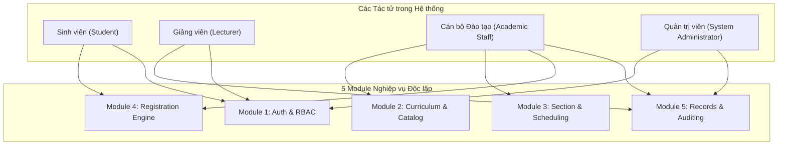

# TÀI LIỆU ĐẶC TẢ USE CASE CHI TIẾT (USE CASE SPECIFICATION)
## DỰ ÁN: HỆ THỐNG ĐĂNG KÝ HỌC PHẦN TRỰC TUYẾN (UNIENROLL)
**Phiên bản:** 1.1  
**Ngày cập nhật:** 28/10/2026  
**Trạng thái:** Đầy đủ 100% các Use Case (19/19 Use Cases)

---

## 1. TỔNG QUAN HỆ THỐNG VÀ CÁC TÁC TỬ (ACTORS)

Hệ thống UniEnroll phục vụ 4 nhóm tác tử chính với phạm vi quyền hạn và trách nhiệm được phân tách nghiêm ngặt:

### Danh mục Tác tử (Actors Catalog)
1. **Quản trị viên (System Administrator - `ROLE_ADMIN`):** Quản lý định danh tài khoản, phân bổ vai trò người dùng, theo dõi và tra cứu toàn bộ nhật ký kiểm toán hệ thống.
2. **Cán bộ Đào tạo (Academic Staff - `ROLE_STAFF`):** Quản lý cơ cấu khoa, danh mục môn học, cây điều kiện môn tiên quyết; lập học kỳ, phòng học, mở lớp học phần, phân công giảng viên, xếp lịch; cấu hình đợt mở cổng đăng ký và theo dõi báo cáo lấp đầy.
3. **Sinh viên (Student - `ROLE_STUDENT`):** Tra cứu chương trình đào tạo, tìm kiếm lớp mở; thực hiện các giao dịch đăng ký/hủy học phần theo thời gian thực; xem thời khóa biểu tuần và tiến độ tích lũy tín chỉ.
4. **Giảng viên (Lecturer - `ROLE_LECTURER`):** Tra cứu thời khóa biểu giảng dạy được phân công; truy xuất danh sách sinh viên chính thức của các lớp phụ trách (Class Roster).

---

## 2. MA TRẬN TỔNG HỢP USE CASE TOÀN HỆ THỐNG (USE CASE MATRIX)

Dưới đây là danh mục toàn bộ 19 Use Case, không bỏ sót bất kỳ chức năng nào:

| Mã UC | Tên Use Case | Tác tử chính | Phân hệ (Module) | Độ ưu tiên | Ràng buộc nghiệp vụ / NFR |
| :--- | :--- | :--- | :--- | :---: | :--- |
| **UC-01** | Đăng nhập hệ thống & Cấp phát JWT | Toàn bộ 4 Actors | Module 1 (Auth) | Critical | Mã hóa BCrypt, JWT Claims |
| **UC-02** | Làm mới Access Token (Refresh Token) | Toàn bộ 4 Actors | Module 1 (Auth) | High | Token Rotation, Cookie HttpOnly |
| **UC-03** | Tra cứu Hồ sơ Người dùng hiện hành (`me`) | Toàn bộ 4 Actors | Module 1 (Auth) | High | Auth Context Extraction |
| **UC-04** | Quản trị Người dùng & Phân bổ Vai trò | Admin | Module 1 (Auth) | Medium | RBAC, User Status Invariant |
| **UC-05** | Quản lý Khoa / Bộ môn (Department) | Staff, Admin | Module 2 (Curriculum) | Medium | Unique Code, Referential Integrity |
| **UC-06** | Quản lý Danh mục Môn học (Course) | Staff | Module 2 (Curriculum) | High | Unique Course Code, Credit Bounds |
| **UC-07** | Thiết lập Điều kiện Môn học Tiên quyết | Staff | Module 2 (Curriculum) | High | **BR-04**, Circular Dependency Check |
| **UC-08** | Quản lý Học kỳ & Cơ sở vật chất Phòng học | Staff | Module 3 (Scheduling) | High | Temporal Sanity, Room Capacity |
| **UC-09** | Mở Lớp học phần Mới & Gán Giảng viên | Staff | Module 3 (Scheduling) | Critical | **BR-02**, Teacher Availability |
| **UC-10** | Cấu hình Lịch học chi tiết (Schedule Slots) | Staff | Module 3 (Scheduling) | Critical | **BR-03**, Room/Teacher Collision |
| **UC-11** | Điều chỉnh Chỉ tiêu Sức chứa Lớp học phần | Staff | Module 3 (Scheduling) | High | **BR-02**, Capacity Invariant |
| **UC-12** | Thiết lập Đợt mở cổng Đăng ký học phần | Staff | Module 4 (Engine) | Critical | **BR-01**, Window Overlap Validation |
| **UC-13** | Tra cứu & Bộ lọc Lớp học phần mở | Student, Staff | Module 4 (Engine) | High | Search Indexing, Latency < 200ms |
| **UC-14** | **Đăng ký Lớp học phần (Core Transaction)** | Student | Module 4 (Engine) | Critical | **BR-01, 02, 03, 04, 05, 06 (Locking)** |
| **UC-15** | **Hủy Đăng ký Lớp học phần (Drop Section)** | Student | Module 4 (Engine) | Critical | **BR-01, BR-05**, Slot Recovery |
| **UC-16** | Xem Thời khóa biểu & Môn đã đăng ký | Student | Module 4 (Engine) | High | Timetable View, Total Credits |
| **UC-17** | Xem & Xuất Danh sách Sinh viên Lớp (Roster) | Lecturer | Module 5 (Reporting) | High | Lecturer Authorization Guard |
| **UC-18** | Xem Dashboard Thống kê Tỷ lệ Lấp đầy | Staff | Module 5 (Reporting) | Medium | Aggregation Query, Underflow Alert |
| **UC-19** | Tra cứu Nhật ký Kiểm toán Đăng ký (Audit) | Admin, Staff | Module 5 (Reporting) | Medium | Immutable Audit Trail, Filters |

---

## 3. ĐẶC TẢ CHI TIẾT ĐẦY ĐỦ TỪNG USE CASE (19/19 USE CASES)

---

### PHÂN HỆ 1: ĐỊNH DANH, XÁC THỰC & QUẢN TRỊ NGƯỜI DÙNG (MODULE 1)

#### UC-01: Đăng nhập Hệ thống & Cấp phát JWT (User Login)
* **Tác tử:** Student, Lecturer, Academic Staff, Admin.
* **Mô tả:** Tiếp nhận thông tin định danh (Username/Email & Password), xác thực mật khẩu qua BCrypt, phát hành cặp token JWT (Access Token ngắn hạn và Refresh Token dài hạn).
* **Tiền điều kiện:** Tài khoản đã tồn tại trong DB và mang trạng thái `ACTIVE`.
* **Luồng sự kiện chính:**
  1. Người dùng nhập `username` và `password` tại màn hình đăng nhập, nhấn "Đăng nhập".
  2. Frontend gửi request `POST /api/v1/auth/login`.
  3. Backend truy vấn bảng `users` theo username; kiểm tra mã băm mật khẩu bằng `BCryptPasswordEncoder.matches()`.
  4. Hệ thống kiểm tra trường `status == UserStatus.ACTIVE`.
  5. Hệ thống sinh Access Token (HMAC-SHA256, hạn 15 phút, chứa claims: `userId`, `role`, `status`) và Refresh Token (hạn 7 ngày).
  6. Backend trả về `ApiResponse` mang token và thông tin profile cơ bản.
  7. Client lưu Access Token vào App Memory và Refresh Token vào Secure Storage / Cookie.
* **Luồng ngoại lệ:**
  * **E01.1 - Sai tên đăng nhập hoặc mật khẩu:** Trả về HTTP 401 Unauthorized kèm mã lỗi `ERR_AUTH_INVALID_CREDENTIALS`.
  * **E01.2 - Tài khoản bị vô hiệu hóa / khóa:** Trạng thái là `INACTIVE` hoặc `LOCKED`. Trả về HTTP 403 Forbidden kèm mã lỗi `ERR_AUTH_ACCOUNT_LOCKED`.
* **Hậu điều kiện:** Phiên đăng nhập được thiết lập, các request tiếp theo được gán Header `Authorization: Bearer <token>`.

---

#### UC-02: Làm mới Access Token (Token Refresh)
* **Tác tử:** Toàn bộ 4 Actors (gọi tự động từ Client Interceptor).
* **Mô tả:** Khi Access Token hết hạn trong lúc người dùng đang thao tác, Client tự động gửi Refresh Token để lấy một Access Token mới mà không làm gián đoạn trải nghiệm người dùng.
* **Tiền điều kiện:** Người dùng đã đăng nhập trước đó và sở hữu Refresh Token hợp lệ.
* **Luồng sự kiện chính:**
  1. Axios Interceptor tại Frontend bắt mã lỗi HTTP 401 khi gọi API thông thường.
  2. Frontend gọi `POST /api/v1/auth/refresh` gửi kèm Refresh Token.
  3. Backend giải mã token, kiểm tra tính toàn vẹn chữ ký và thời hạn còn hiệu lực.
  4. Backend kiểm tra tài khoản tương ứng vẫn ở trạng thái `ACTIVE`.
  5. Backend sinh Access Token mới (hạn 15 phút).
  6. Trả về `ApiResponse` chứa Access Token mới.
  7. Client cập nhật Access Token trong bộ nhớ và tự động gửi lại request ban đầu bị lỗi 401.
* **Luồng ngoại lệ:**
  * **E02.1 - Refresh Token hết hạn hoặc không hợp lệ:** Trả về HTTP 401 `ERR_AUTH_REFRESH_TOKEN_EXPIRED`. Client hủy toàn bộ phiên và điều hướng về trang Login.

---

#### UC-03: Tra cứu Thông tin Tài khoản Hiện hành (Get Current User Profile)
* **Tác tử:** Toàn bộ 4 Actors.
* **Mô tả:** Lấy thông tin chi tiết của người dùng đang đăng nhập dựa trên token gửi kèm trong Header.
* **Tiền điều kiện:** Request có gắn kèm Bearer JWT hợp lệ.
* **Luồng sự kiện chính:**
  1. Frontend gửi request `GET /api/v1/users/me`.
  2. `JwtAuthenticationFilter` giải mã token, trích xuất `userId` và đặt vào `SecurityContextHolder`.
  3. Controller/Service đọc `userId` từ Context, truy vấn bảng `users` cùng bảng Profile tương ứng (`StudentProfile`, `LecturerProfile`, hoặc `StaffProfile`).
  4. Hệ thống đóng gói dữ liệu profile (Mã sinh viên/giảng viên, họ tên, email, khoa, niên khóa, số điện thoại) vào `ApiResponse`.
  5. Trả về HTTP 200 OK.
* **Luồng ngoại lệ:**
  * **E03.1 - Token giả mạo hoặc không tìm thấy User ID:** Trả về HTTP 401 `ERR_AUTH_UNAUTHORIZED`.

---

#### UC-04: Quản lý Người dùng & Phân quyền (Admin User Management)
* **Tác tử:** System Administrator (`ROLE_ADMIN`).
* **Mô tả:** Admin khởi tạo tài khoản mới cho sinh viên/giảng viên/nhân viên, cấp phát vai trò (`Role`), khóa hoặc kích hoạt lại tài khoản, và đặt lại mật khẩu.
* **Tiền điều kiện:** Người dùng thực hiện có vai trò `ROLE_ADMIN`.
* **Luồng sự kiện chính:**
  1. Admin gửi `POST /api/v1/admin/users` kèm: `username`, `email`, `role`, `temporaryPassword`, và thông tin Profile chi tiết.
  2. Hệ thống kiểm tra xem `username` hoặc `email` đã tồn tại trong DB chưa.
  3. Mở Transaction:
     - Băm mật khẩu bằng BCrypt.
     - Tạo bản ghi trong bảng `users` với role được chọn.
     - Khởi tạo Profile tương ứng (`student_profiles`, `lecturer_profiles`, hoặc `staff_profiles`).
  4. Commit Transaction và trả về thông tin User mới với mã HTTP 201 Created.
* **Luồng ngoại lệ:**
  * **E04.1 - Trùng Username hoặc Email:** Trả về HTTP 409 Conflict `ERR_USER_ALREADY_EXISTS`.
  * **E04.2 - Vai trò (Role) không tồn tại:** Trả về HTTP 400 Bad Request `ERR_INVALID_ROLE`.

---

### PHÂN HỆ 2: CHƯƠNG TRÌNH ĐÀO TẠO & MÔN HỌC (MODULE 2)

#### UC-05: Quản lý Khoa / Bộ môn (Department Management)
* **Tác tử:** Academic Staff, Admin.
* **Mô tả:** Quản lý danh sách các Khoa/Bộ môn trong trường (ví dụ: Khoa Công nghệ Thông tin, Khoa Kinh tế).
* **Tiền điều kiện:** Người dùng có quyền `ROLE_STAFF` hoặc `ROLE_ADMIN`.
* **Luồng sự kiện chính:**
  1. Staff gửi request `POST /api/v1/admin/departments` kèm: `code` (ví dụ: `IT`), `name` (Khoa CNTT), `description`.
  2. Hệ thống kiểm tra mã khoa `code` không được trùng lặp.
  3. Lưu bản ghi vào bảng `departments`.
  4. Trả về `ApiResponse` chứa thông tin khoa vừa tạo (HTTP 201).
* **Luồng ngoại lệ:**
  * **E05.1 - Trùng mã khoa:** Trả về HTTP 409 `ERR_DEPARTMENT_CODE_DUPLICATE`.
  * **E05.2 - Xóa khoa đang có môn học liên kết:** Trả về HTTP 400 `ERR_DEPARTMENT_HAS_COURSES`.

---

#### UC-06: Quản lý Danh mục Môn học (Course Management)
* **Tác tử:** Academic Staff.
* **Mô tả:** Định nghĩa thông tin môn học trong chương trình đào tạo: Mã môn học, tên môn, số tín chỉ lý thuyết, số tín chỉ thực hành, tổng số tín chỉ, khoa trực thuộc.
* **Tiền điều kiện:** Khoa (`Department`) quản lý môn học đã tồn tại.
* **Luồng sự kiện chính:**
  1. Staff nhập biểu mẫu thông tin môn học, gửi `POST /api/v1/courses`.
  2. Hệ thống kiểm tra:
     - Mã môn học (`course_code`) là duy nhất trong toàn hệ thống.
     - Số tín chỉ lý thuyết và thực hành $\ge 0$, tổng số tín chỉ $> 0$.
  3. Lưu môn học vào bảng `courses`.
  4. Trả về HTTP 201 Created kèm dữ liệu môn học.
* **Luồng ngoại lệ:**
  * **E06.1 - Trùng mã môn học:** Trả về HTTP 409 `ERR_COURSE_CODE_DUPLICATE`.
  * **E06.2 - Số tín chỉ không hợp lệ:** Trả về HTTP 400 `ERR_INVALID_CREDIT_VALUE`.

---

#### UC-07: Thiết lập Điều kiện Môn học Tiên quyết (Prerequisite Conditions Setup)
* **Tác tử:** Academic Staff.
* **Mô tả:** Thiết lập quy định: Để sinh viên có thể đăng ký môn học $C$, sinh viên bắt buộc phải hoàn thành và đạt điểm đậu (`PASSED`) ở môn $P$ trước đó (**BR-04**).
* **Tiền điều kiện:** Cả 2 môn học $C$ và $P$ đều đã được định nghĩa trên hệ thống.
* **Luồng sự kiện chính:**
  1. Staff chọn môn mục tiêu $C$, gửi request `POST /api/v1/courses/{id}/prerequisites` kèm danh sách ID các môn tiên quyết $\{P_1, P_2, ...\}$.
  2. Hệ thống kiểm tra:
     - Môn $P_i$ không được là chính môn $C$ ($P_i \neq C$).
     - Thuật toán DFS/Tarjan kiểm tra không tạo ra phụ thuộc vòng (Circular Dependency: $A \rightarrow B \rightarrow C \rightarrow A$).
  3. Lưu các bản ghi vào bảng `prerequisite_conditions`.
  4. Trả về danh sách điều kiện tiên quyết đã cập nhật (HTTP 200).
* **Luồng ngoại lệ:**
  * **E07.1 - Phát hiện phụ thuộc vòng:** Trả về HTTP 400 `ERR_CIRCULAR_PREREQUISITE_DETECTED`.

---

### PHÂN HỆ 3: LỚP HỌC PHẦN, PHÒNG HỌC & LỊCH HỌC (MODULE 3)

#### UC-08: Quản lý Học kỳ & Cơ sở vật chất Phòng học (Semester & Room Management)
* **Tác tử:** Academic Staff.
* **Mô tả:** Khởi tạo thông tin Học kỳ (Tên học kỳ, ngày bắt đầu, ngày kết thúc) và Quản lý danh mục Phòng học (Tên phòng, tòa nhà, sức chứa tối đa của phòng).
* **Tiền điều kiện:** Người dùng có quyền `ROLE_STAFF`.
* **Luồng sự kiện chính:**
  1. Staff gửi `POST /api/v1/academic/semesters` (VD: Học kỳ 1 năm học 2026-2027) kèm ngày bắt đầu và kết thúc ($Start < End$).
  2. Staff gửi `POST /api/v1/academic/rooms` kèm: `roomNumber` (A101), `building` (Tòa A), `capacity` (60 chỗ).
  3. Hệ thống kiểm tra tính duy nhất của mã phòng trong cùng tòa nhà.
  4. Lưu dữ liệu và trả về HTTP 201 Created.
* **Luồng ngoại lệ:**
  * **E08.1 - Ngày bắt đầu học kỳ sau ngày kết thúc:** Trả về HTTP 400 `ERR_INVALID_SEMESTER_DATES`.
  * **E08.2 - Trùng tên phòng học trong tòa nhà:** Trả về HTTP 409 `ERR_ROOM_DUPLICATE`.

---

#### UC-09: Mở Lớp Học phần Mới & Gán Giảng viên (Open Course Section)
* **Tác tử:** Academic Staff.
* **Mô tả:** Tạo một lớp học phần cụ thể cho môn học trong học kỳ, gán giảng viên chịu trách nhiệm giảng dạy và thiết lập chỉ tiêu sức chứa ban đầu ($C_{max}$).
* **Tiền điều kiện:** Môn học, Học kỳ và Giảng viên phải tồn tại trên hệ thống.
* **Luồng sự kiện chính:**
  1. Staff gửi request `POST /api/v1/academic/sections` kèm: `courseId`, `semesterId`, `sectionCode` (ví dụ: `CS101.N01`), `capacity` ($C_{max}$), `lecturerId`.
  2. Hệ thống kiểm tra:
     - Mã lớp học phần là duy nhất trong học kỳ đó.
     - Sức chứa $C_{max} > 0$.
  3. Khởi tạo bản ghi `course_sections` với $N_{enrolled} = 0$, `status = 'OPEN'`.
  4. Trả về thông tin lớp học phần vừa mở (HTTP 201).
* **Luồng ngoại lệ:**
  * **E09.1 - Trùng mã lớp trong cùng kỳ:** Trả về HTTP 409 `ERR_SECTION_CODE_DUPLICATE`.
  * **E09.2 - Sức chứa không hợp lệ:** Trả về HTTP 400 `ERR_INVALID_SECTION_CAPACITY`.

---

#### UC-10: Cấu hình Lịch học Chi tiết (Schedule Slots Assignment)
* **Tác tử:** Academic Staff.
* **Mô tả:** Phân bổ các buổi học trong tuần cho lớp học phần: Thứ trong tuần, Tiết bắt đầu, Tiết kết thúc, Phòng học cụ thể.
* **Tiền điều kiện:** Lớp học phần và Phòng học đã tồn tại. Sức chứa phòng học phải $\ge C_{max}$ của lớp học phần.
* **Luồng sự kiện chính:**
  1. Staff gửi `POST /api/v1/academic/sections/{id}/schedules` kèm danh sách các slot (Ví dụ: Thứ 2, Tiết 1-3, Phòng A101).
  2. Hệ thống thẩm định 3 ràng buộc:
     - **Xung đột phòng học:** Phòng A101 không được có lớp nào khác học cùng thứ và cùng khoảng tiết.
     - **Xung đột giảng viên:** Giảng viên phụ trách không được có lịch dạy ở lớp khác trong cùng khung giờ.
     - **Sức chứa:** Sức chứa phòng $\ge$ Sức chứa tối đa $C_{max}$ của lớp học phần.
  3. Lưu các slot vào bảng `schedule_slots`.
  4. Trả về danh sách lịch học của lớp (HTTP 200).
* **Luồng ngoại lệ:**
  * **E10.1 - Trùng lịch phòng học:** Trả về HTTP 409 `ERR_ROOM_SCHEDULE_COLLISION`.
  * **E10.2 - Trùng lịch giảng viên:** Trả về HTTP 409 `ERR_LECTURER_SCHEDULE_COLLISION`.
  * **E10.3 - Phòng học quá nhỏ so với lớp:** Trả về HTTP 400 `ERR_ROOM_CAPACITY_INSUFFICIENT`.

---

#### UC-11: Điều chỉnh Chỉ tiêu Sức chứa Lớp học phần (Adjust Section Capacity)
* **Tác tử:** Academic Staff.
* **Mô tả:** Thay đổi chỉ tiêu số lượng sinh viên tối đa ($C_{max}$) của một lớp học phần đã mở (**BR-02**).
* **Tiền điều kiện:** Lớp học phần đang tồn tại.
* **Luồng sự kiện chính:**
  1. Staff gửi `PUT /api/v1/academic/sections/{id}/capacity` kèm giá trị mới `newCapacity`.
  2. Hệ thống kiểm tra:
     - `newCapacity` không được nhỏ hơn số sinh viên hiện tại đã đăng ký thành công ($N_{enrolled}$).
     - `newCapacity` không vượt quá sức chứa tối đa của phòng học đã gán.
  3. Mở transaction: Cập nhật $C_{max} = newCapacity$.
  4. Tự động điều chỉnh trạng thái: Nếu $N_{enrolled} < newCapacity$ và lớp đang `CLOSED`, tự động mở lại thành `OPEN`.
  5. Ghi vết kiểm toán `OVERRIDE_CAPACITY` vào Module 5.
  6. Trả về thông tin lớp đã cập nhật (HTTP 200).
* **Luồng ngoại lệ:**
  * **E11.1 - Hạ sức chứa thấp hơn số sinh viên đã đăng ký:** Trả về HTTP 400 `ERR_CAPACITY_LOWER_THAN_ENROLLED`.
  * **E11.2 - Sức chứa mới vượt quá phòng học:** Trả về HTTP 400 `ERR_CAPACITY_EXCEEDS_ROOM_LIMIT`.

---

### PHÂN HỆ 4: ĐỘNG CƠ ĐĂNG KÝ HỌC PHẦN (MODULE 4 - TRỌNG TÂM GIAO DỊCH)

#### UC-12: Thiết lập Đợt mở cổng Đăng ký (Registration Phase Management)
* **Tác tử:** Academic Staff.
* **Mô tả:** Thiết lập khung thời gian [$T_{start}, T_{end}$] cho phép sinh viên thực hiện đăng ký và rút môn trong học kỳ (**BR-01**).
* **Tiền điều kiện:** Học kỳ đã được khởi tạo.
* **Luồng sự kiện chính:**
  1. Staff gửi `POST /api/v1/academic/registration-phases` kèm: `semesterId`, `phaseName` (Đợt 1, Đợt bổ sung), `startTime`, `endTime`, `cohort` (áp dụng cho K65, K66...).
  2. Hệ thống kiểm tra $T_{start} < T_{end}$.
  3. Lưu thông tin vào bảng `registration_phases`.
  4. Trả về thông tin đợt đăng ký (HTTP 201).
* **Luồng ngoại lệ:**
  * **E12.1 - Thời gian bắt đầu sau thời gian kết thúc:** Trả về HTTP 400 `ERR_INVALID_PHASE_TIME_RANGE`.

---

#### UC-13: Tra cứu & Lọc Danh mục Lớp học phần Mở (Search & Filter Sections)
* **Tác tử:** Sinh viên, Cán bộ Đào tạo.
* **Mô tả:** Tra cứu danh sách các lớp học phần đang mở trong học kỳ kèm thông tin số lượng slot còn lại, lịch học, giảng viên và phòng học.
* **Tiền điều kiện:** Học kỳ đã có các lớp học phần được mở.
* **Luồng sự kiện chính:**
  1. Sinh viên nhập từ khóa tìm kiếm (Mã môn, Tên môn), chọn Khoa, tích chọn "Chỉ hiện lớp còn slot trống".
  2. Frontend gửi request `GET /api/v1/sections?semesterId=...&keyword=...&openOnly=true`.
  3. Backend thực thi câu lệnh SQL có chỉ mục tối ưu (B-Tree Index trên `course_code`, `status`), nạp kèm `schedule_slots`.
  4. Trả về danh sách lớp kèm số slot trống khả dụng: $SlotsAvailable = C_{max} - N_{enrolled}$ (Độ trễ truy vấn < 200ms).
* **Hậu điều kiện:** Dữ liệu hiển thị trực quan trên giao diện bảng danh mục học phần.

---

#### UC-14: ĐĂNG KÝ LỚP HỌC PHẦN (ENROLL COURSE SECTION) - CORE TRANSACTION
* **Tác tử:** Sinh viên (`ROLE_STUDENT`).
* **Mô tả:** Sinh viên đăng ký tham gia một lớp học phần. Hệ thống thẩm định tuần tự 6 Quy tắc Nghiệp vụ (BR-01 đến BR-06) và thực thi giao dịch có kiểm soát đồng thời (Pessimistic Lock) để chống overbooking.
* **Tiền điều kiện:** Sinh viên có tài khoản `ACTIVE`; Lớp học phần đang tồn tại.
* **Luồng sự kiện chính (Pipeline 6 bước tuần tự):**
  1. Sinh viên nhấn "Đăng ký" tại dòng lớp học phần trên SPA.
  2. Frontend gửi request `POST /api/v1/student/registrations` kèm `{ sectionId }`.
  3. Tầng Service kích hoạt **Registration Pipeline**:
     - **Bước 1 (BR-01 - Khung giờ):** Kiểm tra thời điểm hiện tại $T_{trans}$ có nằm trong [$T_{start}, T_{end}$] của đợt mở cổng dành cho khóa của sinh viên hay không. Nếu không, ném `ERR_REGISTRATION_WINDOW_CLOSED`.
     - **Bước 2 (BR-04 - Môn tiên quyết):** Truy vấn cây môn tiên quyết của môn học; đối soát với `grade_records` của sinh viên. Nếu có môn tiên quyết chưa đạt trạng thái `PASSED`, ném `ERR_PREREQUISITE_NOT_FULFILLED`.
     - **Bước 3 (BR-06 - Tính duy nhất / Trùng môn):** Kiểm tra sinh viên đã đăng ký lớp nào khác cùng môn học này trong kỳ chưa. Nếu có, ném `ERR_DUPLICATE_COURSE_REGISTRATION`.
     - **Bước 4 (BR-03 - Trùng lịch học):** So khớp toàn bộ các `schedule_slots` của lớp mục tiêu với các lớp sinh viên đang theo học trong kỳ. Nếu trùng thứ và giao thoa tiết học, ném `ERR_TIMETABLE_COLLISION`.
     - **Bước 5 (BR-05 - Hạn mức tín chỉ):** Tính $Credits_{hientai} + Credits_{lopmoi}$. Nếu vượt quá 24 tín chỉ (và không có cờ ghi đè đặc quyền), ném `ERR_CREDIT_LIMIT_EXCEEDED`.
     - **Bước 6 (BR-02 - Kiểm tra Sức chứa & Khóa hàng bi quan):**
       - Thực thi: `SELECT * FROM course_sections WHERE id = :id FOR UPDATE`.
       - Đối soát: Nếu $N_{enrolled} \ge C_{max}$, ném `ERR_SECTION_CAPACITY_FULL`.
  4. Thực thi Giao dịch Nguyên tử (Atomic DB Transaction):
     - Tăng số lượng: $N_{enrolled} = N_{enrolled} + 1$. Nếu $N_{enrolled} = C_{max}$ thì gán `status = 'CLOSED'`.
     - Chèn bản ghi vào bảng `enrollment_records` (`student_id`, `section_id`, `status='ENROLLED'`, `enrolled_at=NOW()`).
  5. Commit Transaction và nhả khóa dòng.
  6. Ghi vết kiểm toán bất đồng bộ (`action='ENROLL'`, `status='SUCCESS'`) vào bảng `registration_audit_logs`.
  7. Trả về `ApiResponse` thành công (HTTP 200) chứa thông tin đăng ký.
* **Luồng ngoại lệ (Các mã lỗi chuẩn tương ứng):**
  * **E14.1 - Đóng cổng (BR-01):** HTTP 400 `ERR_REGISTRATION_WINDOW_CLOSED`.
  * **E14.2 - Hết chỗ (BR-02):** HTTP 409 `ERR_SECTION_CAPACITY_FULL`.
  * **E14.3 - Trùng lịch học (BR-03):** HTTP 409 `ERR_TIMETABLE_COLLISION` (kèm ID lớp bị trùng).
  * **E14.4 - Thiếu môn tiên quyết (BR-04):** HTTP 400 `ERR_PREREQUISITE_NOT_FULFILLED` (kèm danh sách môn thiếu).
  * **E14.5 - Quá hạn mức tín chỉ (BR-05):** HTTP 400 `ERR_CREDIT_LIMIT_EXCEEDED`.
  * **E14.6 - Đã đăng ký môn này rồi (BR-06):** HTTP 409 `ERR_DUPLICATE_COURSE_REGISTRATION`.
* **Hậu điều kiện:** Sinh viên chính thức có tên trong danh sách lớp; số slot khả dụng giảm đi 1.

---

#### UC-15: HỦY ĐĂNG KÝ LỚP HỌC PHẦN (DROP COURSE SECTION)
* **Tác tử:** Sinh viên (`ROLE_STUDENT`).
* **Mô tả:** Sinh viên rút tên khỏi lớp học phần đã đăng ký trong kỳ. Hệ thống hoàn lại 1 slot trống cho lớp học phần.
* **Tiền điều kiện:**
  - Thời điểm hiện tại nằm trong khung thời gian hợp lệ (**BR-01**).
  - Bản ghi đăng ký của sinh viên tồn tại với trạng thái `ENROLLED`.
* **Luồng sự kiện chính:**
  1. Sinh viên nhấn "Hủy môn" tại danh sách lớp đã đăng ký.
  2. Frontend gửi request `DELETE /api/v1/student/registrations/{sectionId}`.
  3. Hệ thống kiểm tra thời gian theo **BR-01**. Nếu hết hạn hủy, từ chối với `ERR_REGISTRATION_WINDOW_CLOSED`.
  4. Hệ thống kiểm tra hạn mức tín chỉ tối thiểu theo **BR-05**:
     - Tính: $Credits_{conlai} = Credits_{hientai} - Credits_{lophuy}$.
     - Nếu $Credits_{conlai} < 12$ tín chỉ, ném mã lỗi `ERR_MINIMUM_CREDIT_UNMET`.
  5. Mở Transaction có khóa hàng `CourseSection`:
     - Cập nhật trạng thái bản ghi trong `enrollment_records` thành `DROPPED`.
     - Giảm số lượng đã đăng ký: $N_{enrolled} = N_{enrolled} - 1$.
     - Nếu lớp đang ở trạng thái `CLOSED`, tự động kích hoạt chuyển lại thành `OPEN`.
  6. Commit Transaction.
  7. Ghi nhật ký kiểm toán `action='DROP'` vào Module 5.
  8. Trả về `ApiResponse` thông báo hủy môn thành công (HTTP 200).
* **Luồng ngoại lệ:**
  * **E15.1 - Thấp hơn mức tín chỉ tối thiểu:** Trả về HTTP 400 `ERR_MINIMUM_CREDIT_UNMET`.
  * **E15.2 - Không tìm thấy bản ghi đăng ký:** Trả về HTTP 404 `ERR_ENROLLMENT_NOT_FOUND`.

---

#### UC-16: Xem Thời khóa biểu & Danh sách môn đã đăng ký
* **Tác tử:** Sinh viên.
* **Mô tả:** Xem bảng tổng hợp danh sách các môn học đã đăng ký trong học kỳ kèm lưới Thời khóa biểu tuần trực quan.
* **Tiền điều kiện:** Sinh viên đã đăng nhập thành công.
* **Luồng sự kiện chính:**
  1. Sinh viên truy cập mục "Thời khóa biểu của tôi".
  2. Frontend gửi request `GET /api/v1/student/registrations/active`.
  3. Backend truy vấn các `EnrollmentRecord` có `status = 'ENROLLED'` trong kỳ hiện tại của sinh viên, kèm `ScheduleSlot`, `Room`, `LecturerProfile`.
  4. Backend tính toán tổng số tín chỉ tích lũy trong kỳ.
  5. Trả về JSON chứa danh sách lớp và cấu trúc ma trận lịch học (Thứ, Tiết, Phòng).
  6. Frontend hiển thị lưới thời khóa biểu từ Thứ 2 đến Chủ nhật, Tiết 1 đến Tiết 12.

---

### PHÂN HỆ 5: BÁO CÁO, KIỂM TOÁN & SỔ ĐIỂM DANH (MODULE 5)

#### UC-17: Xem & Xuất Danh sách Sinh viên Lớp học phần (Class Roster)
* **Tác tử:** Giảng viên (`ROLE_LECTURER`).
* **Mô tả:** Giảng viên xem danh sách sinh viên chính thức đã đăng ký lớp học phần do mình phụ trách để quản lý điểm danh và xuất file Excel/CSV.
* **Tiền điều kiện:** Giảng viên được phân công giảng dạy lớp học phần này.
* **Luồng sự kiện chính:**
  1. Giảng viên gửi request `GET /api/v1/lecturer/sections/{sectionId}/students`.
  2. Hệ thống kiểm tra tính hợp lệ: `section.lecturerId == currentUser.lecturerId`. Nếu không khớp, từ chối với HTTP 403 Forbidden.
  3. Truy vấn danh sách sinh viên đang có trạng thái `ENROLLED` trong lớp.
  4. Trả về danh sách gồm: Mã sinh viên, Họ và tên, Email, Lớp sinh hoạt, Thời điểm đăng ký.
  5. Giảng viên có thể nhấn nút "Xuất Excel" để tải file danh sách điểm danh.
* **Luồng ngoại lệ:**
  * **E17.1 - Không có quyền xem lớp của giảng viên khác:** Trả về HTTP 403 `ERR_ACCESS_DENIED_NOT_ASSIGNED_LECTURER`.

---

#### UC-18: Báo cáo Thống kê Tỷ lệ Lấp đầy Lớp học phần (Occupancy Dashboard)
* **Tác tử:** Academic Staff.
* **Mô tả:** Báo cáo tỷ lệ lấp đầy ($N_{enrolled} / C_{max}$) của toàn bộ các lớp học phần trong học kỳ, cảnh báo các lớp đầy hoặc các lớp nguy cơ bị hủy do không đủ số lượng sinh viên tối thiểu.
* **Tiền điều kiện:** Người dùng có quyền `ROLE_STAFF`.
* **Luồng sự kiện chính:**
  1. Staff truy cập Dashboard Thống kê, gửi request `GET /api/v1/academic/reports/occupancy?semesterId={id}`.
  2. Hệ thống truy vấn tổng hợp toàn bộ các lớp trong kỳ:
     - Nhóm lớp đầy 100% ($N_{enrolled} = C_{max}$): Gợi ý mở thêm lớp hoặc nâng sức chứa.
     - Nhóm lớp ổn định ($50\% \le \text{Tỷ lệ} < 100\%$).
     - Nhóm lớp dưới ngưỡng tối thiểu ($N_{enrolled} < 15$ sinh viên): Cảnh báo nguy cơ hủy lớp.
  3. Trả về dữ liệu thống kê tổng quan và danh sách chi tiết.

---

#### UC-19: Tra cứu Nhật ký Kiểm toán Đăng ký (Audit Logs Inquiry)
* **Tác tử:** System Administrator, Academic Staff.
* **Mô tả:** Tra cứu lịch sử toàn bộ các thao tác can thiệp dữ liệu (`ENROLL`, `DROP`, `OVERRIDE_CAPACITY`) nhằm phục vụ việc đối soát tranh chấp hoặc điều tra sự cố.
* **Tiền điều kiện:** Người dùng có quyền `ROLE_ADMIN` hoặc `ROLE_STAFF`.
* **Luồng sự kiện chính:**
  1. Người dùng gửi `GET /api/v1/admin/audit-logs` kèm bộ lọc tùy chọn: `studentId`, `sectionId`, `actionType`, `startDate`, `endDate`.
  2. Hệ thống truy vấn bảng `registration_audit_logs`.
  3. Trả về danh sách nhật ký gồm: ID bản ghi, ID tác tử (`actor_id`), Hành động (`action_type`), ID lớp mục tiêu, Timestamp chính xác, Địa chỉ IP, Trạng thái (`SUCCESS`/`FAILED`), và Chi tiết thông báo lỗi (nếu có).
